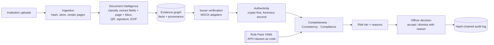
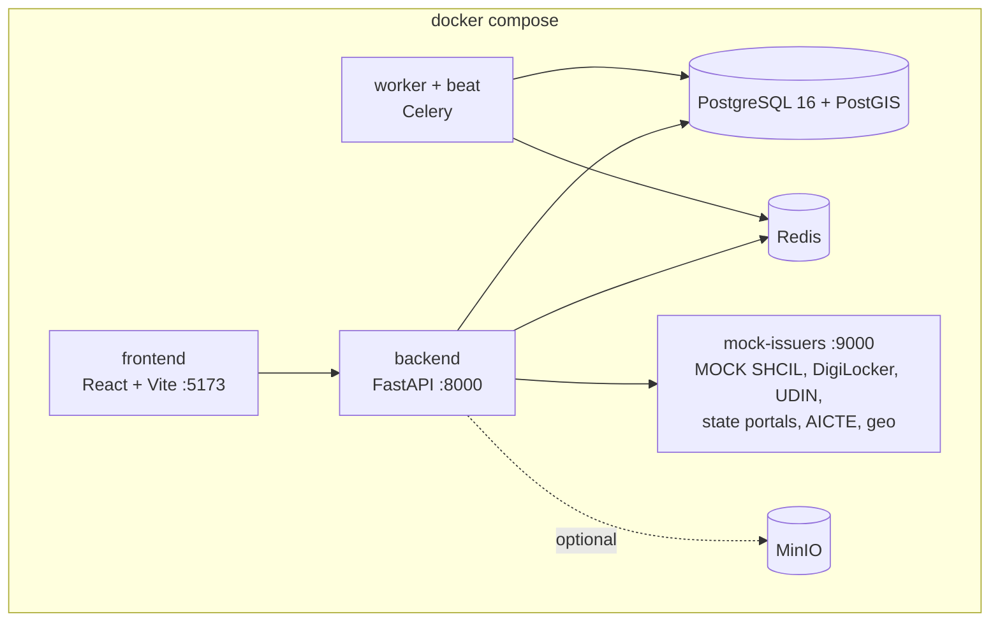

# TatvaAI

**Smart India Hackathon 2026 · SIH26261 · AICTE (Regulation Bureau) · Team Hexaminds**
*AI-Powered Application Validation, Document Authentication and Regulatory Compliance Verification*

> TatvaAI turns AICTE's self-disclosure into verified disclosure, and points inspectors at the institutions most likely to need them.

Plain Extension of Approval (EoA) is granted on an institution's **self-disclosure**: the Approval Process Handbook (APH) 2024-27, Table 2.3 (p. 30), shows no scrutiny committee or Expert Visit Committee for it, and inspections are picked **at random** (Clause 2.3.5, p. 15). TatvaAI checks what institutions disclose (documents, numbers, photos, faculty), shows officers *evidence-linked* findings, and replaces random selection with a **ranked, risk-targeted inspection list**.

**Decision support only.** The system never approves, rejects or penalises. Every flag points to evidence (document + page + bounding box, or a source system); an officer accepts or dismisses it with a reason; everything is written to a hash-chained audit log.
**All people, institutions and documents are synthetic, and every external source (SHCIL, DigiLocker, ICAI, state portals, AICTE records, geo data) is a clearly labelled MOCK.**

**New to the project? Start with the [team guide](docs/SIH26261_GUIDE.md):** the problem statement explained line by line, the AICTE Handbook rules behind every check (clause and printed page, verified against the official APH 2024-27 PDF), every flag and score worked through for institutions A, B and C, the demo script and a judge Q&A bank.

Why it matters (context, not code): an NGO found 353 teachers listed as full-time at more than one college under one university, some at 10 to 11 colleges, with reused photos (The News Minute, July 2024); AICTE's own data checks exposed over one lakh "ghost" teachers (UNESCO IIEP, ETICO).

## What it does

| | |
|---|---|
| **Five engines** | Completeness · Consistency · Authenticity (proof before prediction) · Issuer verification · Compliance (incl. infrastructure evidence) |
| **Six verification statuses** | `VERIFIED` `MISMATCH_DETECTED` `EXPIRED` `VERIFICATION_PENDING` `SOURCE_UNAVAILABLE` `MANUAL_REVIEW_REQUIRED` |
| **Risk tiers** | 🟢 GREEN = **no risk** · 🟠 AMBER = **medium risk** · 🔴 RED = **high risk** (always shown with the text label) |
| **Rule Pack (Handbook-as-Code)** | APH norms as versioned YAML with clause + page citations; officer-side editor with schema validation, **dry-run** diff, activation; old results never change |
| **Verify once, reuse every year** | An unchanged, previously verified document (same SHA-256) is *carried forward* and not re-verified |
| **Officer workbench** | PDF evidence viewer with highlighted bounding box, ELA heatmap, verification panel, compliance table, infrastructure map, timeline, audit trail |
| **Inspection list** | RED applications ranked with reasons and an on-site checklist; PDF export |
| **Audit** | Append-only, hash-chained; `GET /audit/verify` reports the first broken entry |
| **Roles** | `institution` · `officer` (scrutiny) · `inspector` (EVC member). There is no admin role: rule packs, audit and reopen-once are officer duties. |

## Architecture





Repository layout: `backend/` (FastAPI app, engines, rules, adapters, Alembic) · `frontend/` (React + Vite + TypeScript) · `mock_issuers/` (fake external systems) · `rulepacks/` (APH v1 and the v2-demo pack, schema, config tables) · `scripts/` (generator, seed, verification, evaluation, audit tamper demo) · `data/expected_flags.json` (ground truth) · `tests/`.

## Setup

### Docker (recommended)

Prerequisites: Docker Desktop (on Windows use the **WSL2 backend**), 8 GB RAM, no GPU needed.

```bash
cp .env.example .env            # PowerShell: Copy-Item .env.example .env
docker compose up --build -d
docker compose exec backend python scripts/seed.py --reset
```

Open **http://localhost:5173** (API docs: http://localhost:8000/docs). `seed.py` generates the synthetic data, creates the demo users, loads the three institutions (plus last year's applications for A and C), imports rule packs (v1 active, v2-demo draft) and runs the full pipeline on every application. Make targets: `make up`, `make seed`, `make test`, `make verify`, `make evaluate`, `make tamper`. PowerShell users run the same `docker compose ...` and `python scripts\...` commands (no `make` needed).

### Without Docker (SQLite, for development)

```powershell
python -m venv .venv
.\.venv\Scripts\pip install -r backend\requirements.txt
$env:MOCK_DB = "$PWD\data\synthetic\mock_db.json"
.\.venv\Scripts\python scripts\seed.py --reset --inprocess-mock      # builds dev.db with everything loaded
# three terminals:
.\.venv\Scripts\python -m uvicorn main:app --app-dir mock_issuers --host 127.0.0.1 --port 9000
$env:MOCK_ISSUERS_URL = "http://127.0.0.1:9000"; $env:TRUST_ROOT_PATH = "$PWD\data\synthetic\pki\ca.pem"
.\.venv\Scripts\python -m uvicorn app.main:app --app-dir backend --host 127.0.0.1 --port 8000
cd frontend; npm install; npm run dev
```

Use `127.0.0.1`, not `localhost`, for `MOCK_ISSUERS_URL` on Windows (IPv6 fallback makes every call ~1 s slower).

### Demo users (password `Tatva@2026`, synthetic, stored only in your local DB)

| Role | Email |
|---|---|
| institution (A, B, C) | `inst-a@tatva.test`, `inst-b@tatva.test`, `inst-c@tatva.test` |
| officer | `officer@tatva.test` |
| inspector | `inspector@tatva.test` |

Officers can enable TOTP two-factor authentication under *Security* (set `MFA_REQUIRED=true` to nudge it).

## The synthetic data and what must be caught

`python scripts/generate_synthetic.py --seed 2026` is deterministic (same SHA-256 for every file on every run: signed PDFs, photos, CSVs, mock data). A test PKI signs the PDFs with real digital signatures; C's land document is signed and **then edited**.

| Institution | Expected | Planted situations |
|---|---|---|
| **A** Aurora Institute | 🟢 GREEN | Everything valid. Land + occupancy documents carried forward from last year. Karnataka fire portal returns 503 → `SOURCE_UNAVAILABLE` → `MANUAL_REVIEW_REQUIRED` (INFO) |
| **B** Bhavani College | 🟠 AMBER | Fire certificate valid till 2027-06-30 (before AY start); provisional occupancy certificate in its 3rd year |
| **C** Chandra Campus | 🔴 RED | Survey number edited after signing in a different font; fire-certificate QR says 2026-12-31 vs printed 2028-12-31; e-stamp dated after notarisation; lab photo is a cropped copy of A's; classroom photo ~40 km off-site; 12 faculty full-time elsewhere (required 120, valid 97, shortfall 23); built-up 31,500 vs 24,100 sq m from footprints; Block C not visible in imagery until 2026; website lists 85 faculty vs 109 |

```bash
python scripts/verify_planted.py     # fresh DB, full pipeline: A GREEN, B AMBER, C RED, 0 missed; exit code 1 otherwise
python scripts/evaluate.py           # writes reports/evaluation.md (extraction P/R/F1, anomaly recall/precision, verification rate, timing)
python scripts/tamper_audit_demo.py  # edits one audit row behind the app's back; prints "Broken at entry N" (--restore undoes it)
```

## 5-minute demo script

1. **Institution B** (`inst-b`) opens its 2027-28 draft, clicks **Run pre-check** → fix-list shows the expiring fire certificate (Annexure-2 (v), p. 81) and the provisional-occupancy limit (Annexure-3, 3.1 (c), p. 86), each with its APH citation. B **submits** (confirmation explains the edit lock).
2. **Officer** opens the **Review queue**: C 🔴 high risk, B 🟠 medium risk, A 🟢 no risk, sorted by risk (KPI cards and charts above).
3. Open **C → Flags & Evidence**: click `MODIFIED_AFTER_SIGNING` → the viewer jumps to the land document with *survey_no* highlighted (it was `SY-118/4B` when signed, now `SY-118/9C`); toggle **ELA heatmap**. Show `QR_MISMATCH`, `TIMELINE_IMPOSSIBLE`, `DUPLICATE_PHOTO` side by side with A's photo. **Infrastructure** tab: off-site GPS marker and the built-up check. **Compliance** tab: faculty required 120, valid 97, shortfall 23, Annexure-5 p. 95.
4. **Verification** tab: A's SHCIL e-stamp `VERIFIED`; the Karnataka fire portal `SOURCE_UNAVAILABLE` → `MANUAL_REVIEW_REQUIRED`; record a manual confirmation.
5. Dismiss one low-value flag **with a reason** → the score updates; see both in the **Audit** tab.
6. **Inspections**: C on top with reasons; **Export checklist PDF**. Log in as `inspector`: the on-site checklist is grouped by document (land record, fire certificate, faculty list, institution-wide); write a note and press **Confirm issue** or **Clear** on an item and watch the progress bar move.
7. **Officer → Rule packs**: select `v2-demo` (UG ratio 1:18, seeded as a draft; or *Create draft* from the folder) → **Dry-run**: A would move GREEN → AMBER, C's shortfall changes 23 → 37 → **Activate**. Old results still show v1.
8. **Officer → Audit log**: "Chain intact". Run `python scripts/tamper_audit_demo.py`, click **Verify again** → "Broken at entry N". Restore with `--restore`.
9. Download C's **Validation report (PDF)** from its workbench.

## API (10 routers under `/api/v1`, OpenAPI at `/docs`)

`auth` (login, refresh, me) · `mfa` · `applications` (CRUD, submit/lock, reopen once, evidence graph, rule results, infrastructure, timeline, report PDF) · `documents` (upload, file, pages, fields, ELA) · `precheck` (jobs + fix-list) · `verification` (run, list, manual confirmation) · `rules` (list, create, validate, dry-run, activate, LLM draft) · `risk` (score, queue, stats, inspection list + PDF, flags, decisions) · `alerts` · `audit` (list, verify, export). `GET /health` sits outside them. Every route checks the caller's role; an institution can only ever see its own data.

## Rule Pack

`rulepacks/APH-2024-27-v1/` holds `documents.yaml`, `norms.yaml`, `timelines.yaml`, `risk.yaml`, `categories.yaml`. Rule types: `document_required`, `field_required`, `expiry`, `formula`, `timeline`, `consistency`, `threshold`. Formulas run in `simpleeval` (never `eval`) against a context built from the evidence graph. Each rule carries its clause and printed page; each flag and rule result stores the rule id and pack version. Three categories are wired (EoA, increase in intake, name change); **adding another is an edit to `categories.yaml` only**. Config tables (`rulepacks/config/`): TER fees (APH Table 2.1, p. 13), state issuing authorities (3 fictional rows), retention.

## Optional features (all off by default)

Set the flag in `.env` and build with `INSTALL_ML=true` where a library is needed.

| Flag | Status in this build |
|---|---|
| `FEATURE_OCR` | Wired: PaddleOCR for scanned pages (otherwise fields become `MANUAL_REVIEW_REQUIRED`). Exercised in tests with a stand-in OCR engine, **not** with PaddleOCR itself |
| `FEATURE_YOLO` | Wired: YOLOv8 PC count in lab photos vs declared PCs. Not exercised without ultralytics |
| `FEATURE_LLM` | Wired: local Ollama drafts YAML from pasted Handbook text; it is returned for review only |
| `FEATURE_LAYOUTLM`, `FEATURE_FACE`, `FEATURE_DTD`, `FEATURE_RAG`, `FEATURE_REAL_GEO` | **Not wired** (flags exist; copy-move and DocTamper not implemented) |

APH source for the optional RAG feature (never fetched automatically): https://aicte.gov.in/sites/default/files/APH%20Final.pdf

## Tests and CI

```bash
python -m pytest tests -q        # backend unit + integration + migrations + planted-flag verification
cd frontend && npm test          # Vitest smoke tests (queue and workbench render with seeded-style data)
```

GitHub Actions (`.github/workflows/ci.yml`) runs backend tests, `verify_planted.py`, `evaluate.py`, the frontend build and tests, and validates `docker-compose.yml`.

## Security, privacy and safeguards

bcrypt passwords · JWT access (15 min) + refresh (7 days) · TOTP MFA · role checks on every route and query · CORS limited to the frontend origin · upload limits, extension and magic-byte checks · optional Fernet encryption at rest (`FILE_ENCRYPTION_KEY`) · every document view is logged · retention table with a listing function (nothing is deleted automatically) · no real external calls in the default configuration (all adapters read their base URL from config) · no secrets in the repo (`.env.example` only). Designed with the principles of India's **Digital Personal Data Protection Act, 2023** in mind (purpose limitation, minimisation, retention limits).

## Limits you should know about

- Developed and tested with SQLite, local servers and an in-process mock. **`docker compose up` and the PostgreSQL/PostGIS path have not been run end to end on the development machine**; the Alembic migrations are tested against the ORM models on SQLite and the compose file passes `docker compose config`. PostGIS geometry columns are not used (campus points are lat/lon; see `DECISIONS.md`).
- Extraction is anchor-based on the synthetic templates and generalises only to similar layouts; the metrics in `reports/evaluation.md` are on synthetic data and are not real-world accuracy.
- The map has no base tiles by default (they would be external calls); set `VITE_TILES_URL` to enable.
- Screenshots are not included; follow the demo script.

## Troubleshooting

| Problem | Fix |
|---|---|
| `docker compose` cannot connect | Start Docker Desktop and make sure the WSL2 backend is on |
| Login works but pages are empty | Run the seed command; the database is empty until then |
| Pre-check or seed is very slow outside Docker on Windows | Use `127.0.0.1` instead of `localhost` for `MOCK_ISSUERS_URL` |
| Port already in use | Change the published ports in `docker-compose.yml` (5173, 8000, 9000, 9001) |
| QR decoding fails on Windows | `pyzbar` needs the VC++ runtime; the code falls back to OpenCV automatically |
| Start over | `docker compose down -v` then up and seed again |

See `DECISIONS.md` for every design decision and `PLAN.md` for the build phases.
