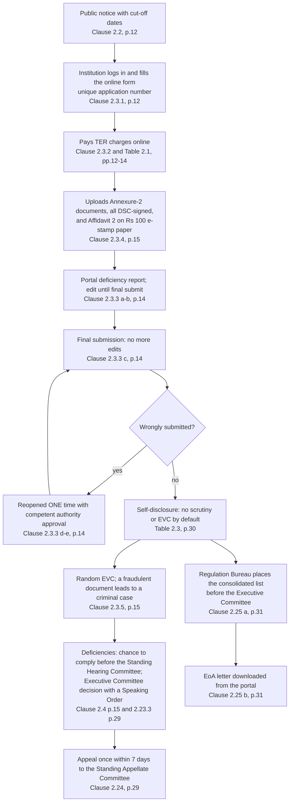
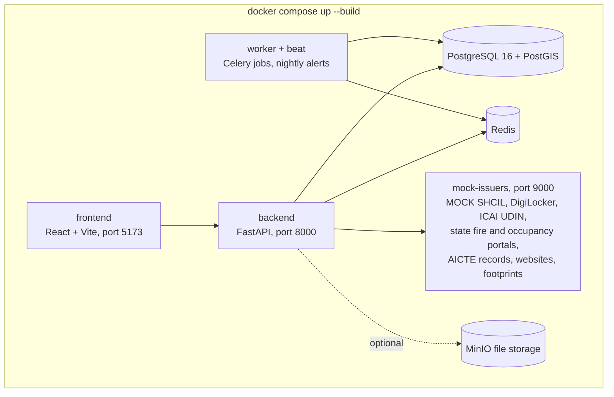
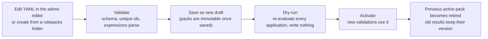

> **Update 2026-10-26: the `admin` role was removed.** There are three roles (institution, officer, inspector). Rule packs, the audit log and reopen-once are officer duties; user management is gone. The inspector also records on-site Confirmed/Cleared verdicts per flagged item. Wherever this guide says "admin" read "officer".

# PramaanAI and SIH26261: the complete team guide

**Team Hexaminds · Smart India Hackathon 2026 · Problem statement SIH26261 (AICTE, Regulation Bureau)**

This guide explains everything about the problem statement, the rules behind it (the AICTE Approval Process Handbook), and how our prototype PramaanAI solves it. It is written so that a teammate who has never opened the code can present the project, run the demo and answer judges' questions.

| | |
|---|---|
| Last updated | 23 October 2026 |
| Prototype version | git commit after `8d5ba59` (all tests passing: 62 backend, 3 frontend) |
| Handbook used | AICTE *Approval Process Handbook 2024-25 to 2026-27* (APH), official PDF from aicte.gov.in, 231 PDF pages |
| Problem statement used | SIH 2026 portal entry SIH26261 (sih.gov.in, problem statements page) |

> **How Handbook references work in this guide.** "APH p.81" means the page number *printed* on the Handbook page. In the official PDF, printed page N is PDF page N + 16 (the first 16 PDF pages are the cover, foreword, abbreviations, definitions and preamble, numbered i to xii). Example: Annexure-2 is printed p.81 = PDF page 97. Handbook text is paraphrased here, not copied; open the PDF for the exact wording before quoting it on stage.

> **Ground rules of the project.** Everything in the prototype is synthetic: every person, institution, certificate and photo is invented, and every outside system (SHCIL, DigiLocker, ICAI, state portals, AICTE records) is a clearly labelled **MOCK**. The software never approves, rejects or penalises anyone. It produces evidence-linked findings; an AICTE officer decides.

---

## Contents

0. [How to read this guide](#0-how-to-read-this-guide)
1. [The two-minute summary](#1-the-two-minute-summary)
2. [Smart India Hackathon and problem statement SIH26261](#2-smart-india-hackathon-and-problem-statement-sih26261)
3. [The regulatory world: AICTE and the Approval Process Handbook](#3-the-regulatory-world-aicte-and-the-approval-process-handbook)
4. [Glossary A to Z](#4-glossary-a-to-z)
5. [PramaanAI at a glance](#5-pramaanai-at-a-glance)
6. [Architecture and the processing pipeline](#6-architecture-and-the-processing-pipeline)
7. [The five engines and every flag they raise](#7-the-five-engines-and-every-flag-they-raise)
8. [Verification statuses, proof levels and carry-forward](#8-verification-statuses-proof-levels-and-carry-forward)
9. [Risk scoring, tiers, routing and the inspection list](#9-risk-scoring-tiers-routing-and-the-inspection-list)
10. [The Rule Pack: the Handbook as code](#10-the-rule-pack-the-handbook-as-code)
11. [Synthetic data and the planted problems](#11-synthetic-data-and-the-planted-problems)
12. [The application, screen by screen](#12-the-application-screen-by-screen)
13. [API reference](#13-api-reference)
14. [Security, privacy and safeguards](#14-security-privacy-and-safeguards)
15. [Demo script and judge Q&A bank](#15-demo-script-and-judge-qa-bank)
16. [Honest limitations and roadmap](#16-honest-limitations-and-roadmap)
17. [Running, testing and troubleshooting](#17-running-testing-and-troubleshooting)
- [Appendix A: APH citation check](#appendix-a-aph-citation-check)
- [Appendix B: APH digest (everything relevant we found)](#appendix-b-aph-digest-everything-relevant-we-found)
- [Appendix C: repository map](#appendix-c-repository-map)
- [Appendix D: flag code quick reference](#appendix-d-flag-code-quick-reference)
- [Appendix E: numbers cheat-sheet for institutions A, B and C](#appendix-e-numbers-cheat-sheet-for-institutions-a-b-and-c)
- [Appendix F: sources](#appendix-f-sources)

---

## 0. How to read this guide

**If you have 15 minutes** read sections 1, 2.5, 5, 9 and 15.1 (the demo script).

**If you are presenting** add sections 3.5 to 3.10 (the rules that create the problem), 7 (what each finding means) and 15.2 (the Q&A bank).

**If you are writing or changing code** read sections 6, 7, 10, 11, 13 and 17, and keep `DECISIONS.md` open: it records every design decision with its reason.

**If a judge asks "where does that rule come from?"** use [Appendix A](#appendix-a-aph-citation-check). Every rule we encode has a clause and printed page, and we checked each one against the official PDF.

Conventions used below:

- `CODE_LIKE_THIS` is a flag code, rule id, status or file name exactly as it appears in the software.
- **Bold** words are defined in the [glossary](#4-glossary-a-to-z).
- Tiers are always written with their meaning: GREEN = no risk, AMBER = medium risk, RED = high risk.

---

## 1. The two-minute summary

**The problem.** Every AICTE-approved technical institution (engineering, management, pharmacy, design and similar colleges) must apply online every year to continue running its courses. This yearly renewal is the **Extension of Approval (EoA)**. For a plain EoA, the Handbook lets AICTE grant approval on the institution's **self-disclosure**: the college uploads seven documents and a sworn **Affidavit 2**, and there is no scrutiny committee and no inspection by default (APH Table 2.3, p.30). Inspections (the **Expert Visit Committee**, EVC) are picked **at random** (Clause 2.3.5 (a), p.15). Officers check documents by hand, and the same documents are checked again every year. Expired certificates, inconsistent numbers, edited documents and "ghost" faculty can slip through.

**Our answer.** PramaanAI ("pramaan" = proof) checks what the institution discloses, before a human decides:

1. It reads every uploaded document, finds each field and remembers exactly where it is on the page.
2. It verifies documents with the original issuer (e-stamp, DigiLocker, ICAI, state fire and building portals, AICTE records), all mocked in the prototype.
3. It proves authenticity cryptographically first (digital signatures, QR codes) and only then uses forensic hints (fonts, metadata, error level analysis).
4. It checks completeness, consistency across documents, years and institutions, and compliance with the Handbook's numeric norms (faculty, rooms, computers, bandwidth, built-up area).
5. It turns findings into a **risk tier** (GREEN = no risk, AMBER = medium risk, RED = high risk) and a **ranked inspection list**, so inspectors go where they are most needed instead of at random.
6. Every finding points to its evidence (document, page, highlighted box, or source system), cites the Handbook clause, and is decided by an officer with a written reason. Everything is written to a tamper-evident audit log.

**One line for judges:** *PramaanAI turns AICTE's self-disclosure into verified disclosure, and points inspectors at the institutions most likely to need them.*

**Proof it works (synthetic data, measured by `scripts/verify_planted.py` and `scripts/evaluate.py`):**

| Institution | Situation | Result |
|---|---|---|
| A, Aurora Institute of Technology (Synthetic) | Clean; two documents unchanged from last year; the Karnataka fire portal is down | GREEN (no risk), score 0, only information notices |
| B, Bhavani College of Engineering (Synthetic) | Fire certificate expires before the academic year starts; provisional occupancy certificate in its third year | AMBER (medium risk), score 30, exactly these two findings |
| C, Chandra Technical Campus (Synthetic) | Land record edited after signing, forged QR date, impossible dates, copied photo, off-site photo, 12 faculty registered elsewhere, faculty shortfall, inflated built-up area, a building that did not exist on its completion date, website contradicting the application | RED (high risk), score 245.05, all 12 planted problems caught |

All 41 synthetic documents are classified correctly, all 337 ground-truth fields are extracted correctly, 15 of 15 planted problems are caught with no false alarms, and the pipeline takes roughly 2 to 5 seconds per application on a laptop, depending on how busy the machine is (2.4 s in one run and 4.9 s in the latest, `reports/evaluation.md`).

The key numbers to remember: **5 engines, 6 verification statuses, 3 risk tiers, 4 roles, 10 API routers.**

---

## 2. Smart India Hackathon and problem statement SIH26261

### 2.1 What SIH is

The **Smart India Hackathon (SIH)** is a national product-building competition run by the Ministry of Education's Innovation Cell together with AICTE. Ministries, departments and public bodies publish real problem statements; student teams pick one, submit an idea through the SIH portal (sih.gov.in), and shortlisted teams build a working prototype in the grand finale. Colleges first run an internal hackathon to choose which teams they nominate. Problem statements are either **Software** or **Hardware**, and each has a **theme**.

> Check dates yourselves on sih.gov.in. When this guide was written, the SIH26261 entry on the portal showed an idea submission deadline of **28 October 2026**.

### 2.2 Our problem statement at a glance

| Field | Value |
|---|---|
| ID | **SIH26261** |
| Title | **AI-Powered Application Validation, Document Authentication and Regulatory Compliance Verification** |
| Organisation | AICTE (All India Council for Technical Education) |
| Department | **Regulation Bureau** (the AICTE bureau that processes approvals and places them before the Executive Committee; see APH Clause 2.25 (a), p.31) |
| Category | Software |
| Theme | Smart Automation |
| Dataset provided | None (so we built our own synthetic dataset; see section 11) |

### 2.3 The title, word by word

- **AI-Powered.** The system uses automated intelligence: document understanding (classification and field extraction), anomaly detection (forensics, duplicate detection, cross-checks) and rule reasoning. Important: "AI" here is decision support, not decision making. The statement itself insists that final decisions stay with AICTE.
- **Application Validation.** Checking that an application is *complete* (all required documents and fields present), *consistent* (the same facts agree everywhere) and *valid* (certificates in date, numbers within norms) before a human spends time on it.
- **Document Authentication.** Establishing that a document is genuine and unaltered. The strongest proof is cryptographic (a valid **digital signature**, a **QR code** that matches the printed text) and confirmation by the **issuing authority**. Weaker hints come from forensics (fonts, metadata, image analysis).
- **Regulatory Compliance Verification.** Checking the facts against the Handbook's norms: faculty-student ratio, classrooms, laboratories, computers, internet bandwidth, built-up area, certificates such as fire safety and structural stability.

### 2.4 What the official statement asks for (paraphrased)

The portal entry is long. Its content, in our own words and in the original order:

**Background.** AICTE processes Extension of Approval and other approval-change applications under the APH and its regulations. That involves record checks, document scrutiny, compliance checks and sometimes inspection. The volume and variety of applications makes manual checking slow, and delays come from missing or expired documents, inconsistent information, suspected alterations and the difficulty of confirming details with the authorities that issued the documents. AICTE wants a secure, AI-enabled **decision-support** tool for early preliminary validation, document authentication and compliance checks.

**Problem.** Build a platform, linked to (or designed for) the AICTE portal, that checks application information and documents against institutional records and **configurable rules**; flags anomalies or possible manipulation; supports verification with issuing authorities; identifies infrastructure and other compliance gaps; and keeps findings **evidence-linked and transparent**, with final scrutiny and decisions remaining with AICTE authorities.

**Six objectives.**
1. Find missing, incomplete, expired or inconsistent information and documents at the application stage.
2. Reduce repeated manual checking by reusing records already in authorised AICTE systems.
3. Detect possible alterations, duplicates and anomalies for further verification.
4. Verify documents through issuer portals, APIs, digital repositories, QR codes or digital signatures, where available and authorised.
5. Check infrastructure evidence against configurable requirements and flag cases needing more evidence or inspection.
6. Give transparent, traceable and explainable results.

**Five functional requirements.**
- **A. Intelligent application and document validation:** work out the application category and its checklist; pull authorised records (affidavits, accreditation, NOCs, prior approval, intake, faculty, deficiency status, TER payment status); use OCR, classification and extraction to find gaps and inconsistencies; produce a structured validation report; allow rectification where the process permits.
- **B. Anomaly and potential forgery detection:** look for alteration, duplication, metadata inconsistencies, mismatched identifiers and irregular dates; every flag must cite its evidence and reason and is only a **preliminary indicator requiring human verification**.
- **C. Verification through original issuing authorities:** verify via authorised APIs, portals, digitally signed records, QR codes or reference numbers; record source, timestamp and result; statuses must distinguish **verified, mismatch, expired, pending, source unavailable and manual review required**; inconclusive cases go to manual confirmation.
- **D. Regulatory and infrastructure compliance assistance:** compare data and evidence with configurable checklists derived from the APH; optionally review photos, videos, floor plans and certificates with computer vision; findings are advisory only.
- **E. Validation dashboard, alerts and audit trail:** a dashboard of status, deficiencies, verification results and cases needing action; alerts for missing information, expiry, pending verification and suspected anomalies; an audit trail of rules applied, records checked, source responses, alerts, observations and actions.

**Eight deliverables.** (1) A working prototype integrated with, or designed for integration with, the AICTE portal and authorised sources; (2) category checklists and configurable rules; (3) OCR-based classification, extraction and completeness checks; (4) cross-document and institutional-record consistency checks with evidence-linked flags; (5) a verification workflow using issuer sources where technically and legally feasible; (6) a compliance-assistance module for documents and infrastructure; (7) a dashboard covering status, deficiencies, verification outcomes, pending actions and audit history; (8) role-based access, secure document handling, confidentiality safeguards and **human review before any adverse action**.

**Expected outcomes.** Less repetitive manual scrutiny; earlier detection of missing, expired or inconsistent information; more reliable and traceable authentication; consistent use of checklists; faster identification of cases needing manual verification, more evidence or inspection; more transparency and auditability.

**How prototypes will be judged (evaluation ideas listed).** Demonstrate with authorised, anonymised or **synthetic** data. Possible measures: extraction accuracy, validation accuracy, anomaly-detection performance, source-verification success rate, reliability of discrepancy flags, average verification time, alert timeliness, and reduction in manual effort.

**Five essential safeguards.** (1) All checks configurable to match the APH and regulations; (2) authorised, role-based access to records and sources, with no bypassing of access controls; (3) protection of institutional and personal data through security, access logging and retention safeguards; (4) explainable, evidence-backed AI flags; (5) AI is decision support only; statutory scrutiny, inspections and final decisions stay with competent authorities.

### 2.5 How PramaanAI answers every line (traceability matrix)

Use this table when a judge says "the statement asks for X; where is it?"

| Statement item | What PramaanAI does | Where to show it |
|---|---|---|
| Objective 1: missing / incomplete / expired / inconsistent | Completeness engine (missing documents and fields, unsigned documents, expiry on submission and on academic-year start, provisional OC limit) and Consistency engine (names, trust, survey number, signatory, dates) | Institution pre-check fix-list; officer *Flags & Evidence* tab |
| Objective 2: reuse records, avoid repeated checks | **Verify once, reuse every year**: a document whose SHA-256 matches one verified last year is carried forward as VERIFIED without re-verification; AICTE records (intake, built-up area, faculty count, campus, TER, provisional-OC history) are pulled from the (mock) AICTE records source | *Verification* tab ("carried forward from 2026-27"); A's land and occupancy certificates |
| Objective 3: alterations, duplicates, anomalies | Authenticity engine (signature, modified-after-signing with the exact changed field, QR mismatch, font inconsistency, metadata, ELA heatmap); duplicate documents, photos and faculty across institutions | C's land document, fire QR, copied lab photo, 12 duplicate faculty |
| Objective 4: verify via portals, APIs, repositories, QR, signatures | Issuer engine with one adapter per source (SHCIL e-stamp, DigiLocker, ICAI UDIN, state fire NOC, state occupancy, AICTE records, accreditation lists), plus PDF signature validation and QR decoding | *Verification* tab with six status badges |
| Objective 5: infrastructure evidence | Photo GPS within 1 km of the campus, photo time plausibility, reused photos, built-up area vs building footprints × floors, completion date vs satellite first-seen year; numeric norms for rooms, labs, PCs, bandwidth | *Infrastructure* tab (map, gallery, side-by-side duplicate) and *Compliance* tab |
| Objective 6: transparent, traceable, explainable | Every flag carries evidence (document, page, bounding box, or source system), an explanation, and, for rule-based flags, the APH clause, page, rule id and rule-pack version | Every flag in the workbench; the validation report PDF |
| Requirement A: category checklist, records, OCR/extraction, report, rectification | Category checklists from `categories.yaml` (EoA, increase in intake, name change); text-layer extraction with optional OCR for scans; validation report PDF; institutions fix and re-run pre-check before submitting; reopen-once after submission | Institution page; report download |
| Requirement B: anomalies with evidence; preliminary indicators | Forensic flags are always labelled "Preliminary indicator — requires human verification" and weighted by confidence | Flag detail panel |
| Requirement C: issuer verification with source, timestamp, result and the six statuses | Each check stores adapter, status, source, request hash, response hash, summary and time. Statuses: `VERIFIED`, `MISMATCH_DETECTED`, `EXPIRED`, `VERIFICATION_PENDING`, `SOURCE_UNAVAILABLE`, `MANUAL_REVIEW_REQUIRED`; unavailable sources are routed to manual review automatically and the officer records a manual confirmation | *Verification* tab, A's Karnataka fire portal |
| Requirement D: configurable APH checklists; photos with computer vision; advisory | The **Rule Pack** (APH norms as versioned YAML with clause and page), admin editor, dry-run, activation; EXIF/GPS and perceptual-hash photo checks; optional YOLO PC counting; all advisory | *Admin → Rule packs*; *Compliance* tab |
| Requirement E: dashboard, alerts, audit trail | Officer queue with KPI cards and charts; alerts bell (missing info, expiring/expired documents, pending verification, anomalies) and a nightly alert job; hash-chained audit log with a verify button | Officer queue; bell icon; *Admin → Audit log* |
| Deliverable 1: prototype for portal integration | REST API (10 routers) and adapters whose base URLs are configuration, so real authorised APIs can replace the mocks | `/docs` (OpenAPI) |
| Deliverables 2 to 7 | As above | |
| Deliverable 8: roles, secure handling, confidentiality, human review before adverse action | Four roles with checks on every route; institutions only see their own data; MFA for officers/admins; access log for every document view; optional encryption at rest; no "reject" button anywhere; decisions need a reason | Login as different roles; flag decision form |
| Evaluation ideas | `scripts/evaluate.py` measures extraction precision/recall/F1, anomaly recall/precision, tier accuracy, source-verification rate and time per application; `scripts/verify_planted.py` proves every planted problem is caught | `reports/evaluation.md` |
| Safeguards 1 to 5 | Configurable rule pack; role-based access; access logging and retention table; evidence-backed flags; decision support only, with an on-screen banner | Section 14 |

### 2.6 The five pain points and the feature that removes each

| Pain point named in the statement | Why it happens today | PramaanAI feature |
|---|---|---|
| Missing or expired documents | Officers read every upload by hand; validity dates are easy to miss | Completeness rules generated from the category checklist; expiry checked both at submission and on the academic-year start date; nightly alerts 60 days before expiry |
| Inconsistent information | The same fact (name, survey number, built-up area, faculty count) appears in many places | Consistency engine compares documents with each other, with the online form, with last year's application, with AICTE records and with the institution's own website |
| Suspected alterations | Edits made after a document was signed or issued look perfect to the eye | Signature validation detects any change after signing and shows exactly which field changed; QR payload vs printed text; issuer's original record; font and metadata forensics |
| Slow confirmation with issuing authorities | Letters and phone calls | Issuer adapters return an answer in seconds; when a portal is down the case is routed to manual review instead of blocking |
| The same records checked again every year | No memory of what was verified before | SHA-256 fingerprint of every file; unchanged and previously verified documents are carried forward |

---

## 3. The regulatory world: AICTE and the Approval Process Handbook

This section explains the rules that create our problem. You do not need to memorise the Handbook, but you should understand why self-disclosure exists, what an institution uploads, who checks it, and what happens when something is false.

### 3.1 AICTE and its legal powers

- **AICTE** (All India Council for Technical Education) was set up in November 1945 as an advisory body and became a statutory body through the **AICTE Act, 1987 (Act 52 of 1987)** (APH Preamble, p.xii; Foreword, p.i).
- Under the Act, "technical education" covers education, research and training in engineering and technology, architecture, town planning, management, pharmacy, applied arts and crafts, and other areas the Central Government notifies (Preamble, p.xii).
- The Preamble (p.xii) lists the Act's powers that matter for approvals. In plain words:
  - **Section 10(g):** set up a performance appraisal system for institutions, with norms and ways of enforcing accountability.
  - **Section 10(i):** lay down norms and standards for curriculum, physical and instructional facilities, staff patterns and qualifications, quality, assessment and examination.
  - **Section 10(k):** grant approval for new institutions and for new courses or programmes.
  - **Section 10(n):** prevent commercialisation of technical education.
  - **Section 10(p) and Section 11(1)-(4):** inspect, or cause to inspect, any technical institution; tell the institution the inspection date; share the results and the action to be taken; the institution reports back what it will do.
- **Why this matters for us:** PramaanAI supports the Council's own duties of appraisal (10(g)), enforcing norms (10(i)) and inspection (10(p), 11). It does not replace any of them.

### 3.2 The Approval Process Handbook (APH)

- The **Approval Process Handbook 2024-25 to 2026-27** is published by AICTE and is declared a **legal document** under the AICTE Act and a list of AICTE regulations (APH title pages; Definition 8, p.viii). It prescribes the norms and procedures for every kind of approval for three academic years.
- Its structure (APH Index, p.v):

| Part | Printed pages | What it contains |
|---|---|---|
| Foreword, Abbreviations, Definitions, Preamble | i to xii | The 15 changes in this edition; 63 defined terms; AICTE Act powers |
| Chapter I | 1 to 10 | Approval of a **new** technical institution |
| Chapter II | 11 to 32 | **Extension of Approval** and all other changes for **existing** institutions (our focus) |
| Chapter III | 33 to 36 | Collaboration and twinning programmes |
| Chapter IV | 37 to 44 | Approval for universities |
| Chapter V | 45 to 52 | Open and distance learning, online learning |
| Chapter VI | 53 to 69 | Standard norms and requirements (land, buildings, faculty, essential and desirable requirements) |
| Chapter VII | 70 to 74 | **Penal action** for violating norms |
| Chapter VIII | 75 | Do's and don'ts |
| Annexures 1 to 18 | 77 to 184 | Document lists (1, 2), built-up area norms (3), computers and library (4), faculty (5), competent authorities by state (14), committees (16), mandatory disclosures (18) and more |
| Affidavits 1 to 13 | 185 to 200 | Sworn statement formats (Affidavit 2 is the main EoA affidavit) |
| Formats 1 to 4, Certificates 1 to 3 | 201 to 214 | NOC from state, NOC from university (Format 2), Trust resolution (Format 3), architect and bank certificates |

- The Foreword (pp.i-ii) lists what changed in this edition. The ones that matter for us: EoA for up to **3 years** for outstanding institutions; **simplified EoA**; **fewer land-document and NOC requirements**; clearer norms; **revised penal clauses**.

### 3.3 New approval versus Extension of Approval

- A **new** institution applies under Chapter I through the National Single Window System (Clause 1.3.1, p.1), faces a **Scrutiny Committee** that checks the authenticity of documents (Clause 1.8, p.7) and an **EVC** that checks facilities (Clause 1.9, p.8), and receives a **Letter of Approval (LoA)**, a **Letter of Deficiency (LoD)** or a **Letter of Rejection (LoR)** (Clause 1.10 (b), p.8). An LoA is valid for two academic years, and from the next year the institution must apply for EoA every year whether or not it admitted students (Clause 1.10, p.9).
- An **existing** institution must apply through the AICTE web portal **every year** for **Extension of Approval** of its courses (Clause 2.1 (c), p.12). It must not admit students without prior approval (Clause 2.1 (b), p.12).

### 3.4 The 17 kinds of Chapter II application

Chapter II (p.11) covers 17 application types for existing institutions. The prototype wires three of them (marked ✓); the others can be added by editing `categories.yaml` only (section 10.10).

| # | Application type (APH Chapter II list, p.11) | In prototype |
|---|---|---|
| i | Extension of Approval based on **self-disclosure** | ✓ `EOA` |
| ii | Increase in intake / additional course(s) | ✓ `INCREASE_IN_INTAKE` |
| iii | Start a new programme or level | |
| iv | Introduce or continue seats for Non-Resident Indians | |
| v | Supernumerary seats for foreign nationals, OCI, children of Indian workers in Gulf countries | |
| vi | Integrated or dual degree course | |
| vii | Off-campus | |
| viii | Fellow Programme in Management | |
| ix | Merger of institutions | |
| x | Conversion of diploma level into degree level and vice versa | |
| xi | Conversion of women's institution into co-ed and vice versa | |
| xii | EoA after a break, hibernation, restoration of intake | |
| xiii | Change of site / location | |
| xiv | Change of course name, merger of courses, reduction in intake, closure of programmes/courses | |
| xv | **Change in the name of the institution**, affiliating university/board, or type of institution | ✓ `NAME_CHANGE_INSTITUTION` |
| xvi | Change in the name or address of the Trust / Society / Company | |
| xvii | Closure of the institution | |

### 3.5 Self-disclosure and Table 2.3: why the problem exists

- **Clause 2.5 (p.15):** the Council grants EoA **based on self-disclosure** of facilities and infrastructure entered on the AICTE portal, on the condition that all norms are met. Annexure-2 documents must be uploaded. The Council monitors compliance and starts penal action if norms are not met.
- **Clause 2.3.4 (c) (p.15):** applications *other than* EoA on self-disclosure are processed by the Scrutiny / Re-Scrutiny Committee and EVC strictly on the uploaded documents.
- **Table 2.3 (p.30)** lists who checks each type of application. The rows that matter to us:

| Type of application | Documents | Self-disclosure | Scrutiny / Re-scrutiny | EVC (inspection) | SHC / SAC |
|---|---|---|---|---|---|
| **EoA based on self-disclosure** | Annexure-2 | **Yes** | – | – | – |
| NRI seats | Annexure-2 | Yes | – | – | – |
| **Increase in intake / additional courses** | Annexure-2 | – | **Yes** | **Yes** | As applicable |
| **Change in the name of the institution** | Annexure-2 | – | **Yes** | – | – |
| Change of site / location | Annexure-2 | – | Yes | Yes | As applicable |
| Closure of the institution | Annexure-2 | – | Yes | – | – |

So for a plain EoA nobody checks the documents by default. AICTE relies on the documents and Affidavit 2 being true.

- **Clause 2.3.5 (p.15), the Expert Visit Committee:** (a) institutions **at random** are subject to EVC inspection; (b) if any submitted document is found to be fraudulent, a **criminal case** is filed against the Director/Principal and the Chairman/Secretary of the Trust/Society/Company.

**Our key insight.** Random selection wastes inspections on clean institutions and misses risky ones. A risk-ranked list (section 9) sends the EVC first to the institutions whose own documents contradict themselves. This is how we "point inspectors at the institutions most likely to need them".

### 3.6 How an EoA application moves through AICTE



Details worth knowing:

- **Public notice and deadlines (Clause 2.2, p.12).** Applications and TER payment must be in by the last date in the public notice; offline applications are not accepted.
- **Data entry and the edit lock (Clause 2.3.3, p.14).** The applicant must make sure the data is correct. Editing is possible until **final submission**; after that nothing can be edited until processing ends. A wrongly submitted application can be **reopened one time**, with a Trust resolution in Format 3 and the approval of the competent authority (and TER plus any late penalty).
- **Documents and the affidavit (Clause 2.3.4, p.15).** All documents are uploaded **digitally signed with a DSC**; no hard copies are needed. **Affidavit 2** is sworn before a First Class Judicial Magistrate, Public Notary or Oath Commissioner on **Rs 100** non-judicial stamp paper or e-stamp paper, digitally signed and uploaded. False information lets AICTE invoke civil and/or criminal provisions. Clause 6.39 (p.59) repeats that every approved institution must upload Affidavit 2 on e-stamp paper with the authorised signatory's digital signature.
- **Chance to comply (Clause 2.4, p.15).** The institution gets an opportunity to submit compliance of deficiencies so as to reach **"Nil Deficiency"**.
- **Processing and hearings (Clauses 2.23 to 2.24, p.29).** Scrutiny and EVC follow Chapter I procedures; shortcomings can be answered before the **Standing Hearing Committee**; its recommendations go to the **Executive Committee**, whose decision is uploaded with a detailed **Speaking Order**; the institution can appeal **once** within **7 days** to the **Standing Appellate Committee**, which is given the Regulation Bureau's observations.
- **Grant (Clause 2.25, p.31).** The **Regulation Bureau** places the consolidated list of institutions and approved intake before the Executive Committee/Council. Deficiencies noted by scrutiny or EVC get a **Speaking Order** after the institution has had a chance to comply, and must be fixed before the next year's EoA. Student enrolment details must be uploaded by **30 November** (2.25 (n)).
- **Transparency (Clause 2.28, p.32).** Scrutiny and EVC can be online or offline and are recorded for transparency and accountability; expert signatures are not needed if documents are verified online.

### 3.7 The committees (Annexure-16, pp.176-178)

| Committee | Role in one line (Annexure-16, 16.8, p.178) |
|---|---|
| **Council** | Performs the functions in Section 10 of the AICTE Act |
| **Executive Committee (EC)** | Performs functions assigned by the Council; takes approval decisions that the Council ratifies |
| **Scrutiny / Re-Scrutiny Committee** | Verifies the **authenticity of documents** against Annexure 1/2 (members: academics of IIT/IIM/NIT/government institutions, an advocate, an architect or structural engineering professor) |
| **Expert Visit Committee (EVC)** | Visits the premises online or offline to verify **infrastructure and faculty** against the norms (a professor, a second expert or industry expert, and an architect or civil/structural/planning expert) |
| **Standing Hearing Committee (SHC)** | Assesses compliance of deficiencies from the EVC report or a show-cause notice |
| **Standing Appellate Committee (SAC)** | Hears appeals and assesses compliance of deficiencies observed by the SHC |
| **Standing Complaint Scrutiny Committee (SCSC)** | Processes complaints against institutions (chaired by a retired High Court judge) |

PramaanAI mostly helps the **Regulation Bureau** and **Scrutiny-style officers** (our `officer` role) and the **EVC** (our `inspector` role).

### 3.8 Three-year EoA (Extended EoA)

From AY 2024-25, existing institutions can get EoA for **3 years** by paying 3 years' TER if they meet **any one** of six criteria (Clause 2.1 (a), pp.11-12):

1. Ranked in the 8th edition of **NIRF** (announced 5 June 2023);
2. In the **QS** World Ranking Asia 2024 (announced 8 November 2023);
3. At least **30%** of eligible courses **NBA**-accredited, valid till 30 April 2025;
4. A valid **NAAC** score of **3.01 or more** out of 4;
5. **Autonomous status** from UGC or autonomy from AICTE;
6. More than **80% admission** for each of the last 5 academic years.

Even with extended EoA, the institution must submit its data every year during the approval process (note under 2.1 (a), p.12). The prototype encodes criterion 4 (rule `ELIG-3YR-NAAC`): Institution A claims NAAC 3.22 and the mock NAAC list confirms it. The other five criteria are listed in the roadmap (section 16).

### 3.9 TER charges (the fee)

- **TER** stands for **Technical Education Regulatory** charges (APH Abbreviations, p.vii). They are paid only online through the AICTE payment gateway (Chapter VIII item 9, p.75) before the deadline, otherwise the application is not considered (Clause 2.3.2 (d), p.14).
- **Table 2.1 (p.13)** gives amounts in lakh rupees. For **EoA on self-disclosure**, an institution that is not government or a university pays **Rs 0.20 lakh** for all programmes except PGDM/MBA (Rs 0.40 lakh for PGDM/MBA); government institutions and universities pay Rs 0.05 lakh. These EoA charges are counted **per division** of the applied intake (footnote of Table 2.1, p.13).
- Charges rise **10% every year** (note i, p.14). They are **not refunded** once an application is processed, even if it is rejected (note iii, p.14). Some other flat charges: increase in intake Rs 1.25 lakh, change of institution name Rs 0.60 lakh (non-government, Table 2.1, p.13); late submission penalty Rs 1.25 lakh.
- **In the prototype** (`rulepacks/config/ter_fees.yaml`): Rs 20,000 per division, base year 2024-25, +10% a year. For AY 2027-28 that is 20,000 × 1.1³ = Rs 26,620 per division: A (2 divisions) pays Rs 53,240, B (3) Rs 79,860, C (10) Rs 2,66,200. The issuer engine checks the receipt number and amount on the TER receipt against the (mock) AICTE payment record.

### 3.10 The EoA document list (Annexure-2, 2.1, p.81) explained

Annexure-2, section 2.1 lists what an existing institution uploads for **EoA on self-disclosure** (also for EoA after a break and restoration of intake). Supporting documents and affidavits are authenticated by the Chairman/Secretary of the Trust/Society/Company for self-financing institutions. Every document must carry a DSC (Clause 2.3.4 (a), p.15).

| # | Document | What it is, in plain words | How PramaanAI checks it |
|---|---|---|---|
| (i) | **Affidavit 2** with the digital signature of the Trust's Chairman/Secretary, on Rs 100 e-stamp paper, sworn before a First Class Judicial Magistrate, Notary or Oath Commissioner | The institution's sworn promise that everything in the application is true (contents in the table below) | Present and signed; e-stamp value is Rs 100; e-stamp certificate verified with SHCIL (mock); e-stamp issued on or before the notarisation date; signatory matches the form |
| (ii) | Copy of the **pay receipt** printed from the AICTE portal for the EoA year | Proof that TER was paid | Present and signed; receipt number and amount verified against AICTE payment records (mock) |
| (iii) | Valid **Occupancy / Completion Certificate / Building Licence / Form D** from the competent authority | Permission from the local authority to occupy the building (the Annexure cites "Clause 7.17", which is Clause 6.17 (g), p.57) | Present, signed and valid on the academic-year start; type and dates verified with the state occupancy portal (mock); a **provisional** certificate is accepted for only 2 consecutive years (Annexure-3, 3.1 (c), p.86); the completion date is compared with satellite imagery |
| (iv) | Valid **Structural Stability Certificate** from a registered structural engineer, if the building is more than **30 years** from the issue of its completion certificate | An engineer's certificate that an old building is safe; valid for **5 years** from issue (Clause 6.17 (h), p.57) | Required only when the oldest building is over 30 years old on the academic-year start (B's 1990 main block); validity checked; no issuer source exists, so it goes to manual review |
| (v) | Valid **Fire Safety Certificate** from the competent authority | Fire and life safety approval from the state fire department, which must be obtained before applying (Annexure-3, 3.1 (d), p.86) | Present, signed, valid at submission and on the academic-year start; QR payload vs printed dates; verified with the state fire NOC portal (mock) |
| (vi) | **Satellite map** showing the land's location, with latitude and longitude at the **entrance of the main building** marked on it | A screenshot from a map site with the coordinates written on it | Present, signed, coordinates present; the campus point anchors the photo-GPS and footprint checks |
| (vii) | **Audited statement of accounts** of the Trust/Society/Company for the **previous year** | The chartered accountant's audited accounts | Present, signed; **UDIN** verified with ICAI (mock); entity name matches the Trust |

Prototype additions (not in Annexure-2, but needed for the checks in the brief and allowed by the Handbook's own data duties):

- **Faculty list (CSV).** The Handbook requires faculty data on the portal and its truth is declared in Affidavit 2 (Clause 6.14 (c), p.55; Affidavit 2 items 9, 17, 27, pp.186-187).
- **Infrastructure photos** with GPS. The Handbook's EVC process already asks for video of all facilities with GPS coordinates at the entrance of the main building (Clause 1.9 (f)-(g) and note, p.8).
- **Land document** (optional). Land documents are not in the EoA list (the 2024-27 edition reduced land-document compliance, Foreword p.ii); they are required for new institutions (Annexure-1, 1.1 (xii), p.77) and change of site. If an institution uploads one, PramaanAI still verifies it.

**Increase in intake (Annexure-2, 2.6, p.82)** additionally needs **Affidavit 8** on Rs 100 stamp paper (not for extended EoA) and a **Trust resolution in Format 3** approving the extra courses or divisions and allocating land, building and funds. Affidavit 8 (p.194) declares that the Trust resolved to apply, paid TER, and has created the extra infrastructure, hostel and faculty.

**Change in the name of the institution (Annexure-2, 2.10, p.83)** needs an **NOC from the affiliating university in Format 2**, or a receipt with the university's official seal proving the documents were submitted to it, and a **Trust resolution in Format 3**. Name rules: a private institution cannot use a name whose abbreviation looks like IIT, IIM, NIT and similar, or words such as "Government", "India", "National" (Clause 1.5.4, p.5; Clause 6.41, p.59); names must not copy another institution in the state (Clause 1.5.5, p.5); the full name must use the same font and size everywhere (Clause 1.5.6, p.5).

**What Affidavit 2 actually promises (Affidavit-2 format, pp.186-188).** The deponent is the Chairperson/Secretary of the Trust/Society/Company. Among its 33 declarations, these are the ones PramaanAI tests:

| Affidavit 2 declaration (paraphrased) | Our check |
|---|---|
| 3. The information in the application is true and complete; nothing concealed | All five engines |
| 4. The institution functions at the location approved by the Council | Photo GPS within 1 km of the campus; campus coordinates vs AICTE records |
| 5. The occupancy/completion certificate and the structural stability certificate are uploaded | Document checklist, expiry, provisional OC limit, satellite first-seen year |
| 7. A valid fire safety certificate is uploaded | Expiry, QR mismatch, fire portal verification |
| 9. Faculty norms and the faculty-student ratio are maintained, and the faculty data is true | Faculty ratio and cadre rules; duplicate faculty in the AICTE registry; website disclosure |
| 12 and 15. Land, built-up area and infrastructure details are true | Built-up area vs footprints; survey number consistency; land record tampering |
| 13. The land is contiguous and undisputed | Land record checks (survey number, owner) |
| 14. False, misleading or suppressed information allows the Council to withdraw approval and act against the people involved | The reason findings matter |
| 26. The audited accounts of the previous year are uploaded | Accounts present; UDIN verification |
| 27. All faculty, staff and student data on the portal is correct | Registry cross-check; disclosure mismatch |

### 3.11 Land, buildings and safety (Chapter VI and Annexure-3)

- **Land (Clause 6.17 (a)-(e), pp.56-57).** Clear title in the name of the Trust/Society/Company, or a registered lease of at least **30 years** whose remaining (live) lease covers the longest course; land must be contiguous (no river, rail line or highway splitting it); a land-use certificate from the state's competent authority.
- **Buildings (Clause 6.17 (f)-(j), p.57).** Built as per the approved plan; an **Occupancy Certificate / Completion Certificate / Building Licence / Form D** from the competent authority; after **30 years** from the completion certificate, a **Structural Stability Certificate** from a registered structural engineer, valid for **5 years**; a **valid fire safety certificate**; state-wise competent authorities are listed in **Annexure-14** (pp.163-169).
- **Annexure-14 (pp.163-169)** is a table, state by state, of who issues the **land-use certificate, site plan, building plan and occupancy certificate** (for example town and country planning departments, development authorities, municipal corporations). Our config file `rulepacks/config/issuing_authorities.yaml` mirrors this shape with three fictional rows.
- **Provisional occupancy certificate (Annexure-3, 3.1 (c), p.86).** A partial or provisional OC issued by the state is accepted only for **2 consecutive academic years**. (Planted in Institution B.)
- **Fire (Annexure-3, 3.1 (d), p.86).** The fire and life safety certificate must be obtained before applying.
- **Built-up area (Annexure-3, 3.2, p.87).** Total built-up area = instructional + administrative + amenities area (all carpet area) + **access and circulation area** of about **25%**. Minimum administrative area is 750 m² and amenities 500 m² for an approved intake up to 300 (3.3 and 3.4, p.90).
- **Excess built-up area (Clause 6.18, p.57)** may be used for hostels, research parks, clubs and incubators.

### 3.12 The numeric norms we check

**Faculty (Annexure-5, pp.95-96).**

- **S** is the **sum of students as per approved intake for all years** of the course (p.95). A 4-year course with 60 seats a year has S = 240.
- **Faculty-student ratios:** UG Engineering **1:20**, UG Planning 1:16, UG Applied Arts 1:15, UG Design 1:15, UG Hotel Management 1:20, UG Computer Applications **1:25**, UG Management **1:25** (5.2, p.95); PG Engineering **1:15**, PG Planning 1:10, PG Applied Arts 1:15, PG Design 1:15, PG Hotel Management 1:12, **MCA 1:20**, **MBA/PGDM 1:20** (5.3, p.96); Diploma 1:25 (5.1, p.95).
- **Cadre ratio** Professor : Associate Professor : Assistant Professor = **1 : 2 : 6** (not for Diploma), written in the tables as R = 1 + 2 + 6 = 9, so Professors = S / (20 × 9) × 1, Associates × 2, Assistants × 6 for UG Engineering (p.95-96). For **PG Engineering and PG Hotel Management** the table uses **R = 1 + 1 + 1** (equal numbers of each cadre); MCA and MBA/PGDM use 1:2:6 (p.96). If a qualified Professor is not available, an Associate Professor may be considered.
- **Relief for low admissions (p.96).** If the average admission over the last 3 years is **at most 50%** of the average sanctioned intake, the faculty requirement drops by **25%**. The Handbook's own example: sanctioned 300 over three years, average admissions 130 (below 50%), 4-year course, norm 60 faculty, recommended **45** (60 × 0.75). With 175 admissions (above 50%) it stays 60. Our unit test reproduces exactly this example.
- **Also relevant:** at least one Professor (or Associate Professor) with a Ph.D. for every PG course (Clause 6.14 (f), p.56); adjunct faculty and professors of practice up to 15% of required strength (6.14 (d), p.55); salaries by ECS and EVC checks salary statements (6.14 (a), p.55); faculty IDs added or removed on the AICTE portal in the same month someone joins or leaves (6.14 (c), p.55); biometric attendance (6.14 (j), p.56).

**Rooms and areas for Engineering and Technology (Annexure-3, 3.2.1 A, pp.87-88).**

| Facility | Minimum number | Carpet area each |
|---|---|---|
| Classrooms | divisions per year × course duration in years × 0.5 | 66 m² for a 60-seat division (33 m² for 30) |
| Tutorial rooms | 25% of total classrooms | 33 m² |
| First-year laboratories | 4 (2 of them basic sciences) up to an intake of 600 | 66 m² |
| Other laboratories | 2 per course per year, up to 180 intake per course | 66 m² |
| PG laboratories | 1 per course, plus 1 research laboratory | 66 m² |
| Workshop | 1 up to intake 600, +1 for 601 to 1200 | 200 m² |
| Extra laboratory/workshop for "X" category courses (mechanical, production, civil, electrical, chemical, textile, marine, aeronautical and allied) | 1 | 200 m² (UG), 150 m² (diploma) |
| CAD centre / drawing hall | 1 up to intake 600, +1 for 601 to 1200 | 132 m² |
| Computer centre | 1 up to intake 600, +1 for 601 to 1200 | 150 m² |
| Seminar hall | 1 | 132 m² |
| Library | 1 (+50 m² per 60 students beyond 420 approved intake) | 400 m² |
| Language laboratory | 1 (with at least 20 computers) | 33 m² |

**Computers and internet (Annexure-4, 4.1, p.92).** PC (or laptop) to student ratio with a minimum of 20 PCs: Engineering diploma and UG **1:10**, PG **1:4**; Computer Applications UG 1:10, PG 1:4; Management UG 1:10, PG 1:6. Printers at least **5%** of PCs. Every department needs its own computer laboratory with at least 20 computers. Internet bandwidth by approved intake: up to 300 → **100 Mbps**; 301 to 600 → **300 Mbps**; 601 to 900 → **500 Mbps**; above 900 → **1 Gbps**.

**Library (Annexure-4, 4.3, p.93).** Book titles and volumes by number of first-year divisions (for UG Engineering, 100 titles in the first year and 50 per course per year after, volumes = 5 × titles × divisions), reading room for 15% of students (maximum 150), membership of the National Digital Library (p.94).

### 3.13 Mandatory disclosure on the website (Clause 6.32, p.58; Annexure-18, pp.180-184)

Every institution must publish **mandatory disclosures** in its brochure and on its website. Annexure-18 (p.180) states that **the onus of authenticity lies with the institution only, not AICTE**. The list includes the name and address of the institution and Trust; governance committees; programmes approved and NBA-accredited; **course-wise faculty list and the permanent faculty-student ratio** (18.7, p.181); seats sanctioned and students admitted in each of the last three years (18.10, p.182); the number and size of classrooms, tutorial rooms, laboratories and computer centres, the **fire and safety certificate**, a short infrastructure video (18.15, pp.183-184). Suppression or misrepresentation invites penal action; the complete disclosure must be one PDF whose link is entered on the AICTE portal, freely viewable by the public (p.184).

**Why this matters:** the website is a second, public statement of the same facts. PramaanAI reads the (mock) disclosure page and flags `DISCLOSURE_MISMATCH` when it contradicts the application (Institution C shows 85 faculty on its website but declares 109).

### 3.14 Penalties (Chapter VII, pp.70-74)

- **Clause 7.1 (p.70):** violations can lead to a fine, no admission, reduced approved intake, withdrawal of approval, or criminal action against the Trust and the people involved. If any affidavit information is proved false, penal action starts against the deponent.
- **Clause 7.3 (p.70)** lists the penalties: suspension of NRI/supernumerary seats for a year; reduction in approved intake; no admission in one or more courses for a year; withdrawal of approval for courses or for the institution; withdrawal of graded autonomy; a fine of five times the total fee for each excess admission; no AICTE grants.
- **Clause 7.4 (p.71)** lists violations, including:
  - **(a)** non-submission, or submission of incomplete, false or incorrect information in the EoA application;
  - **(c)** not meeting the faculty-student ratio, pay scales or qualifications;
  - **(d)** not meeting computer, software, laboratory, book, journal or library requirements;
  - **(e)** not meeting essential requirements;
  - **(f)** wrong location or insufficient built-up area;
  - **(j)** not allowing the EVC, or not having an occupancy/completion certificate, building licence, Form D or barrier-free environment (p.72).
- **Complaints (Clause 7.10, p.73):** handled by AICTE's public grievance cell and the Standing Complaint Scrutiny Committee, which can order a warning, show-cause notice or EVC; anonymous complaints are not processed.

PramaanAI's findings are written so an officer can see which of these provisions might be engaged, but the software never applies a penalty.

### 3.15 Other provisions that shape our design

- **EVC video with GPS (Clause 1.9 (f)-(g) and note, p.8).** For online EVC the institution records a 30-minute video of all facilities; the recording must show GPS coordinates at the entrance of the main building, academic building, administrative building and library. This is the Handbook's own precedent for GPS-tagged infrastructure evidence.
- **EVC checks against approved intake, not admitted students (Chapter VIII item 7, p.75).** Our norms use approved intake.
- **Low enrolment (Clause 6.12 (a), p.54).** Admissions below 30% for 5 years running can lead to a 50% intake cut.
- **Show approvals publicly (Clause 6.53 (e), p.68).** Information submitted to AICTE, accreditation status and all approval letters since inception must be on the institution's website.
- **Do not demand original degree certificates from faculty (Clause 6.14 (b), p.55; 7.4 (k), p.72).**

### 3.16 Real-world evidence (for the pitch, not for the code)

Our brief cites two pieces of public evidence that the risk is real: an NGO investigation reported by *The News Minute* (July 2024) that found 353 teachers listed as full-time at more than one college under one university, some at 10 to 11 colleges, with reused photos; and AICTE data checks reported by UNESCO's IIEP ETICO platform that exposed over one lakh "ghost" teachers. **Before quoting these on stage, open the original articles and check the exact numbers and wording.**

---

## 4. Glossary A to Z

Each entry says what the term means in plain words, then where it comes from in the Handbook (APH) or where it lives in PramaanAI. Regulatory, academic, document and technical terms are mixed in one alphabetical list so you can look anything up quickly.

### A

**Academic Year (AY).** The academic activities of a university, board or institution in one year: an odd semester followed by an even semester (APH Definition 1, p.viii). Applications are made for a specific AY. *In PramaanAI:* the AY under review is **2027-28**, starting **1 August 2027** (`academic_year_start` in the rule pack); last year's applications are **2026-27**.

**Access and Circulation Area (ACA).** Corridors, staircases, lobbies and other common walkways; about 25% of the built-up area (Annexure-3, 3.2 (b), p.87; 3.4 note 3, p.91).

**Adapter.** A small piece of code that talks to one outside system (for example SHCIL or DigiLocker) and turns its answer into a standard result. *In PramaanAI:* `backend/app/adapters/`; every adapter calls the MOCK issuers service and its base URL comes from configuration, so a real authorised API could be plugged in later.

**Adjunct faculty / Professor of Practice.** Industry experts or visiting staff who may make up to 15% of the required faculty in most programmes (Clause 6.14 (d), p.55). Not counted as regular full-time faculty in our checks.

**Affidavit.** A written statement of fact sworn under oath before a person authorised to administer oaths, such as a Notary Public or Oath Commissioner (Definition 5, p.viii). The APH has 13 affidavit formats (pp.185-200).

**Affidavit 1.** For a forgotten portal password (p.185).

**Affidavit 2.** The main sworn declaration for Chapter I/II/IV applications: the Chairperson/Secretary of the Trust declares that everything submitted is true, that the institution is at the approved location, that occupancy, structural stability and fire certificates are uploaded, that faculty norms are met, that land and built-up area details are true, and accepts withdrawal of approval if anything is false (format pp.186-188). Sworn on Rs 100 non-judicial or e-stamp paper before a First Class Judicial Magistrate, Notary or Oath Commissioner, digitally signed and uploaded (Clause 2.3.4 (b), p.15; Annexure-2, 2.1 (i), p.81). *In PramaanAI:* document type `AFFIDAVIT_2`; checks for signature, Rs 100 value, e-stamp verification, e-stamp date before notarisation date, signatory consistency.

**Affidavit 8.** For an additional course or increase in intake: the Trust resolved to apply, paid TER, and created the extra infrastructure and faculty (p.194; required by Annexure-2, 2.6 (i), p.82). *In PramaanAI:* required document `AFFIDAVIT_8` in the `INCREASE_IN_INTAKE` category (the classifier does not yet recognise it; see section 16).

**Affiliating University / Board.** The university (or state technical board for diplomas) whose degree or diploma the institution's students receive. Its NOC (Format 2) is needed for several changes.

**AICTE.** All India Council for Technical Education, the statutory regulator of technical education in India (AICTE Act 1987). See section 3.1.

**AICTE portal.** The web portal (www.aicte-india.org) where institutions apply, pay TER, upload documents and download approval letters (Definition 6, p.viii). PramaanAI is designed to sit beside it.

**AICTE records (mock).** Our simulated AICTE database for each institution: last EoA, approved intake by course and year, built-up area, faculty count, campus coordinates, TER payments, deficiency history and provisional-occupancy history. *Endpoint:* `/aicte/records/{institution_id}` on the mock service.

**Alembic.** The tool that creates and upgrades database tables step by step ("migrations"). *In PramaanAI:* `backend/alembic/versions/0001` to `0005`.

**Alert.** An in-app notification shown under the bell icon. Kinds: `MISSING_INFO`, `DOC_EXPIRING`, `DOC_EXPIRED`, `PENDING_VERIFICATION`, `ANOMALY`. Created by the pipeline and by a nightly job (expiry within 60 days; pending verifications older than 7 days).

**Anchor-based extraction.** Our way of reading fields from a PDF: find a label ending with a colon (the anchor, such as "Survey No:") and take the text to its right on the same line. Works perfectly on our document templates; real-world layouts would need the optional LayoutLM or OCR features.

**Annexure.** An attachment section of the APH with detailed lists and tables. The ones we use most: Annexure-2 (EoA documents, p.81), Annexure-3 (land and built-up area norms, p.86), Annexure-4 (computers, internet, library, p.92), Annexure-5 (faculty, p.95), Annexure-14 (competent authorities, p.163), Annexure-16 (committees, p.176), Annexure-18 (mandatory disclosures, p.180).

**API (Application Programming Interface).** A set of web addresses ("endpoints") that programs call to read or change data. *In PramaanAI:* 10 routers under `/api/v1`, documented automatically at `/docs`.

**Applicant.** Whoever applies to the Council for any approval (Definition 7, p.viii). For EoA this is the institution, represented by its Trust.

**Approved Intake.** The maximum number of students that can be admitted to a course in a year, excluding supernumerary seats, as approved by AICTE (Definition 10, p.viii). **Total Approved Intake** covers all programmes and courses of an institution (Definition 59, p.xi).

**APH (Approval Process Handbook).** The AICTE handbook of norms and procedures for all approvals, a legal document under the AICTE Act (Definition 8, p.viii). This guide uses the 2024-25 to 2026-27 edition.

**Audit log (hash-chained).** A list of every important action (logins, uploads, engine runs, verification calls, decisions, rule-pack changes, reports) where each entry stores the fingerprint (hash) of the previous one. Changing or deleting any entry breaks the chain from that point. *In PramaanAI:* `audit_log` table, `GET /api/v1/audit/verify`, *Admin → Audit log*.

**Audited statement of accounts.** The Trust/Society/Company's financial statements for the previous year, audited by a chartered accountant (Annexure-2, 2.1 (vii), p.81). *Document type:* `AUDITED_ACCOUNTS`; verified by UDIN.

**Authenticity engine.** The PramaanAI engine that checks whether a document is genuine: cryptographic proof first (signature, modification after signing, QR), forensic hints second (fonts, metadata, ELA). Section 7.2.

### B

**bcrypt.** A slow, salted way of storing passwords so that a stolen database does not reveal them. Used for all user passwords.

**BoG / BoM.** Board of Governors / Board of Management of an institution; recommended composition in Annexure-17 (p.179).

**Bounding box (bbox).** The rectangle on a page that contains a piece of text, stored as four numbers x0, y0, x1, y1. *In PramaanAI:* normalised to 0-1 (fractions of page width and height) so it can be drawn at any zoom; the evidence viewer draws it in red.

**Break in EoA.** When an institution did not obtain EoA on its own in a previous year (Definition 14, p.viii). Applications after a break go through scrutiny and EVC; after six years without applying, the institution must apply as new (Clause 2.16.1, p.24).

**Building Licence.** One of the documents accepted in place of an occupancy/completion certificate (Clause 6.17 (g), p.57).

**Built-up area.** The total floor area of the buildings: instructional, administrative and amenities carpet areas plus about 25% for circulation (Annexure-3, 3.2, p.87). *In PramaanAI:* the declared total is compared with the building footprints × floors from the (mock) geo dataset; more than 15% difference raises `BUILTUP_AREA_IMPLAUSIBLE`.

### C

**Cadre ratio.** The required mix of Professors : Associate Professors : Assistant Professors, **1 : 2 : 6** for UG and for MCA/MBA (not for diploma), equal numbers (1:1:1) for PG Engineering and PG Hotel Management (Annexure-5, pp.95-96). *Rule:* `FAC-CADRE-ENGG`; *flag:* `NORM_CADRE_RATIO`.

**Carpet area.** The usable floor area inside the walls of a room. The Handbook's room sizes are carpet areas (Annexure-3, 3.2 (a), p.87).

**Carry-forward.** Our "verify once, reuse every year" feature: if this year's file has the same SHA-256 as a file that was VERIFIED last year for the same institution, the verification is copied ("VERIFIED, carried forward from 2026-27") and the issuer is not asked again.

**Category (application category).** The kind of application (EoA, increase in intake, name change and 14 others; p.11). Each category has its own document checklist in `categories.yaml`.

**Celery, worker, beat.** A job system for running work in the background. The worker runs jobs (for example a pre-check when `USE_CELERY=true`); "beat" is the scheduler that starts the nightly alert job at 02:00.

**Certificate Authority (CA).** An organisation that issues digital certificates and vouches for who owns a signing key. *In PramaanAI:* a **test** CA ("PramaanAI Test Root CA (Synthetic)") created by `scripts/make_test_pki.py`; real DSCs are issued by licensed CAs in India.

**Chartered Accountant (CA, accounting).** A member of the Institute of Chartered Accountants of India (ICAI) who audits accounts and generates a UDIN for each certificate.

**Citation.** The Handbook source of a rule: document, clause and printed page (for example "APH 2024-27, Annexure-5, p.95"). Every rule in our rule pack carries one, and it is shown on every rule-based flag.

**Classification (document classification).** Deciding what kind of document an upload is (affidavit, fire certificate, and so on). *In PramaanAI:* keyword rules on the title and text; photos are `INFRA_PHOTO`, CSV files are `FACULTY_LIST`; unknown files are `UNKNOWN`.

**Competent Authority.** The government body legally empowered to issue a certificate or make a decision. For land and buildings, state-wise lists are in Annexure-14 (pp.163-169). For admission, see Definition 20 (p.viii). For reopening a submitted application, the AICTE competent authority (Clause 2.3.3 (e), p.14).

**Completeness engine.** The PramaanAI engine that checks required documents and fields, signatures, expiry and the provisional-occupancy limit. Section 7.3.

**Completion Certificate (CC).** A certificate from the local authority that construction finished according to the approved plan. Often used interchangeably with occupancy certificate (Clause 6.17 (g), p.57). The 30-year structural-stability rule counts from its issue (Clause 6.17 (h), p.57).

**Compliance engine.** The PramaanAI engine that evaluates numeric Handbook norms (faculty, rooms, labs, PCs, bandwidth) and infrastructure evidence (photos, footprints, imagery). Section 7.5.

**Compliance Report.** The institution's reply showing how it has fixed deficiencies found by the EVC or listed in a show-cause notice or speaking order (Definition 21, p.viii).

**Confidence.** A number from 0 to 1 that says how sure an automated check is. Forensic flags are weighted by their confidence in the risk score.

**Consistency engine.** The PramaanAI engine that compares facts across documents, years, institutions and the public website, and checks that dates are in a possible order. Section 7.4.

**Contractual faculty.** Temporary faculty, allowed only for short periods in extraordinary circumstances (Clause 6.14 (e), p.56).

**CORS.** A browser security rule; our API only accepts browser calls from the frontend's own address.

**Course.** One branch of learning within a programme, such as Civil Engineering or Mechanical Engineering (Definition 25, p.viii).

**Cross-institution check.** Comparing an application with other institutions' data: the same faculty, the same document file, the same certificate number, a near-identical photo. The later uploader gets the flag; the earlier owner gets an information notice.

**Cross-year check.** Comparing this year's application with last year's application and with AICTE records (intake, built-up area, faculty count, campus location, land record details).

**CSS portal.** AICTE's query and grievance portal (Clause 6.26, p.57; Chapter VIII item 12, p.75).

### D

**Dashboard (officer queue).** The officer's start page: KPI cards, charts of applications by tier and findings by engine, and the list of applications sorted by risk.

**Decision (flag decision).** An officer's recorded acceptance or dismissal of a flag, with a mandatory written reason. Dismissed flags are kept (never deleted) but stop counting towards the score.

**Deficiency / Deficiency Report / Nil Deficiency.** A shortfall against the norms. The portal can generate a deficiency report for a submitted application (Clause 2.3.3 (b), p.14). Several approvals require "Nil Deficiency" based on self-disclosure (Clause 2.4, p.15; 2.8 (a), p.18).

**Deterministic.** Producing exactly the same output every time from the same input. Our synthetic data generator is deterministic: every file has the same SHA-256 on every run (fixed seed 2026, fixed dates, test keys derived from the seed).

**DigiLocker.** The Government of India's digital document wallet, where issuers publish documents that citizens and organisations can share. *In PramaanAI:* a mock DigiLocker holds the original land record; C's edited survey number does not match it (`ISSUER_MISMATCH`).

**Digital signature / DSC (Digital Signature Certificate).** A cryptographic seal on a PDF made with a private key; anyone can check it with the signer's certificate. If even one byte of the signed content changes, the signature no longer validates. All APH documents must be uploaded DSC-signed (Clause 1.4.3, p.4; Clause 2.3.4 (a), p.15). *In PramaanAI:* validated with pyHanko; statuses `SIGNED_VALID`, `SIGNED_MODIFIED`, `SIGNED_INVALID`, `SIGNED_UNTRUSTED`, `UNSIGNED`.

**Division.** A batch of seats. For diploma and UG Engineering, a division is at most **60 or 30** seats; PG Engineering 30; MCA and PG Management 60; integrated degrees 60 (Definition 26, p.ix). Divisions drive classroom counts and EoA TER charges.

**Docker / Docker Compose / container.** Tools that package each service (database, API, frontend, mock issuers) with everything it needs, so the whole system starts with one command (`docker compose up --build`).

**DPDP Act 2023.** India's Digital Personal Data Protection Act. We follow its principles: purpose limitation, data minimisation, storage limitation (retention table), security safeguards, access logging.

**Dry-run.** Running a draft rule pack against all existing applications to see what would change (tiers, flags appearing, disappearing or reworded) without changing anything. Required before activating a new pack.

### E

**e-stamp / Non-judicial stamp paper.** Stamp duty paid electronically (e-stamp) or on printed stamp paper, used for affidavits and agreements. Affidavit 2 must be on Rs 100 paper (Clause 2.3.4 (b), p.15). Each e-stamp certificate has a unique number, issue date, state and value that SHCIL can confirm.

**Edit lock.** After final submission, the application cannot be edited (Clause 2.3.3 (c), p.14). PramaanAI enforces this: uploads and edits return HTTP 409 once locked.

**ELA (Error Level Analysis).** An image-forensics technique: re-save an image as JPEG and look at how much each area changes. Areas edited separately can stand out. Crisp printed text is bright everywhere, so in PramaanAI the ELA heatmap is shown to officers as evidence but never raises a flag on its own.

**Engine.** One of our five checking modules: issuer verification, authenticity, completeness, consistency, compliance (with infrastructure evidence).

**EoA (Extension of Approval).** AICTE's yearly permission for an existing institution to continue its approved courses for that academic year (Definition 27, p.ix). **Extended EoA** covers more than one year (up to 3, Clause 2.1 (a), p.11).

**EoA on self-disclosure.** EoA granted on the institution's own declaration of facilities and documents (Clause 2.5, p.15), with no scrutiny or EVC by default (Table 2.3, p.30). This is the centre of our problem.

**Evidence.** What a flag points to: a document, page and bounding box (and the field and value), or a source system and record id. Every flag must have at least one evidence item.

**Evidence graph.** All facts about an application stored with their provenance (document/page/box, online form, or system record). Stored in normal database tables; shown at `GET /applications/{id}/evidence-graph`.

**EVC (Expert Visit Committee).** The committee that visits (physically or online) to verify infrastructure and faculty (Definition 29, p.ix; Clause 1.9, p.8; composition in Annexure-16, p.177). For plain EoA it is chosen at random (Clause 2.3.5, p.15). Our `inspector` role.

**Executive Committee (EC).** AICTE's committee under Section 12 of the Act that decides approvals; its decisions are ratified by the Council (Definition 28, p.ix; Clause 2.25 (a), p.31).

**EXIF.** Information a camera stores inside a photo: date and time, GPS latitude and longitude, camera model, software. *In PramaanAI:* read from every photo; GPS far from the campus raises `PHOTO_GPS_OFFSITE`; editing software in the EXIF raises `METADATA_ANOMALY`. EXIF can be edited, so these are preliminary indicators.

**Expiry.** The "valid till" date on a certificate. *In PramaanAI:* checked against the submission date (`DOC_EXPIRED`) and against the academic-year start date (`DOC_EXPIRES_BEFORE_AY`).

### F

**Fact.** One piece of information with its source, for example "institution.survey_no = SY-118/4B (from the online form)" or "doc:LAND_DOCUMENT#1.survey_no = SY-118/9C (page 1, box …)". Facts make up the evidence graph.

**Faculty member.** A person qualified as per AICTE regulations working full time in an institution (Definition 30, p.ix). Only full-time, regular faculty count towards the ratio.

**Faculty registry (mock AICTE).** Our simulated national list of which institution each faculty ID is registered with, and since when. Endpoint `/aicte/faculty-registry/{faculty_id}`.

**Faculty-student ratio (FSR).** Required number of full-time faculty per student, based on approved intake for all years (Annexure-5, pp.95-96). UG Engineering 1:20.

**FAR / FSI.** Floor Area Ratio / Floor Space Index: how much building area local rules allow on a plot. Land needs are decided by local FSI/FAR norms (Annexure-3, 3.1 and 3.5, pp.86, 91).

**FastAPI.** The Python web framework our backend is written in.

**Fernet.** A simple, standard way to encrypt files with a secret key. If `FILE_ENCRYPTION_KEY` is set, every stored file is encrypted at rest.

**Fingerprint (flag).** A stable identifier of a flag built from engine, code, rule, document and key, so that a re-run updates the same flag and officer decisions survive.

**Fire Safety Certificate / Fire NOC.** A certificate from the state fire department that the building meets fire and life safety rules; must be valid (Annexure-2, 2.1 (v), p.81) and obtained before applying (Annexure-3, 3.1 (d), p.86). *Document type:* `FIRE_SAFETY_CERTIFICATE`.

**First Class Judicial Magistrate / Notary Public / Oath Commissioner.** Officials authorised to administer oaths; an affidavit is sworn before one of them (Clause 2.3.4 (b), p.15).

**Flag.** A finding raised by an engine: a code, a severity, a confidence, a message, an explanation, evidence, and (for rule-based flags) the rule id, rule-pack version and citation. A flag is never a decision.

**Footprint (building footprint).** The outline of a building on the ground, as seen from above (from maps or satellite data). Footprint area × number of floors estimates the built-up area. *In PramaanAI:* mock GeoJSON at `/geo/footprints/{campus_id}`, with each building's area, floors and the year it first appears in imagery.

**Forensics / forensic indicator.** Checks that look for signs of editing without cryptographic proof: font inconsistency, metadata anomalies, ELA, photo GPS/time, photo reuse, imagery timing. Always labelled **"Preliminary indicator — requires human verification"** and weighted by confidence.

**Form D.** A building-related certificate accepted in some states in place of an occupancy certificate (Clause 6.17 (g), p.57).

**Format 2.** The NOC letter from the affiliating university or board (p.202).

**Format 3.** The resolution of the Trust/Society/Company approving an action, signed by its Chairman/Secretary (p.205).

### G

**GeoJSON.** A standard text format for map shapes (points, polygons). Used for building footprints.

**GPS / latitude and longitude.** Position on Earth in degrees. The satellite map must show the latitude and longitude of the main building entrance (Annexure-2, 2.1 (vi), p.81).

**GREEN / AMBER / RED.** PramaanAI's risk tiers: **GREEN = no risk** (fast-track, officer confirms), **AMBER = medium risk** (fix-list to the institution), **RED = high risk** (ranked inspection list). Always shown with the text label.

### H

**Hamming distance.** The number of bits that differ between two fingerprints. Used to compare perceptual hashes of photos (out of 64 bits).

**Hash / SHA-256.** A fixed-length fingerprint of a file or text. Any change to the input changes the hash completely. *In PramaanAI:* every upload gets a SHA-256 (used for carry-forward and duplicate detection); every audit entry stores hashes.

**Hibernation.** Approval kept in abeyance with the Council's permission while an institution restructures (Definition 14, p.viii; Clause 2.16.1 (d), p.24).

### I

**ICAI / UDIN.** The Institute of Chartered Accountants of India issues a **Unique Document Identification Number (UDIN)** for every certificate a chartered accountant signs, so anyone can check that the certificate is genuine. *In PramaanAI:* mock endpoint `/udin/verify`.

**Increase in intake.** An application to add seats or courses; needs scrutiny and EVC (Table 2.3, p.30), Affidavit 8 and a Format 3 resolution (Annexure-2, 2.6, p.82). Category `INCREASE_IN_INTAKE`.

**INFO / MINOR / MAJOR / CRITICAL.** Flag severities, from notice only to most serious. Weights in the score: 0 / 5 / 15 / 40.

**Inspection list (risk-targeted).** RED applications of the latest academic year ranked by score, each with reasons and an on-site checklist; exportable as PDF. Replaces random selection.

**Inspector.** Our role for EVC members: sees the ranked inspection list and checklists.

**Institution user.** Our role for the applicant institution: fills the form, uploads, runs pre-check, submits; sees only its own data.

**Issuer / issuing authority.** The body that issued a document (SHCIL for e-stamps, the fire department for fire NOC, the local authority for occupancy, ICAI for UDIN, DigiLocker for issued records).

**Issuer verification engine.** The PramaanAI engine that asks each issuing source to confirm a document and records one of six statuses. Section 7.1.

### J

**JWT (JSON Web Token).** A signed login token. *In PramaanAI:* access tokens last 15 minutes and refresh tokens 7 days.

**Jobs table.** Records background jobs such as pre-checks (status PENDING, RUNNING, DONE, FAILED, and the result).

### L

**Land document / land record.** Proof of ownership or lease of the campus land (sale deed, gift deed, registered lease of at least 30 years; Annexure-1, 1.1 (xii), p.77; Clause 6.17 (b), p.56). Not part of the EoA list, but checked if uploaded. *Document type:* `LAND_DOCUMENT`.

**Land Use Certificate.** Certificate from the competent authority that the land may be used for education, with a village map showing survey numbers (Annexure-1, p.78; Clause 6.17 (e), p.57).

**Lateral entry.** Admission directly into the second year (up to 10% supernumerary; Clause 6.13, p.54).

**Leaflet.** The map library used in the Infrastructure tab.

**Level.** Diploma, post-diploma certificate, UG degree, PG diploma, PG degree (Definition 38, p.x).

**LoA / LoD / LoR.** Letter of Approval, Letter of Deficiency, Letter of Rejection (Clause 1.10 (b), p.8).

### M

**Mandatory disclosure.** The information every institution must publish on its website and in its brochure (Clause 6.32, p.58; Annexure-18, pp.180-184). The institution alone is responsible for its authenticity (p.180).

**MFA / TOTP.** Multi-factor authentication with a Time-based One-Time Password (the 6-digit code in an authenticator app). Enabled under *Security*; required at login once enabled; recommended for officers and admins.

**Migration.** A versioned script that creates or changes database tables (Alembic).

**MinIO.** An on-premise file store compatible with Amazon S3; optional (`STORAGE=minio`), local disk by default.

**MOCK.** A fake version of an outside system that behaves like the real one but serves synthetic data. Every mock response contains `"mock": true` and the UI shows a small MOCK tag.

**Modification after signing.** A change made to a PDF after it was digitally signed, usually as an "incremental update" appended to the file. The original signature still validates for the signed part, but signature analysis reveals that later content was added. *Flag:* `MODIFIED_AFTER_SIGNING`.

### N

**NAAC.** National Assessment and Accreditation Council, which grades institutions on a 4-point scale. A valid score of 3.01 or more is one route to 3-year EoA (Clause 2.1 (a)(iv), p.11).

**NBA.** National Board of Accreditation, which accredits individual programmes (Definition 40, p.x). 30% of eligible courses NBA-accredited is another 3-year EoA route.

**NEP 2020.** National Education Policy 2020; the APH aligns several changes with it (Foreword).

**NIRF.** National Institutional Ranking Framework, the Government of India's annual ranking. Being ranked in its 8th edition is a 3-year EoA route.

**NOC (No Objection Certificate).** A letter from an authority (affiliating university in Format 2, state government in Format 1) saying it has no objection to a proposal.

**Normalisation (text).** Making two texts comparable before matching: lower case, removing punctuation, expanding abbreviations ("Inst." → "institute", "Tech." → "technology", "&" → "and"). Used before fuzzy name comparison.

### O

**Occupancy Certificate (OC).** Permission from the local authority to occupy a completed building (Clause 6.17 (g), p.57; Annexure-2, 2.1 (iii), p.81). A **partial or provisional OC** is accepted for only 2 consecutive academic years (Annexure-3, 3.1 (c), p.86). *Document type:* `OCCUPANCY_CERTIFICATE`.

**OCR (Optical Character Recognition).** Turning an image of text (a scan or photo) into characters. Our synthetic PDFs have a text layer, so OCR is optional (`FEATURE_OCR`, PaddleOCR); scanned pages without OCR are marked `MANUAL_REVIEW_REQUIRED`.

**Officer.** Our role for the Regulation Bureau's scrutiny officer: reviews the queue and workbench, decides flags, records manual verifications.

**Online form (application form).** The data the institution types into the portal (programmes, intake, buildings, built-up area, faculty count, infrastructure counts, signatory). Stored as `form_data`; used as the reference in consistency checks.

### P

**PaddleOCR / LayoutLMv3 / YOLOv8 / Ollama.** Optional AI models: OCR, layout-aware extraction, object detection (counting PCs in lab photos), and a local large language model for drafting rules. Off by default (feature flags).

**Perceptual hash (pHash).** A 64-bit fingerprint of what an image looks like, so that resized, cropped or recompressed copies still have nearly the same hash. *In PramaanAI:* blurred pHash compared across several centre crops; a distance of 8 or less out of 64 means "near copy" (C's copied lab photo scores 2).

**PKI (Public Key Infrastructure).** The system of keys, certificates and certificate authorities behind digital signatures.

**Pre-check.** The institution-side run of the full pipeline before submission, returning a plain-language fix-list grouped by severity with "how to fix" text and the APH citation. Forensic indicators are hidden from institutions.

**Proof level.** How strongly a document's authenticity is established: `ISSUER_VERIFIED` (valid signature and the issuer confirms), `CRYPTOGRAPHIC` (valid signature only), `FORENSIC_ONLY` (no cryptographic proof). Forensic findings weigh less on documents with stronger proof.

**Programme.** A field of technical education such as Engineering and Technology, Pharmacy, Management, MCA (Definition 46, p.x).

**Provenance.** Where a fact came from. Every fact in the evidence graph has it.

**Provisional (partial) occupancy certificate.** See Occupancy Certificate.

### Q

**QR code.** A square barcode printed on many certificates that encodes the certificate's key data. If the QR says one thing and the printed text says another, the printed text was probably changed. *Flag:* `QR_MISMATCH`.

**QS World University Rankings (Asia).** A private international ranking; being in QS Asia 2024 is a 3-year EoA route (Clause 2.1 (a)(ii), p.11).

### R

**React / Vite / TypeScript.** The tools used to build the web interface.

**Re-scrutiny.** The second scrutiny meeting that checks only the deficiencies found by the first (Clause 1.8 (g), p.7).

**Regulation Bureau.** The AICTE bureau that handles approvals: it schedules scrutiny, places the consolidated approval list before the Executive Committee and gives observations to the appellate committee (Clauses 1.8 (b), 2.24 (d), 2.25 (a)). The department behind SIH26261.

**Reopen once.** A submitted application can be reopened only one time, with the competent authority's approval (Clause 2.3.3 (e), p.14). *In PramaanAI:* `POST /applications/{id}/reopen`, admin only, refused the second time.

**Risk score.** The sum of the weights of all non-dismissed flags (forensic flags multiplied by their confidence).

**Role-based access control (RBAC).** Each user has one role and every endpoint checks it; institutions are also limited to their own records.

**Routing.** What happens next by tier: GREEN → fast-track (officer confirms); AMBER → fix-list to the institution; RED → ranked inspection list.

**Rule.** One encoded Handbook requirement in the rule pack, with id, title, scope, type, severity, flag code, message and citation.

**Rule Pack.** All the rules for a Handbook version, written as YAML files, validated against a JSON Schema, versioned (draft → active → retired) and editable by the admin. "Handbook-as-code".

**Rule result.** The outcome of one rule on one application: PASS, FAIL or INSUFFICIENT_EVIDENCE, with the inputs and computed numbers, stored with the rule-pack version.

### S

**S (in faculty norms).** The sum of students as per approved intake for all years of a course (Annexure-5, p.95).

**SAC / SHC / SCSC.** Standing Appellate Committee (appeals), Standing Hearing Committee (compliance of deficiencies), Standing Complaint Scrutiny Committee (complaints) (Definitions 53-55, pp.x-xi; Annexure-16, p.178).

**Satellite map.** A map extract showing the land with the latitude and longitude of the main building entrance (Annexure-2, 2.1 (vi), p.81). *Document type:* `SATELLITE_MAP`.

**Satellite first-seen year.** The first year a building is visible in satellite imagery. If a completion certificate claims a year when the building was not yet visible, `BUILDING_NOT_VISIBLE_ON_DATE` is raised.

**Scrutiny Committee.** The committee that verifies the authenticity of documents (Annexure-16, 16.8, p.178). Not used for plain EoA (Table 2.3, p.30).

**Section 8 company.** A not-for-profit company under Section 8 of the Companies Act 2013; one of the three kinds of promoter (Definition 19, p.viii).

**Security deposit / FDR.** A deposit created with AICTE when a new institution or programme is approved, held for 10 years (Clause 1.12, p.10).

**Self-disclosure.** See EoA on self-disclosure.

**Severity.** How serious a flag is: CRITICAL, MAJOR, MINOR, INFO.

**SHCIL.** Stock Holding Corporation of India Limited, the central record-keeper for e-stamp certificates. *In PramaanAI:* mock endpoint `/shcil/verify`.

**simpleeval.** A safe calculator for rule formulas: it can evaluate expressions such as `ceil(S / 20)` but cannot run arbitrary code. We never use Python's `eval`.

**Speaking Order.** A written order that gives reasons for a decision; issued for rejections and deficiencies (Clauses 1.10 (b), 2.23.3, 2.25 (c)).

**SQLAlchemy / PostgreSQL / PostGIS / SQLite.** The database toolkit and databases. Production setup: PostgreSQL 16 with PostGIS (map extensions); tests and local development: SQLite.

**Structural Stability Certificate (SSC).** A registered structural engineer's certificate that a building more than 30 years from its completion certificate is safe for human habitation; valid for 5 years (Clause 6.17 (h), p.57; Annexure-2, 2.1 (iv), p.81).

**Supernumerary seats.** Seats over and above approved intake (tuition fee waiver, foreign nationals, lateral entry, PwBD and others; Definition 57, p.xi).

**Survey number.** The government land-record number of a plot (for example SY-118/4B). It appears on land records, occupancy certificates, land-use certificates and Format 3 resolutions; a change is a strong sign of tampering or substitution.

**Synthetic data.** Invented but realistic data used to build and test the system without real personal or institutional data, as the problem statement allows.

### T

**Table 2.1 / 2.2 / 2.3.** APH tables for TER charges (p.13), processing periods (p.28) and processing steps by application type (p.30).

**TER (Technical Education Regulatory) charges.** The processing fee paid online for each application (Clause 2.3.2 and Table 2.1, pp.12-14). *Document type:* `TER_RECEIPT`.

**Test PKI.** Our own throw-away certificate authority and signer certificates used to digitally sign the synthetic PDFs. Never valid outside the prototype.

**Tier.** See GREEN / AMBER / RED.

**Timeline integrity.** Checking that dates appear in a possible order (e-stamp issued before notarisation, fire certificate after the first building's completion, signatures before the deadline).

**Trust / Society.** Promoter bodies: a Trust registered under the Indian Trusts Act 1882 or other relevant acts; a Society registered under the Societies Registration Act 1860 (Definitions 60, 51).

### U

**UDIN.** See ICAI / UDIN.

**Unapproved institution.** An institution offering technical courses without AICTE approval; declared unapproved and subject to penal action (Clause 2.26, p.32; 7.2, p.70).

### V

**Verification status.** The outcome of one issuer check, always one of six: `VERIFIED`, `MISMATCH_DETECTED`, `EXPIRED`, `VERIFICATION_PENDING`, `SOURCE_UNAVAILABLE`, `MANUAL_REVIEW_REQUIRED`. Section 8.

**Versioning (rule packs).** Only one pack is active at a time; packs cannot be changed once created; every result remembers the version it was produced under.

### Y

**YAML.** A human-readable text format for structured data, used for rule packs.

---

## 5. PramaanAI at a glance

### 5.1 Principles (say these out loud in the pitch)

1. **Decision support only.** The software never approves, rejects or penalises. There is no "reject" button anywhere. A persistent banner on every officer, inspector and admin page says: *Decision support only. Final decisions rest with competent AICTE authorities.*
2. **Evidence first.** Every flag points to its evidence: the document, page and highlighted box, or the source system and record. Rule-based flags also cite the Handbook clause and page and the rule-pack version.
3. **Proof before prediction.** Cryptographic proof (signatures, QR codes) and issuer confirmation come first; forensic hints (fonts, metadata, image analysis) only add weight where proof is missing, and are always labelled as preliminary.
4. **Verify once, reuse every year.** Unchanged documents that were verified last year are carried forward instead of being checked again.
5. **Handbook as code.** Norms live in versioned YAML rule packs with citations, not hidden in program code. Changing a norm is a reviewed configuration change with a dry-run, not a software release.
6. **Privacy by design.** Synthetic data only in the prototype; role-based access; institutions see only their own data; access logs; optional encryption; retention limits; masked identifiers where possible.

### 5.2 Who uses it

| Role | Who in real life | What they do in PramaanAI | Login (demo) |
|---|---|---|---|
| `institution` | The college, acting for its Trust | Fill and correct the form, upload documents, run **pre-check**, read the fix-list, **submit** (which locks the application) | `inst-a@pramaan.test`, `inst-b@…`, `inst-c@…` |
| `officer` | Regulation Bureau scrutiny officer | Review the risk-sorted queue; open the workbench; read each flag with its evidence; **accept or dismiss with a reason**; record **manual verification** when a source is down; download the validation report | `officer@pramaan.test` |
| `inspector` | EVC member | See the **ranked inspection list** with reasons and an on-site checklist; export it as PDF | `inspector@pramaan.test` |
| `admin` | Regulation Bureau administrator | Manage **rule packs** (edit YAML, validate, dry-run, activate); verify and export the **audit log**; manage users; **reopen** a submitted application once | `admin@pramaan.test` |

All demo passwords are `Pramaan@2026`. These accounts exist only in your local database.

### 5.3 What the system produces

- For each application: **flags** (findings with evidence), **verification rows** (one per issuer check with one of six statuses), **rule results** (PASS/FAIL/INSUFFICIENT_EVIDENCE for every Handbook norm), a **proof level** per document, a **risk score and tier** with the top reasons, and a **validation report PDF**.
- Across applications: the **officer queue** (sorted by risk), **statistics** (applications by tier, findings by engine), the **inspection list** (RED applications ranked, with checklists, as a PDF), **alerts**, and the **audit log**.
- For institutions: a **pre-check fix-list** in plain language with "how to fix" and the Handbook citation.

---

## 6. Architecture and the processing pipeline

### 6.1 The services



| Service | Technology | Job |
|---|---|---|
| `frontend` | React, TypeScript, Vite, React Router, react-pdf (PDF.js), Leaflet, Recharts, lucide icons | The web app for all four roles |
| `backend` | Python 3.11, FastAPI, Pydantic v2, SQLAlchemy 2, Alembic | API, document intelligence, engines, scoring, reports |
| `worker`, `beat` | Celery with Redis | Background pre-checks (when `USE_CELERY=true`) and the 02:00 nightly alert job |
| `db` | PostgreSQL 16 with PostGIS | All data (SQLite is used for tests and local runs) |
| `mock-issuers` | A separate small FastAPI app | Fake external systems; every response says `"mock": true` |
| `minio` | S3-compatible storage | Optional; local disk is the default (`STORAGE=local`) |

### 6.2 The pipeline, step by step

The same pipeline runs when an officer clicks **Re-run validation**, when an institution runs **pre-check**, when it **submits**, and when the seed script loads data. Code: `backend/app/services/pipeline.py`.

```mermaid
flowchart LR
  A["1 Ingestion<br/>type and size checks,<br/>SHA-256, store, render pages"] --> B["2 Document intelligence<br/>classify, extract fields with page and box,<br/>QR, signature, EXIF"]
  B --> C["3 Carry-forward<br/>reuse last year's verified documents"]
  C --> D["4 Evidence graph<br/>facts with provenance,<br/>AICTE records, faculty registry"]
  D --> E["5 Rule Pack evaluation<br/>every Handbook rule:<br/>PASS / FAIL / INSUFFICIENT"]
  E --> F["6 Engines in fixed order<br/>issuer, authenticity, completeness,<br/>consistency, compliance + infrastructure"]
  F --> G["7 Flags saved<br/>decisions kept by fingerprint"]
  G --> H["8 Alerts"]
  H --> I["9 Risk score and tier"]
  I --> J["10 Officer decision<br/>accept or dismiss with reason"]
  F -. every step .-> K[("Hash-chained audit log")]
  J -.-> K
```



1. **Ingestion** (`services/ingestion/upload.py`). Accepts only PDF, JPG/JPEG, PNG and CSV; checks the size (20 MB by default) and that the file content matches its extension (a PDF must start with `%PDF`, a JPEG with its JPEG marker, and so on). Computes the **SHA-256**, stores the original under `documents/{application}/{document}/original_{name}` (local disk, or MinIO, optionally encrypted), and writes `document.upload` and `document.extract` audit entries.
2. **Document intelligence** (`services/extraction/`).
   - *PDFs:* reads the text layer with PyMuPDF; **classifies** the document from its title (and body keywords as a fallback); **renders** every page as a 150-dpi image for the viewer and forensics; **extracts fields** with page, normalised bounding box and confidence; **validates the digital signature** with pyHanko (intact, valid, trusted by the test CA, covers the whole file or not, modification level) and stores the PDF metadata; **decodes the QR code** on occupancy and fire certificates (pyzbar, falling back to OpenCV). Pages with no text layer are sent to OCR when `FEATURE_OCR` is on, otherwise marked `MANUAL_REVIEW_REQUIRED`.
   - *Photos:* classified as `INFRA_PHOTO`; EXIF GPS latitude/longitude, capture time, camera and software are read; a perceptual hash is computed.
   - *Faculty CSV:* each row becomes a faculty record (faculty ID, hashed national ID, name, designation, qualification, full-time flag, joining date, department).
3. **Carry-forward** (`services/evidence/carry_forward.py`). For each document, look for a file with the same SHA-256 in the same institution's earlier applications that was VERIFIED; if found, copy the verification with the label "carried forward from 2026-27" and skip the issuer call later.
4. **Evidence graph** (`services/evidence/graph.py`). Turns everything into **facts** with provenance (section 6.4). Calls the (mock) AICTE records source and faculty registry, and the NAAC list when the institution claims accreditation.
5. **Rule Pack evaluation** (`services/rules/`). Builds a context of numbers and dates from the facts (never from raw tables), then evaluates every active rule safely with simpleeval. Each result is stored with the rule-pack version (section 10).
6. **Engines, in a fixed order** (`services/engines/`): **issuer → authenticity → completeness → consistency → compliance → infrastructure**. Issuer runs first so that authenticity knows which documents the issuer confirmed (proof level) and which it contradicted (corroboration). Section 7 explains every engine.
7. **Flags saved** with an upsert by fingerprint: a re-run updates existing flags (keeping officer decisions) and removes flags that no longer apply.
8. **Alerts** for missing information (to the institution) and suspected anomalies (to officers).
9. **Risk scoring** (`services/risk/scoring.py`): score, tier and top reasons, stored with the rule-pack version (section 9).
10. **Audit**: one entry per engine run, per verification call, and for the score.

### 6.3 Document intelligence in more detail

**Classification rules** (`services/extraction/classifier.py`). The first lines of page 1 are matched against title keywords:

| Document type | Title keywords |
|---|---|
| `AFFIDAVIT_2` | "affidavit 2" |
| `TER_RECEIPT` | "payment receipt", "(TER)" |
| `OCCUPANCY_CERTIFICATE` | "occupancy certificate", "completion certificate", "building licence" |
| `STRUCTURAL_STABILITY_CERTIFICATE` | "structural stability" |
| `FIRE_SAFETY_CERTIFICATE` | "fire and life safety", "fire safety" |
| `SATELLITE_MAP` | "satellite map" |
| `AUDITED_ACCOUNTS` | "audited statement", "statement of accounts" |
| `LAND_DOCUMENT` | "land ownership", "sale deed", "lease deed" |
| `NOC_AFFILIATING_UNIVERSITY` | "no objection certificate", "affiliating university" |
| `TRUST_RESOLUTION` | "trust resolution", "resolution of the" |

If no title matches, body keywords decide with lower confidence (0.6 instead of 0.95); otherwise the type is `UNKNOWN` and the institution is told the file was not recognised. Photos are always `INFRA_PHOTO` and CSV files `FACULTY_LIST` (confidence 0.9).

**Field extraction** (`services/extraction/fields.py`). Every text span on the page is collected with its font and box. A span ending in ":" is a label; spans to its right on the same line form the value. The label is mapped to a field name (for example "E-Stamp Issue Date" → `estamp_issue_date`, "Survey No" → `survey_no`). The value's box is converted to fractions of the page (0-1), so the viewer can draw it at any size. Text-layer fields get confidence 0.99; OCR fields 0.85.

**Signature inspection** (`services/extraction/signature.py`). For each embedded signature: who signed (certificate subject), when (signer-reported time), whether the signed bytes are intact, whether the signature is mathematically valid, whether the certificate chains to the trusted test CA, how much of the file it covers (`ENTIRE_FILE` or only an earlier revision), and the modification level of later changes. Result per document: `UNSIGNED`, `SIGNED_VALID`, `SIGNED_MODIFIED`, `SIGNED_INVALID` or `SIGNED_UNTRUSTED`. The function `signed_revision()` can cut the file back to exactly what was signed, which is how PramaanAI shows *what* changed after signing.

**Photos** (`services/extraction/media.py`). EXIF GPS is converted from degrees-minutes-seconds to decimal degrees; capture time, camera make/model and software are kept; a perceptual hash is stored.

### 6.4 The evidence graph

Every fact has a **subject**, an **attribute**, a **value**, an optional **unit**, and a **source**. The source is one of:

- `document`: the document id, page and bounding box of the extracted field;
- `form`: the online application form;
- `system`: a source system and record id (AICTE records, faculty registry, NAAC list), always marked MOCK;
- `derived`: computed from other facts (for example valid full-time faculty).

Subjects used:

| Subject | Example attributes |
|---|---|
| `institution` | name, trust_name, address, state, survey_no, aicte_id |
| `campus` | lat, lon |
| `signatory` | name |
| `programme:<course>` | programme, level, intake, duration, divisions |
| `enrolment` | avg_sanctioned_3yr, avg_admitted_3yr |
| `building:<name>` | completion_date, floors, declared_built_up_m2, oc_type |
| `application` | declared_built_up_total_m2 |
| `faculty` | declared_full_time, record_count, valid_full_time, duplicates_cross_institution, valid_by_department, registry_unavailable |
| `infrastructure` | classrooms_count, classrooms_area_each_m2, labs_count, …, pcs, printers, bandwidth_mbps |
| `accreditation_claim`, `accreditation_list` | body, score; naac_score from the NAAC list |
| `aicte_record` | previous_eoa, approved_intake, built_up_area_m2, faculty_count, campus, ter_payments, provisional_oc_history |
| `doc:<TYPE>#<n>` | every extracted field, plus dsc_status, sha256, signed_at, qr_payload, carried_forward_from |

An officer can see the whole graph as JSON at `GET /api/v1/applications/{id}/evidence-graph`. For C, the fact `doc:LAND_DOCUMENT#1.survey_no = "SY-118/9C"` has source page 1 and a box, while `institution.survey_no = "SY-118/4B"` comes from the form: the disagreement between these two facts is exactly what the consistency engine reports.

### 6.5 The data model (19 tables)

| Table | What one row is |
|---|---|
| `users` | A login: email, name, role, institution (for institution users), bcrypt hash, TOTP secret, active flag |
| `institutions` | Name, slug, state, AICTE id |
| `campuses` | Address, state, latitude and longitude of the main entrance |
| `applications` | Institution, category, academic year, status (DRAFT, SUBMITTED, REOPENED), submitted time, lock, reopen count, rule-pack version, risk tier, score, top reasons, form data |
| `documents` | Application, type, classification confidence, file name and type, storage key, SHA-256, size, pages, upload time and user, signature status and details, QR payload, carried-forward year, proof level, forensics (ELA key, font and metadata findings) |
| `document_pages` | One rendered page image per page |
| `extracted_fields` | Field name, value, confidence, status, page, bounding box |
| `faculty_records` | One faculty row from the CSV |
| `document_access` | Who viewed which document, when, and what (file, page, ELA) |
| `facts` | The evidence graph |
| `verifications` | One issuer check: adapter, status, source, request and response hashes, summary, time, carried-forward year, manual note and officer |
| `rule_packs` | Version, status (draft, active, retired), effective date, the whole pack as YAML, who created and approved it |
| `rule_results` | One rule's outcome on one application, with its version |
| `flags` | Engine, code, severity, confidence, message, explanation, evidence, rule id and version, citation, status (OPEN, ACCEPTED, DISMISSED), document, forensic, fingerprint |
| `flag_decisions` | Officer, decision (ACCEPT or DISMISS), reason, time |
| `audit_log` | Sequence number, time, actor, action, entity, payload, payload hash, previous hash, hash |
| `alerts`, `alert_reads` | Alerts by audience (institution or officer) and who has read them |
| `jobs` | Background jobs such as pre-checks |

---

## 7. The five engines and every flag they raise

Every engine produces **flags**. A flag always has: a `code`, the `engine`, a `severity` (CRITICAL, MAJOR, MINOR, INFO), a `confidence` between 0 and 1, a plain-language `message`, an `explanation`, and a list of `evidence` items. Rule-based flags also carry the `rule_id`, the `rule_pack_version` and the APH `citation`. Forensic flags start their explanation with **"Preliminary indicator — requires human verification"**.

The engines run in this order: **issuer → authenticity → completeness → consistency → compliance (with infrastructure evidence)**. Code: `backend/app/services/engines/`.

### 7.1 Issuer verification engine (`issuer.py`)

**Purpose.** Ask the authority that issued each document whether the document is genuine and current, and record the answer with one of the six statuses (section 8).

**How each document type is checked:**

| Document | Source (all MOCK) | What is compared |
|---|---|---|
| Affidavit 2 | SHCIL e-stamp, by e-stamp certificate number | e-stamp issue date, value (Rs 100), state |
| Land document | DigiLocker, by the DigiLocker URI printed on the record | survey number, owner, registration number, and whether the file's SHA-256 equals the originally issued file |
| Audited accounts | ICAI UDIN register, by UDIN | chartered accountant's name, entity (Trust) name, financial year |
| Fire safety certificate | The state fire NOC portal, by certificate number | valid-till date, issue date; EXPIRED if the issuer's record has expired by the submission date |
| Occupancy certificate | The state occupancy portal, by certificate number | certificate type (full or provisional), issue date, valid-till, built-up area; EXPIRED as above |
| TER receipt | AICTE payment records for the academic year | receipt number, amount |
| Structural stability certificate | No issuer source exists (registers of structural engineers are not online) | Recorded as `MANUAL_REVIEW_REQUIRED` for an officer |
| 3-year EoA claim (NAAC) | The NAAC grade list | Claimed score vs listed score (rule `ELIG-3YR-NAAC`) |

Numbers are compared as numbers; text is compared after normalisation (case, punctuation, common abbreviations). Documents already carried forward from last year are skipped.

**Flags:**

| Code | Severity | Raised when | Example in our data |
|---|---|---|---|
| `ISSUER_MISMATCH` | MAJOR | The issuer's record disagrees with the document, or the document is not found at the source | C's land record: DigiLocker holds survey number SY-118/4B, the uploaded file says SY-118/9C, and the file's hash differs from the issued original |
| `ISSUER_EXPIRED` | MAJOR | The issuer says the certificate expired before submission | Not planted; covered by unit tests |
| `ISSUER_UNAVAILABLE` | INFO | The source returned an error, has no API, or timed out. A second verification row `MANUAL_REVIEW_REQUIRED` is created automatically. INFO flags do not change the tier | A's fire certificate (Karnataka fire portal returns 503); B's two occupancy certificates (Maharashtra occupancy portal has no API) |
| `ACCREDITATION_CLAIM_UNVERIFIED` | MAJOR | The institution claims 3-year EoA eligibility through NAAC but the list does not support it (Clause 2.1 (a)(iv), p.11) | Not planted: A claims 3.22 and the list confirms it, so A's check is VERIFIED |

### 7.2 Authenticity engine (`authenticity.py`): proof before prediction

**Purpose.** Decide whether each document is genuine, using the strongest available proof first.

**Step 1, cryptographic proof (for every PDF):**

| Code | Severity | Raised when | Example |
|---|---|---|---|
| `SIGNATURE_INVALID` | CRITICAL (broken signature) or MAJOR (signer not trusted by the CA) | The signature does not validate, the signed bytes were altered, or the signing certificate does not chain to a trusted CA | Not planted; covered by tests |
| `MODIFIED_AFTER_SIGNING` | CRITICAL | The signature only covers an earlier revision and a later revision changed the content. PramaanAI cuts the file back to the signed revision, re-reads it and compares every field, so the flag says exactly what changed and highlights that field | C's land record: "survey_no was SY-118/4B when signed, now SY-118/9C", signed 2026-01-10 |
| `QR_MISMATCH` | MAJOR | The QR payload on an occupancy or fire certificate disagrees with the printed field (certificate number, type, issue date, valid-till) | C's fire certificate: QR says valid till 2026-12-31, printed text says 2028-12-31 |

**Step 2, forensic indicators** (always preliminary, weighted by confidence):

| Code | Severity | Raised when | Example |
|---|---|---|---|
| `TAMPER_SUSPECTED` | **CRITICAL** if the same document also failed a cryptographic check or an issuer check (corroborated); otherwise MAJOR, MINOR or INFO depending on the proof level (see below) | A field's value is printed in a different font from the rest of the document's values (a classic sign of text pasted over the original). Evidence: the field's box, the font found, and the document's ELA heatmap. Confidence 0.6 + 0.15 per odd field (maximum 0.95) | C's land record: survey number in Times-Roman while every other value is Helvetica; corroborated by `MODIFIED_AFTER_SIGNING` and `ISSUER_MISMATCH`, so CRITICAL, confidence 0.75 |
| `METADATA_ANOMALY` | MINOR (no cryptographic proof) or INFO | PDF metadata shows modification more than a day after signing, creation after signing, or a known editing program as producer; or a photo's EXIF names editing software. (The YOLO option also uses this code when a lab photo shows more PCs than declared.) | None in the final data |
| ELA heatmap (no flag) | – | An Error Level Analysis image is stored for every document and photo and shown in the viewer; it never raises a flag by itself because crisp printed text is bright everywhere | Toggle "Show ELA heatmap" in the viewer |

**Proof levels and how they weigh forensic findings.** After both steps each document gets a proof level, stored on the document and shown on the *Summary* tab:

| Proof level | Meaning | A forensic finding on this document is weighted |
|---|---|---|
| `ISSUER_VERIFIED` | Valid, trusted, unmodified signature (and QR consistent) **and** the issuer confirmed it (or it was carried forward as verified) | INFO (proof outweighs a hint) |
| `CRYPTOGRAPHIC` | Valid signature, but no issuer confirmation (for example the issuer portal is down) | MINOR |
| `FORENSIC_ONLY` | No cryptographic proof (unsigned, broken or modified signature, QR mismatch); photos are always here | MAJOR |

Any forensic finding corroborated by a cryptographic failure or an issuer mismatch on the same document becomes CRITICAL regardless of the table above. This is the brief's rule: `TAMPER_SUSPECTED` is MAJOR on its own and CRITICAL only when corroborated.

### 7.3 Completeness engine (`completeness.py`)

**Purpose.** Is everything that the category requires present, signed, filled in and valid on the right dates? This engine is entirely driven by rule-pack rules (section 10), so changing a requirement never needs code.

| Code | Severity | Raised when | Handbook basis | Example |
|---|---|---|---|---|
| `DOC_MISSING` | As set per document in `categories.yaml`: CRITICAL for Affidavit 2, TER receipt, occupancy, structural stability (if required) and fire certificates; MAJOR for satellite map, audited accounts and faculty list; MINOR for photos | A required document type was not uploaded. The structural stability certificate is required only when the oldest building is more than 30 years old on the academic-year start | Annexure-2, 2.1 (i)-(vii), p.81 | Not planted; B's 1990 building makes the structural certificate required, and B supplied it |
| `DOC_UNSIGNED` | Same as the document | A required document has no digital signature | Clause 2.3.4 (a), p.15 | Not planted |
| `FIELD_MISSING` | MAJOR | A required field is missing: satellite map latitude/longitude/marked location; affidavit e-stamp number, e-stamp date, notarisation date, signatory; or the affidavit is not on Rs 100 e-stamp paper | Annexure-2, 2.1 (i) and (vi), p.81 | Not planted |
| `DOC_EXPIRED` | MAJOR | A certificate's valid-till date is before the submission date | Annexure-2, 2.1 (v), p.81 | Not planted |
| `DOC_EXPIRES_BEFORE_AY` | MAJOR | A certificate is valid at submission but expires before the academic year starts (fire, time-limited occupancy, structural stability) | Annexure-2, 2.1 (iii)-(v), p.81 | **B's fire certificate is valid only till 2027-06-30; the academic year starts 2027-08-01** |
| `PROVISIONAL_OC_LIMIT_EXCEEDED` | MAJOR | A provisional/partial occupancy certificate is used for more than 2 consecutive academic years (years used = the AICTE record's history + this year) | Annexure-3, 3.1 (c), p.86 | **B's New Block: used in 2025-26, 2026-27 and now 2027-28, so 3 years** |

### 7.4 Consistency engine (`consistency.py`)

**Purpose.** Do the same facts agree everywhere: across documents, across years, across institutions, with the institution's own website, and in time?

**(a) Cross-document (rules `CONS-*`):**

| Rule | Compares | Match test | Flag |
|---|---|---|---|
| `CONS-INSTITUTION-NAME` | Institution name on the affidavit, TER receipt, occupancy, structural and fire certificates and satellite map vs the form | similarity ≥ 0.9 after normalisation | `MISMATCH_CROSS_DOC` MAJOR |
| `CONS-TRUST-NAME` | Trust name on the affidavit, land owner on the land record, entity on the audited accounts vs the form | similarity ≥ 0.9 | `MISMATCH_CROSS_DOC` MAJOR |
| `CONS-SURVEY-NO` | Survey number on the land record and occupancy certificates vs the form | exact (after normalisation) | `MISMATCH_CROSS_DOC` MAJOR |
| `CONS-SIGNATORY` | Signatory on the affidavit vs the form | similarity ≥ 0.9 | `MISMATCH_CROSS_DOC` MINOR |

Normalisation means "AURORA INSTITUTE OF TECHNOLOGY (SYNTHETIC)" and "Aurora Institute of Technology (Synthetic)" count as the same (A's TER receipt deliberately uses capitals to prove this). Example: **C's land record survey number SY-118/9C differs from the form's SY-118/4B** (an expected consequence of the tampering).

**(b) Timeline integrity (rules `TL-*`), flag `TIMELINE_IMPOSSIBLE` (MAJOR):**

| Rule | Impossible sequence |
|---|---|
| `TL-ESTAMP-BEFORE-NOTARY` | The e-stamp was issued **after** the affidavit was notarised (you cannot swear an affidavit on paper that did not exist yet). **C: e-stamp 2027-01-20, notarised 2027-01-15** |
| `TL-FIRE-AFTER-COMPLETION` | The fire certificate was issued before the first building was completed |
| `TL-DSC-BEFORE-DEADLINE` | A document was digitally signed after the submission deadline (demo deadline 2027-03-31) |

**(c) Cross-year, flag `MISMATCH_CROSS_YEAR` (MAJOR).** Compared with the (mock) AICTE record and last year's application: approved intake per course, declared built-up area and declared faculty count (more than a 10% change), campus coordinates (more than 0.5 km apart), and the land record's survey number, owner and registration number against last year's land record. **C: the survey number was SY-118/4B in 2026-27 and is SY-118/9C now.**

**(d) Cross-institution.** The later uploader gets the flag; the institution that had it first gets an INFO notice only.

| Code | Severity | Raised when | Example |
|---|---|---|---|
| `DUPLICATE_FACULTY_CROSS_INSTITUTION` | MAJOR (later registrant) / INFO (earlier) | A faculty member listed as full-time is registered full-time at another institution in the AICTE faculty registry (also checks the same hashed national ID on another institution's list this year). These people are excluded from the valid-faculty count | **C: 12 faculty (AICTE-FAC-900001 to 900012) are registered full-time at Delta Polytechnic (Synthetic) since 2019; C added them in 2026** |
| `DUPLICATE_DOCUMENT_CROSS_INSTITUTION` | MAJOR (later) / INFO (earlier) | Another institution uploaded a byte-identical file, or the same certificate number, e-stamp number, receipt number, UDIN or registration number | Not planted |
| `DUPLICATE_PHOTO` | MAJOR (later) / INFO (earlier), forensic, confidence = 1 − distance/64 | A photo is a near-copy of another institution's photo: blurred perceptual hash compared across several centre crops, distance 8 or less out of 64 | **C's lab_1.jpg is A's lab photo, cropped and recompressed (distance 2, confidence 0.97); A gets an INFO notice** |

**(e) Public disclosure, flag `DISCLOSURE_MISMATCH` (MAJOR).** PramaanAI reads the institution's mandatory-disclosure page (Annexure-18, p.180) and compares total intake, faculty count and accreditation with the application. The address comes from configuration plus the institution's slug, never from a link typed in the form (so an applicant cannot point the checker at a page they control). **C's website lists 85 faculty; the application declares 109.** If the page cannot be read: `ISSUER_UNAVAILABLE` (INFO).

### 7.5 Compliance engine (`compliance.py`) and infrastructure evidence (`infrastructure.py`)

**Purpose.** Do the declared numbers meet the Handbook's norms, and does the physical evidence support the declarations? All rule results (PASS, FAIL or INSUFFICIENT_EVIDENCE) are stored and shown on the *Compliance* tab; only FAIL becomes a flag.

**Norm flags (from rule-pack formulas, section 10):**

| Code | Severity | Rules |
|---|---|---|
| `NORM_FACULTY_SHORTFALL` | MAJOR | `FAC-UG-ENGG-RATIO` (1:20), `FAC-PG-ENGG-RATIO` (1:15), `FAC-MCA-MBA-RATIO` (1:20), `FAC-UG-CA-MGMT-RATIO` (1:25), all with the 25% relief for low admissions. **C: S = 2,400, required 120, valid 97, shortfall 23 (Annexure-5, p.95)** |
| `NORM_CADRE_RATIO` | MINOR | `FAC-CADRE-ENGG`: Professors ≥ ⌈N/9⌉ and Associate Professors ≥ ⌈2N/9⌉ for UG Engineering, N = valid full-time faculty. All three institutions pass |
| `NORM_ROOMS` | MAJOR (classrooms, labs) / MINOR (tutorial rooms) | `INFRA-CLASSROOMS`, `INFRA-TUTORIAL`, `INFRA-LABS` |
| `NORM_AREA` | MINOR | `INFRA-WORKSHOP`, `INFRA-COMPUTER-CENTRE`, `INFRA-SEMINAR-HALL`, `INFRA-LIBRARY`, `INFRA-LANGUAGE-LAB` |
| `NORM_PC_RATIO` | MAJOR (PCs) / MINOR (printers) | `INFRA-PC-RATIO`, `INFRA-PRINTERS` |
| `NORM_BANDWIDTH` | MINOR | `INFRA-BANDWIDTH` |

**Infrastructure evidence flags** (stored with engine name `compliance`):

| Code | Severity | Raised when | Example |
|---|---|---|---|
| `PHOTO_GPS_OFFSITE` | MAJOR, forensic, confidence 0.9 | A photo's EXIF GPS is more than 1 km (configurable) from the declared campus point (haversine distance) | **C's classroom_1.jpg was taken about 40 km from the campus** |
| `METADATA_ANOMALY` (photo time) | MINOR, forensic, confidence 0.5 | A photo's capture time is after the submission date or more than about 3 years before it | None in the final data |
| `BUILTUP_AREA_IMPLAUSIBLE` | MAJOR | Declared total built-up area differs by more than 15% (configurable) from Σ(footprint area × floors) in the geo dataset | **C declares 31,500 m²; footprints 6,025 m² × 4 floors = 24,100 m²; 30.7% too high** |
| `BUILDING_NOT_VISIBLE_ON_DATE` | MAJOR, forensic, confidence 0.8 | A building's completion year is within the imagery period (from 2005) but the building first appears in imagery more than a year later | **C's Block C: completion certificate dated 2023, first visible in 2026** |

---

## 8. Verification statuses, proof levels and carry-forward

### 8.1 The six statuses

Every question PramaanAI asks an issuing source ends in exactly one of these six answers (code: `backend/app/services/engines/common.py`, `issuer.py`).

| Status | Plain meaning | When it happens | What the officer does | Example in our data |
|---|---|---|---|---|
| `VERIFIED` | The source confirms the document | Every compared field agrees and the record is current; also after a manual confirmation, or when carried forward from an earlier year | Nothing, unless other flags exist | A's SHCIL e-stamp; B's Maharashtra fire certificate |
| `MISMATCH_DETECTED` | The source disagrees | A compared field differs, the file's SHA-256 differs from the issued original, or the source says "not found" (HTTP 404) | Treat as serious; ask for the original | C's land record (DigiLocker: SY-118/4B vs SY-118/9C) |
| `EXPIRED` | The source says the certificate is no longer valid | The issuer's own valid-till date is before the submission date | Ask for a renewed certificate | Not planted |
| `VERIFICATION_PENDING` | The source has not answered yet | The source accepted the request but returns status PENDING | Wait; an alert appears after 7 days | Not planted |
| `SOURCE_UNAVAILABLE` | We could not ask | The portal is down (HTTP 5xx), has no API (HTTP 501), or timed out | Nothing here: a `MANUAL_REVIEW_REQUIRED` row is created automatically | A: Karnataka fire portal (HTTP 503); B: Maharashtra occupancy portal (HTTP 501, no API) for both occupancy certificates |
| `MANUAL_REVIEW_REQUIRED` | A human must confirm | Created automatically next to every `SOURCE_UNAVAILABLE` row, and for checks no online source can answer (structural stability certificates) | Phone, letter or site visit, then **Record manual confirmation** with a note | A's fire certificate; B's two occupancy certificates and its structural stability certificate |

Two design points to remember:

- **An unreachable source never counts against the institution.** `SOURCE_UNAVAILABLE` raises only an INFO notice (`ISSUER_UNAVAILABLE`), which adds 0 to the risk score. The institution's pre-check shows it as "an officer will confirm this directly with the issuing authority".
- **A manual confirmation is a first-class record.** It needs a note of at least 5 characters, changes the row to `VERIFIED` with the summary "Manually confirmed by officer: ...", stores who confirmed it, and writes a `verification.manual` audit entry. Re-running validation keeps manual confirmations and carried-forward rows; only automatic rows are re-checked.

### 8.2 What is stored for every check

Each verification row keeps: the adapter (for example `shcil_estamp`), the source's display name (always ending in "(MOCK)" in this prototype), a hash of the request and a hash of the response, a one-line response summary, the time of the check, `carried_forward_from` (the academic year, if reused), and for manual confirmations the note and the officer. The hashes let anyone later prove exactly what was asked and what came back without the database holding the full responses.

### 8.3 How the five synthetic applications come out

| Application | Automatic checks and results |
|---|---|
| A 2026-27 (last year) | SHCIL, DigiLocker, ICAI UDIN, occupancy, AICTE TER record and NAAC list: `VERIFIED`. Karnataka fire portal: `SOURCE_UNAVAILABLE` → `MANUAL_REVIEW_REQUIRED` |
| A 2027-28 | Land record and occupancy certificate: `VERIFIED (carried forward from 2026-27)`, not re-asked. SHCIL, UDIN, TER, NAAC: `VERIFIED`. Fire: `SOURCE_UNAVAILABLE` → `MANUAL_REVIEW_REQUIRED` |
| B 2027-28 | SHCIL, DigiLocker (land record uploaded voluntarily), UDIN, Maharashtra fire portal, TER: `VERIFIED`. Both occupancy certificates: `SOURCE_UNAVAILABLE` (no API) → `MANUAL_REVIEW_REQUIRED`. Structural stability certificate: `MANUAL_REVIEW_REQUIRED` ("structural engineer registration cannot be checked automatically") |
| C 2026-27 (last year) | All eight checks `VERIFIED` (no tampering was planted last year) |
| C 2027-28 | Three occupancy certificates: `VERIFIED (carried forward from 2026-27)`. SHCIL, UDIN, Tamil Nadu fire portal, TER: `VERIFIED`. **DigiLocker land record: `MISMATCH_DETECTED`** (survey number and file hash) |

`reports/evaluation.md` counts the automatic checks across all five applications (carried-forward and manual rows left out): 32 checks, of which 28 (87.5%) reached a definite answer: 27 `VERIFIED` and 1 `MISMATCH_DETECTED`; the other 4 were `SOURCE_UNAVAILABLE`. Those 4 are planted on purpose to show the manual route.

Notice that C's fire certificate is `VERIFIED` by the fire portal (the portal's record agrees with the **printed** valid-till date, 2028-12-31) and still gets `QR_MISMATCH`, because the QR code printed on the same certificate says 2026-12-31. Issuer verification and authenticity are independent checks; one passing does not hide the other.

### 8.4 Proof levels in our data

(The three levels are defined in section 7.2.)

| Document | A 2027-28 | B 2027-28 | C 2027-28 |
|---|---|---|---|
| Affidavit 2 | ISSUER_VERIFIED | ISSUER_VERIFIED | ISSUER_VERIFIED |
| Audited accounts | ISSUER_VERIFIED | ISSUER_VERIFIED | ISSUER_VERIFIED |
| TER receipt | ISSUER_VERIFIED | ISSUER_VERIFIED | ISSUER_VERIFIED |
| Land record | ISSUER_VERIFIED (carried) | ISSUER_VERIFIED | **FORENSIC_ONLY** (signature shows modification) |
| Occupancy certificate(s) | ISSUER_VERIFIED (carried) | CRYPTOGRAPHIC (portal has no API) | ISSUER_VERIFIED (carried, ×3) |
| Fire certificate | CRYPTOGRAPHIC (portal down) | ISSUER_VERIFIED | **FORENSIC_ONLY** (QR mismatch) |
| Structural stability | not required | CRYPTOGRAPHIC (no online register) | not required |
| Satellite map | CRYPTOGRAPHIC | CRYPTOGRAPHIC | CRYPTOGRAPHIC |
| Photos | FORENSIC_ONLY | FORENSIC_ONLY | FORENSIC_ONLY |

The satellite map is always CRYPTOGRAPHIC because there is no issuing authority to ask; photos are always FORENSIC_ONLY because photos cannot carry a digital signature.

### 8.5 Verify once, reuse every year (carry-forward)

Most EoA documents do not change from one year to the next: the land record, the occupancy certificates, often the structural certificate. Today they are re-uploaded and re-read every year. PramaanAI's rule (`backend/app/services/evidence/carry_forward.py`):

1. Before any engine runs, take each uploaded document's **SHA-256** (its exact fingerprint).
2. Look for a document with the same SHA-256 in an **earlier application of the same institution** that has a `VERIFIED` check.
3. If found, copy those checks to this year, labelled "VERIFIED (carried forward from 2026-27)", and mark the document "Verified earlier". The issuer is not asked again.

What this gives us:

- **Less work and fewer external calls**: A's land record and occupancy certificate, and C's three occupancy certificates, are reused.
- **Tampering automatically breaks reuse.** C's land record was edited after signing, so its bytes and SHA-256 changed. It no longer matches last year's verified file, so it is checked again, and DigiLocker reports the mismatch. A forger cannot "ride" on last year's verification.
- **Nothing that was never verified is reused.** A's fire certificate was `SOURCE_UNAVAILABLE` last year too, so there is nothing to carry; it goes to manual review again.
- Carry-forward only reuses the issuer's answer. The cryptographic checks, expiry rules, consistency checks and norms still run on the document every year.

Limitation (also in section 16): a carried-forward check does not ask whether the issuer has since **revoked** the certificate. A production system would re-verify carried documents on a sampling basis, or subscribe to revocation notices where a source offers them.

---

## 9. Risk scoring, tiers, routing and the inspection list

Code: `backend/app/services/risk/scoring.py`; weights and thresholds: `rulepacks/APH-2024-27-v1/risk.yaml` (so they are versioned with the rules).

### 9.1 The formula

For every flag that has **not** been dismissed by an officer:

```
contribution = weight(severity) × (confidence if the flag is a forensic indicator, else 1)
weights: CRITICAL 40 · MAJOR 15 · MINOR 5 · INFO 0
score = sum of all contributions (rounded to 2 decimals)
```

Forensic indicators are `TAMPER_SUSPECTED`, `METADATA_ANOMALY`, `DUPLICATE_PHOTO`, `PHOTO_GPS_OFFSITE` and `BUILDING_NOT_VISIBLE_ON_DATE`. They count in proportion to how sure we are: a 90%-confident hint counts 90% of a proven fact.

### 9.2 Tier rules

| Tier | Label (always shown with the colour) | Rule | Routing |
|---|---|---|---|
| 🔴 RED | **High risk** | any CRITICAL flag, **or** score ≥ 60 | `INSPECTION_LIST`: added to the ranked inspection list |
| 🟠 AMBER | **Medium risk** | otherwise, any MAJOR flag, **or** score ≥ 20 | `FIX_LIST`: fix-list sent to the institution with a rectification window |
| 🟢 GREEN | **No risk** | everything else | `FAST_TRACK`: the officer confirms |

The *top reasons* shown with the tier are the six largest non-INFO contributions, largest first.

### 9.3 Institution A: score 0, GREEN

| Flag | Severity | Contribution |
|---|---|---|
| `ISSUER_UNAVAILABLE` (Karnataka fire portal) | INFO | 0 |
| `DUPLICATE_PHOTO` (A's lab photo was reused by C; A uploaded first) | INFO | 0 |
| **Total** | | **0 → GREEN, fast-track** |

### 9.4 Institution B: score 30, AMBER

| Flag | Severity | Contribution |
|---|---|---|
| `DOC_EXPIRES_BEFORE_AY` (fire certificate valid till 2027-06-30) | MAJOR | 15 |
| `PROVISIONAL_OC_LIMIT_EXCEEDED` (New Block, 3rd year) | MAJOR | 15 |
| `ISSUER_UNAVAILABLE` × 2 (Maharashtra occupancy portal) | INFO | 0 |
| **Total** | | **30 → AMBER** (MAJOR present, no CRITICAL, score below 60) |

### 9.5 Institution C 2027-28: score 245.05, RED

| # | Flag | Severity | Forensic? | Calculation | Contribution |
|---|---|---|---|---|---|
| 1 | `MODIFIED_AFTER_SIGNING` (land record) | CRITICAL | no | 40 × 1 | 40.00 |
| 2 | `TAMPER_SUSPECTED` (survey number font) | CRITICAL | yes, 0.75 | 40 × 0.75 | 30.00 |
| 3 | `ISSUER_MISMATCH` (DigiLocker) | MAJOR | no | 15 × 1 | 15.00 |
| 4 | `QR_MISMATCH` (fire certificate) | MAJOR | no | 15 × 1 | 15.00 |
| 5 | `TIMELINE_IMPOSSIBLE` (e-stamp after notarisation) | MAJOR | no | 15 × 1 | 15.00 |
| 6 | `MISMATCH_CROSS_DOC` (survey number vs form) | MAJOR | no | 15 × 1 | 15.00 |
| 7 | `MISMATCH_CROSS_YEAR` (survey number vs last year) | MAJOR | no | 15 × 1 | 15.00 |
| 8 | `DUPLICATE_FACULTY_CROSS_INSTITUTION` (12 faculty) | MAJOR | no | 15 × 1 | 15.00 |
| 9 | `DISCLOSURE_MISMATCH` (website 85 vs 109) | MAJOR | no | 15 × 1 | 15.00 |
| 10 | `NORM_FACULTY_SHORTFALL` (needs 120, valid 97) | MAJOR | no | 15 × 1 | 15.00 |
| 11 | `BUILTUP_AREA_IMPLAUSIBLE` (31,500 vs 24,100 sq m) | MAJOR | no | 15 × 1 | 15.00 |
| 12 | `DUPLICATE_PHOTO` (lab photo = A's, distance 2/64) | MAJOR | yes, 0.97 | 15 × 0.97 | 14.55 |
| 13 | `PHOTO_GPS_OFFSITE` (classroom photo 40 km away) | MAJOR | yes, 0.9 | 15 × 0.9 | 13.50 |
| 14 | `BUILDING_NOT_VISIBLE_ON_DATE` (Block C) | MAJOR | yes, 0.8 | 15 × 0.8 | 12.00 |
| | **Total** | | | 70 + 9 × 15 + 40.05 | **245.05 → RED** |

C is RED twice over: it has CRITICAL flags, and its score is far above 60. The top six reasons shown are `MODIFIED_AFTER_SIGNING` 40, `TAMPER_SUSPECTED` 30, then four of the 15-point MAJOR flags.

### 9.6 C last year: RED without any CRITICAL flag

C's 2026-27 application had no tampering planted, yet it is RED with **100.05**: duplicate faculty 15 + disclosure mismatch 15 + faculty shortfall 15 + built-up area 15 + duplicate photo 14.55 + off-site photo 13.5 + building not visible 12. No single flag is CRITICAL; the **accumulation** of seven MAJOR findings crosses 60. This is why the score threshold exists alongside the "any CRITICAL" rule.

### 9.7 What an officer's decision does

An officer can **Accept** or **Dismiss** each flag, always with a written reason (at least 5 characters). There is deliberately **no "reject application" action** anywhere in the system.

- **Accept**: records agreement; the flag already counts, so the score does not change.
- **Dismiss**: the flag stays on record (never deleted, shown greyed out, can be filtered), but stops counting. The score and tier are recalculated immediately and the audit entry stores both the before and after values.

Examples:

| Action | Score before → after | Tier |
|---|---|---|
| Dismiss C's `DISCLOSURE_MISMATCH` ("website updated after the cut-off date; figures confirmed by phone") | 245.05 → 230.05 | stays RED (CRITICAL flags remain) |
| Dismiss B's `PROVISIONAL_OC_LIMIT_EXCEEDED` | 30 → 15 | stays AMBER (one MAJOR remains) |
| Then also dismiss B's `DOC_EXPIRES_BEFORE_AY` (renewed certificate seen) | 15 → 0 | becomes GREEN |

A re-run of validation keeps decisions: flags are matched by a fingerprint, so a dismissed flag that is found again stays dismissed, and a flag that no longer applies disappears.

### 9.8 The inspection list and on-site checklist

`GET /risk/inspection-list` returns the **RED** applications of the latest academic year, ranked by score (highest first). Each entry carries the institution, score, top reasons and an **on-site checklist**: one concrete instruction per distinct flag code, CRITICAL first, dismissed and INFO flags left out (`backend/app/services/risk/inspection.py`). The officer can export it as a PDF.

For C 2027-28 the checklist has 14 items, starting with:

1. `MODIFIED_AFTER_SIGNING`: compare the survey number and other land-record details with the original at the sub-registrar or revenue office.
2. `TAMPER_SUSPECTED`: ask for the original paper document and check the highlighted field for overwriting or font differences.
3. `BUILDING_NOT_VISIBLE_ON_DATE`: check the construction date of the named block against the completion certificate and site records.
4. `BUILTUP_AREA_IMPLAUSIBLE`: measure the built-up area of each block against the approved building plan.
5. `DISCLOSURE_MISMATCH`: compare the website's mandatory disclosure with the declared figures.
6. `DUPLICATE_FACULTY_CROSS_INSTITUTION`: check attendance, salary and appointment records of the flagged faculty; interview a sample.

...and so on for `DUPLICATE_PHOTO`, `ISSUER_MISMATCH`, `MISMATCH_CROSS_DOC`, `MISMATCH_CROSS_YEAR`, `NORM_FACULTY_SHORTFALL`, `PHOTO_GPS_OFFSITE`, `QR_MISMATCH` and `TIMELINE_IMPOSSIBLE`.

This is the heart of the answer to Clause 2.3.5 (a), p.15 ("institutions at random shall be subject to EVC"): instead of a random draw, the EVC goes first to the institutions with evidence against them, and knows what to check when it gets there.

### 9.9 What the score is not

- It is **not a probability of fraud** and not a verdict. It is a priority order for human attention.
- The weights (40/15/5/0) and thresholds (60/20) are policy choices, stored in the rule pack's `risk.yaml`, so the Regulation Bureau can change them with the same draft → dry-run → activate process as any rule.
- A GREEN tier means "no finding needs attention", not "certified genuine". The officer still confirms it.

---

## 10. The Rule Pack: the Handbook as code

### 10.1 Why the rules live in YAML

The APH changes every cycle (it is revised and re-issued; the current one covers 2024-27). If norms were written in Python, every change would need a developer and a new release, and nobody could say which rule produced which result. In PramaanAI:

- Every Handbook requirement we check is a **rule** in a YAML file, with the **clause and printed page** it comes from.
- Rules are grouped into a versioned **rule pack** (`APH-2024-27`, version `v1`). Exactly one pack is active.
- Every result and every flag stores the **rule id and pack version** that produced it, so a decision can always be traced to the exact text of the rule at that time.
- A new pack is created as a **draft**, validated, **dry-run** against all existing applications (nothing written), and only then activated.

### 10.2 The files

| File | What it holds |
|---|---|
| `rulepacks/APH-2024-27-v1/documents.yaml` | Pack header (`pack`, `version`, `effective_from: 2026-11-01`, `academic_year_start: 2027-08-01`) and the expiry and required-field rules |
| `norms.yaml` | Faculty ratios, cadre, rooms, areas, computers, bandwidth, 3-year EoA eligibility |
| `timelines.yaml` | Constants (`submission_deadline: 2027-03-31`), timeline rules and cross-document consistency rules |
| `categories.yaml` | The application categories and their required documents (document rules are generated from it) |
| `risk.yaml` | Severity weights, tier thresholds, detection thresholds (photo GPS radius 1 km, built-up deviation 15%, cross-year change 10%, name similarity 0.9, expiry alert 60 days, pending alert 7 days) |
| `rulepacks/schema.json` | JSON Schema every pack must pass |
| `rulepacks/config/ter_fees.yaml` | TER charges from APH Table 2.1, p.13 |
| `rulepacks/config/issuing_authorities.yaml` | Which (fictional) authority issues which certificate in each of the three states |
| `rulepacks/config/retention.yaml` | How long each kind of record is kept |

### 10.3 Anatomy of one rule

```yaml
- id: FAC-UG-ENGG-RATIO                       # unique, never reused
  title: Faculty-student ratio, UG Engineering (1:20)
  applies_to: { programme: ENGINEERING_AND_TECHNOLOGY, level: UG }   # evaluated per programme group
  type: formula
  let:                                        # named steps, shown on the Compliance tab
    S: sum_approved_intake_all_years
    base_required: "ceil(S / 20)"
    relief: "0.25 if avg_admitted_3yr <= 0.5 * avg_sanctioned_3yr else 0"
    required: "ceil(base_required * (1 - relief))"
  check: "valid_full_time_faculty >= required"   # PASS if true, FAIL if false
  code: NORM_FACULTY_SHORTFALL                # flag raised on FAIL
  severity: MAJOR
  message: "Faculty required {required}, valid full-time faculty {valid_full_time_faculty}, shortfall {required - valid_full_time_faculty}"
  citation: { source: "APH 2024-27", clause: "Annexure-5, 5.2 (UG 1:20); relief per 5.3 note p.96", page: 95 }
```

Expressions are evaluated with **simpleeval**, a restricted calculator: only the listed variables and the functions `ceil`, `floor`, `min`, `max`, `sum`, `len`, `abs`, `round` exist. Python's `eval` is never used, so a rule cannot run arbitrary code. If a variable the rule needs is missing, the result is `INSUFFICIENT_EVIDENCE` with the missing name (never a silent pass); an unsupported expression is refused, not executed.

### 10.4 The seven rule types

| Type | What it does | Example |
|---|---|---|
| `document_required` | A document type must be present and meet requirements (`dsc_valid`, `estamp_value_100`); generated from `categories.yaml` | `DOC-EOA-AFFIDAVIT-2` |
| `field_required` | Named fields must be present in a document | `FIELD-SATMAP-COORDS` |
| `expiry` | A date field must not be before a reference date (submission date or academic-year start) | `EXP-FIRE-AY` |
| `formula` | Compute with `let` steps, then `check` | `FAC-UG-ENGG-RATIO` |
| `timeline` | A date order must hold | `TL-ESTAMP-BEFORE-NOTARY` |
| `consistency` | One attribute must agree across documents and the form (fuzzy similarity or exact) | `CONS-INSTITUTION-NAME` |
| `threshold` | A computed value must stay within a limit | `TL-PROVISIONAL-OC-LIMIT`, `INFRA-BANDWIDTH` |

A rule can also have `when:` (evaluate only if true, for example only if the institution claims 3-year EoA) and `applies_to:` (category, programme, level).

### 10.5 Variables the rules can use

Built from the evidence graph for each application (`backend/app/services/rules/context.py`):

| Variable | Meaning |
|---|---|
| `sum_approved_intake_all_years` (per programme group) | S = annual intake × course duration, summed over the group's courses |
| `valid_full_time_faculty`, `valid_professors`, `valid_associates` (per group) | Faculty counted after removing people registered full-time elsewhere |
| `avg_admitted_3yr`, `avg_sanctioned_3yr` | 3-year averages for the 25% relief test |
| `annual_intake_total`, `S_total`, `divisions_total`, `ncourses_total`, `max_duration` | Whole-institution intake figures (a division = 60 seats) |
| `classrooms_count`, `classrooms_area_each_m2`, ... `pcs`, `printers`, `bandwidth_mbps` | Declared infrastructure from the form |
| `submission_date`, `academic_year_start`, `submission_deadline` | Reference dates |
| `max_building_age_years`, `earliest_completion_date`, `uses_provisional_oc`, `provisional_oc_consecutive_years` | From the buildings and the AICTE record |
| `affidavit_estamp_issue_date`, `affidavit_notarisation_date`, `fire_issue_date`, `latest_signed_date` | From extracted fields and signatures |
| `has_accreditation_claim`, `naac_claimed_score`, `naac_listed_score` | From the form and the (mock) NAAC list |

### 10.6 Every rule in pack v1 (53 rules)

31 rules are written by hand; 22 document rules are generated from `categories.yaml`.

**Validity and required fields (`documents.yaml`, 6 rules)**

| Rule | Checks | Flag, severity | Citation |
|---|---|---|---|
| `EXP-FIRE-AY` | Fire certificate valid on the academic-year start (2027-08-01) | `DOC_EXPIRES_BEFORE_AY`, MAJOR | Annexure-2 (v), p.81 |
| `EXP-FIRE-NOW` | Fire certificate valid at submission | `DOC_EXPIRED`, MAJOR | Annexure-2 (v), p.81 |
| `EXP-OC-AY` | A time-limited occupancy certificate valid on the AY start | `DOC_EXPIRES_BEFORE_AY`, MAJOR | Annexure-2 (iii), p.81 |
| `EXP-STRUCT-AY` | Structural stability certificate valid on the AY start | `DOC_EXPIRES_BEFORE_AY`, MAJOR | Annexure-2 (iv), p.81 |
| `FIELD-SATMAP-COORDS` | Satellite map shows latitude, longitude and the marked main entrance | `FIELD_MISSING`, MAJOR | Annexure-2 (vi), p.81 |
| `FIELD-AFFIDAVIT2` | Affidavit 2 carries e-stamp number, e-stamp date, notarisation date, signatory | `FIELD_MISSING`, MAJOR | Annexure-2 (i), p.81 |

**Faculty (`norms.yaml`, 5 rules)**

| Rule | Formula | Flag, severity | Citation |
|---|---|---|---|
| `FAC-UG-ENGG-RATIO` | required = ⌈S/20⌉, less 25% relief if admissions ≤ 50% of sanctioned | `NORM_FACULTY_SHORTFALL`, MAJOR | Annexure-5, 5.2, p.95 (relief: 5.3 note, p.96) |
| `FAC-PG-ENGG-RATIO` | ⌈S/15⌉ with the same relief | `NORM_FACULTY_SHORTFALL`, MAJOR | Annexure-5, 5.3, p.96 |
| `FAC-MCA-MBA-RATIO` | ⌈S/20⌉ for MCA and MBA/PGDM | `NORM_FACULTY_SHORTFALL`, MAJOR | Annexure-5, 5.3, p.96 |
| `FAC-UG-CA-MGMT-RATIO` | ⌈S/25⌉ for UG Computer Applications and Management | `NORM_FACULTY_SHORTFALL`, MAJOR | Annexure-5, 5.2, p.95 |
| `FAC-CADRE-ENGG` | UG Engineering: Professors ≥ ⌈N/9⌉ and Associate Professors ≥ ⌈2N/9⌉ (1:2:6) | `NORM_CADRE_RATIO`, MINOR | Annexure-5, 5.2 and 5.3 note, p.96 |

**Rooms and areas (8 rules)**

| Rule | Requirement as encoded | Flag, severity | Citation |
|---|---|---|---|
| `INFRA-CLASSROOMS` | ⌈divisions × duration × 0.5⌉ rooms of ≥ 66 sq m | `NORM_ROOMS`, MAJOR | Annexure-3, 3.2.1 A, p.87 |
| `INFRA-TUTORIAL` | 25% of the classroom requirement, ≥ 33 sq m each | `NORM_ROOMS`, MINOR | Annexure-3, 3.2.1 A, p.87 |
| `INFRA-LABS` | 4 + 2 × courses × 3 labs of ≥ 66 sq m (4 first-year labs, then 2 per course per later year) | `NORM_ROOMS`, MAJOR | Annexure-3, 3.2.1 A, p.87 |
| `INFRA-WORKSHOP` | 1 of ≥ 200 sq m up to intake 600, 2 above | `NORM_AREA`, MINOR | Annexure-3, 3.2.1 A, p.87 |
| `INFRA-COMPUTER-CENTRE` | 1 of ≥ 150 sq m up to intake 600, 2 above | `NORM_AREA`, MINOR | Annexure-3, 3.2.1 A, p.88 |
| `INFRA-SEMINAR-HALL` | 1 of ≥ 132 sq m | `NORM_AREA`, MINOR | Annexure-3, 3.2.1 A, p.88 |
| `INFRA-LIBRARY` | 1 of ≥ 400 sq m | `NORM_AREA`, MINOR | Annexure-3, 3.2.1 A, p.88 |
| `INFRA-LANGUAGE-LAB` | 1 of ≥ 33 sq m | `NORM_AREA`, MINOR | Annexure-3, 3.2.1 A, p.88 |

**Computers and internet (3 rules)**

| Rule | Requirement | Flag, severity | Citation |
|---|---|---|---|
| `INFRA-PC-RATIO` | PCs ≥ max(20, ⌈S_total/10⌉) | `NORM_PC_RATIO`, MAJOR | Annexure-4, 4.1, p.92 |
| `INFRA-PRINTERS` | Printers ≥ ⌈5% of PCs⌉ | `NORM_PC_RATIO`, MINOR | Annexure-4, 4.1 note 3, p.92 |
| `INFRA-BANDWIDTH` | 100 Mbps up to intake 300, 300 Mbps up to 600, 500 Mbps up to 900, 1 Gbps above | `NORM_BANDWIDTH`, MINOR | Annexure-4, 4.1 note 5, p.92 |

**Eligibility (1 rule)**

| Rule | Requirement | Flag, severity | Citation |
|---|---|---|---|
| `ELIG-3YR-NAAC` | Only if 3-year EoA is claimed through NAAC: listed score ≥ 3.01 and not below the claimed score | `ACCREDITATION_CLAIM_UNVERIFIED`, MAJOR | Clause 2.1 (a)(iv), p.11 |

**Timelines (`timelines.yaml`, 4 rules)**

| Rule | Requirement | Flag, severity | Citation |
|---|---|---|---|
| `TL-ESTAMP-BEFORE-NOTARY` | e-stamp issue date ≤ notarisation date | `TIMELINE_IMPOSSIBLE`, MAJOR | Annexure-2 (i), p.81 |
| `TL-FIRE-AFTER-COMPLETION` | fire certificate issue date ≥ earliest building completion | `TIMELINE_IMPOSSIBLE`, MAJOR | Annexure-3, 3.1 (d), p.86 |
| `TL-DSC-BEFORE-DEADLINE` | latest signing date ≤ submission deadline (evaluated only where a deadline is configured: 2027-28) | `TIMELINE_IMPOSSIBLE`, MAJOR | Clause 2.2 (b), p.12; DSC upload, Clause 2.3.4 (a), p.15 |
| `TL-PROVISIONAL-OC-LIMIT` | a provisional occupancy certificate used for ≤ 2 consecutive academic years | `PROVISIONAL_OC_LIMIT_EXCEEDED`, MAJOR | Annexure-3, 3.1 (c), p.86 |

**Consistency (4 rules)**: `CONS-INSTITUTION-NAME`, `CONS-TRUST-NAME`, `CONS-SURVEY-NO`, `CONS-SIGNATORY` (section 7.4 (a)). Citations: Clause 2.3.3 (a), p.14; Annexure-2 (vii), p.81; Affidavit-2 item 15, p.186; Annexure-2 (i), p.81.

**Generated document rules (22)**. Id pattern `DOC-<CATEGORY>-<DOCUMENT>`:

- EoA (9): `DOC-EOA-AFFIDAVIT-2`, `-TER-RECEIPT`, `-OCCUPANCY-CERTIFICATE`, `-STRUCTURAL-STABILITY-CERTIFICATE` (only if a building is over 30 years old), `-FIRE-SAFETY-CERTIFICATE`, `-SATELLITE-MAP`, `-AUDITED-ACCOUNTS`, `-FACULTY-LIST`, `-INFRA-PHOTO`.
- Increase in intake (11): the nine EoA documents (it inherits EoA) plus `AFFIDAVIT-8` and `TRUST-RESOLUTION` (Annexure-2, 2.6 (i) and (iii), p.82).
- Change of name of the institution (2): `NOC-AFFILIATING-UNIVERSITY` and `TRUST-RESOLUTION` (Annexure-2, 2.10 (i) and (ii), p.83).

Two of the EoA document rules are prototype choices rather than Annexure-2 items, and say so in their citations: the **faculty list** (the APH requires faculty data on the portal, Clause 6.14 (c), p.55, and Affidavit 2 item 9) and the **infrastructure photos** (the APH asks for an EVC video with GPS at the main entrance, Clause 1.9 (f)-(g), p.8; photos are our stand-in).

### 10.7 Worked numbers for A, B and C (2027-28)

| Rule | A (2 courses × 60) | B (3 courses × 60) | C (5 courses × 120) |
|---|---|---|---|
| S (intake × 4 years) | 480 | 720 | 2,400 |
| Faculty required, 1:20 | ⌈480/20⌉ = 24 | 36 | 120 |
| Valid full-time faculty | 26 → PASS | 42 → PASS | 97 (109 declared − 12 duplicates) → **FAIL, shortfall 23** |
| 25% relief? | No (admits 97% of sanctioned) | No | No |
| Cadre 1:2:6 (Prof / Assoc needed) | 3 / 6 → PASS | 5 / 10 → PASS | 11 / 22 → PASS |
| Divisions (60 seats each) | 2 | 3 | 10 |
| Classrooms needed (declared) | 4 (6) | 6 (8) | 20 (22) |
| Tutorial rooms needed (declared) | 1 (3) | 2 (3) | 5 (7) |
| Labs needed (declared) | 16 (18) | 22 (24) | 34 (36) |
| PCs needed (declared) | 48 (60) | 72 (84) | 240 (252) |
| Printers needed (declared) | 3 (4) | 5 (6) | 13 (14) |
| Bandwidth needed (declared) | 100 (200) Mbps | 100 (200) Mbps | 300 (600) Mbps |
| Workshop, computer centre, seminar hall, library, language lab | all PASS | all PASS | all PASS |

The generator declares slightly more infrastructure than required everywhere on purpose, so the only norm failure in the whole dataset is C's faculty shortfall, which comes from the duplicate faculty.

### 10.8 Versions, validation, dry-run and activation



- **Validate** checks the JSON Schema, that ids are unique, and that every expression parses. Errors are shown line by line.
- **Dry-run** recomputes only the rule-derived flags with the draft pack (forensics, issuer answers and cross-institution checks are kept as they are), keeps officer decisions on flags that persist, and reports per application: tier before and after, score before and after, flags that would appear, disappear or change wording. Nothing is written.
- **Activate** asks for confirmation, makes the draft the only active pack, and retires the old one. Results already produced keep the version they were produced with; an application gets the new pack's results only when it is validated again.
- Every step is in the audit log: `rulepack.create`, `rulepack.dry_run`, `rulepack.activate`.

### 10.9 The v2-demo pack and its dry-run

`rulepacks/APH-2024-27-v2-demo/` is identical to v1 except for its version and one number: the UG Engineering faculty ratio is **1:18** instead of 1:20. It exists only to demonstrate versioning (it is *not* a real Handbook change). Dry-run result:

| Institution (2027-28) | Required under v2-demo | Valid faculty | Effect |
|---|---|---|---|
| A | ⌈480/18⌉ = 27 | 26 | New `NORM_FACULTY_SHORTFALL`; **GREEN → AMBER** (score 0 → 15) |
| B | ⌈720/18⌉ = 40 | 42 | No change |
| C | ⌈2400/18⌉ = 134 | 97 | Flag reworded: shortfall **23 → 37**; still RED |

Last year's applications of A and C change the same way, because the dry-run covers every application. That is exactly why the dry-run exists: an administrator sees that a one-number change would move a currently clean institution into the fix-list **before** it affects anyone.

### 10.10 Adding a new application category

Three of the APH's 17 Chapter II categories are wired: EoA, increase in intake and change of name of the institution. Adding another is an edit to `categories.yaml` only: give it a title, whether a scrutiny committee or EVC applies (from Table 2.3, p.30), optionally `inherits: EOA`, and its documents with severity and citation. The document rules are generated from it, so no code changes.

### 10.11 Drafting rules from Handbook text (optional)

With `FEATURE_LLM=true` and a local Ollama model, an admin can paste a Handbook paragraph and get a draft YAML rule back (`POST /rulepacks/draft-from-text`). The draft is **returned for review only**: it is never saved or activated automatically, and it must pass the same validation and dry-run as a hand-written rule.

---

## 11. Synthetic data and the planted problems

### 11.1 Why synthetic, and how you can tell

Our ground rules forbid real personal data and real government systems. So every person, institution and document is invented, and you can always tell:

- every institution and trust name ends in "(Synthetic)";
- every generated PDF carries the footer "SYNTHETIC DOCUMENT FOR PROTOTYPE TESTING. Not a real certificate. All names and numbers are fictional.";
- AICTE ids start with `SYN-AICTE-`, and every external source is named "... (MOCK)" with a MOCK tag in the UI;
- people's names come from the Faker library (Indian locale), and national IDs exist only as SHA-256 hashes of made-up strings.

Synthetic data with **planted** problems also gives us exact ground truth: we know what must be caught, so we can measure recall and precision honestly (`data/expected_flags.json`).

### 11.2 Generating it

```bash
python scripts/generate_synthetic.py --seed 2026
```

It writes, under `data/synthetic/`:

- per institution (`a`, `b`, `c`) and academic year: `docs/*.pdf` (DSC-signed), `faculty.csv`, `photos/*.jpg` (with EXIF and GPS), `application.json` (the application form);
- `pki/`: the test certificate authority and signer certificates (section 11.8);
- `mock_db.json`: everything the mock issuers answer with;
- `manifest.json`: the SHA-256 of every file plus the field ground truth for extraction scoring.

It also writes `data/expected_flags.json` (what must be caught). `scripts/seed.py --reset` runs the generator, loads everything into the database and runs the pipeline.

### 11.3 The four institutions

| | A: Aurora Institute of Technology | B: Bhavani College of Engineering | C: Chandra Technical Campus | D: Delta Polytechnic |
|---|---|---|---|---|
| State | Karnataka | Maharashtra | Tamil Nadu | (not given) |
| AICTE id | SYN-AICTE-1001 | SYN-AICTE-1002 | SYN-AICTE-1003 | SYN-AICTE-1004 |
| Trust / Society | Aurora Vidya Trust | Bhavani Shiksha Samiti | Chandra Educational Society | — |
| Campus point | 13.1200 N, 77.6300 E | 18.6100 N, 73.8200 E | 11.0500 N, 77.0100 E | — |
| Survey number | SY-42/3A | SY-77/1 | SY-118/4B | — |
| Programmes | CSE, ECE: 60 each (UG, 4 years) | CSE, Mechanical, Civil: 60 each | CSE, ECE, Mechanical, Civil, EEE: 120 each | — |
| Buildings (completion, floors × footprint, declared built-up) | Main Block: 2012, 3 × 2,000 sq m, 6,100 sq m | Main Block: 1990, 3 × 1,800, 5,500; New Block: 2024, 3 × 1,500, 4,600 (provisional OC) | Main Block: 2016, 4 × 3,000, 15,500; Block B: 2019, 4 × 1,725, 8,500; Block C: 2023, 4 × 1,300, 7,500 | — |
| Full-time faculty declared | 26 | 42 | 109 (97 own + 12 duplicates) | — |
| Website faculty figure | 26 | 42 | 85 | — |
| Fire certificate | 2025-11-20 to 2028-11-19 | 2024-07-01 to **2027-06-30** | 2025-12-31 to 2028-12-31 (QR: 2026-12-31) | — |
| 3-year EoA claim | NAAC 3.22 (list confirms 3.22) | none | none | — |
| Applications | 2026-27 and 2027-28 | 2027-28 | 2026-27 and 2027-28 | none: exists only in the (mock) AICTE faculty registry |
| Expected tier 2027-28 | 🟢 GREEN (no risk) | 🟠 AMBER (medium risk) | 🔴 RED (high risk) | — |

B's Main Block (1990) is more than 30 years old on 2027-08-01, so B must also submit a **structural stability certificate** (issued 2025-02-14, valid till 2030-02-13); A and C do not need one.

### 11.4 What each application contains

| Document | Signed by (test DSC) | Main fields |
|---|---|---|
| Affidavit 2 | the institution (`inst-a/b/c`), on 5 February | institution, trust, address, state, e-stamp number, e-stamp value (Rs 100), e-stamp issue date, notarisation date, notary, signatory, designation (Chairperson / Secretary of the Trust) |
| TER receipt | the AICTE portal (`aicte-portal`), on 1 February | receipt number, institution, AICTE id, amount, payment date, academic year |
| Occupancy certificate (one per building) | the state authority (`auth-<state>`) | certificate number and type (FULL or PROVISIONAL), institution, building, issue and completion dates, built-up area, floors, survey number, valid till, authority; QR code |
| Structural stability certificate (B only) | the state authority | certificate number, institution, building, engineer and registration number, issue date, valid till |
| Fire safety certificate | the state authority | certificate number, institution, issue date, valid till, authority, state; QR code |
| Satellite map | the institution | institution, latitude, longitude, marked location "Main Building Entrance", imagery date; a map image |
| Audited accounts | the chartered accountant firm (`ca-firm`) | entity (the trust), financial year, UDIN, CA name, firm and registration number, total income, report date |
| Land record (uploaded although not on the EoA list) | the state authority, 2026-01-10 | owner, survey number, village, area, registration number and date, land use, DigiLocker URI |
| `faculty.csv` | (CSV, not signed) | faculty id, name, designation, qualification, full-time flag, joining date, department, hashed national id |
| Photos: classroom, lab, library | (photos cannot be signed) | EXIF capture time, GPS latitude and longitude, camera make and model |
| `application.json` | (the form) | institution, programmes, enrolment averages, buildings, declared built-up total, declared faculty, declared infrastructure, accreditation claim, website address |

### 11.5 Every planted situation and what catches it (2027-28)

| # | Inst. | What is planted | How it was made | Caught by | Severity |
|---|---|---|---|---|---|
| 1 | A | Karnataka fire portal is down | The mock returns HTTP 503 for Karnataka | Issuer → `ISSUER_UNAVAILABLE` + `MANUAL_REVIEW_REQUIRED` | INFO |
| 2 | B | Fire certificate expires 2027-06-30, before the AY starts on 2027-08-01 | Certificate dates | Completeness → `DOC_EXPIRES_BEFORE_AY` (`EXP-FIRE-AY`) | MAJOR |
| 3 | B | New Block's provisional occupancy certificate in its 3rd consecutive year | AICTE record shows it used in 2025-26 and 2026-27 | Completeness → `PROVISIONAL_OC_LIMIT_EXCEEDED` (`TL-PROVISIONAL-OC-LIMIT`) | MAJOR |
| 4 | C | Land record's survey number changed after signing | Signed on 2026-01-10, then an incremental update replaces SY-118/4B with SY-118/9C | Authenticity → `MODIFIED_AFTER_SIGNING` | CRITICAL |
| 5 | C | The replaced text is in a different font | Times-Roman over a Helvetica document | Authenticity → `TAMPER_SUSPECTED` (corroborated by #4 and #6) | CRITICAL |
| 6 | C | The land record disagrees with DigiLocker | DigiLocker mock holds the original fields and file hash | Issuer → `ISSUER_MISMATCH` | MAJOR |
| 7 | C | Fire certificate QR says valid till 2026-12-31; print says 2028-12-31 | Different date in the QR payload | Authenticity → `QR_MISMATCH` | MAJOR |
| 8 | C | E-stamp issued 2027-01-20, affidavit notarised 2027-01-15 | Dates on the affidavit and in the SHCIL mock | Consistency → `TIMELINE_IMPOSSIBLE` (`TL-ESTAMP-BEFORE-NOTARY`) | MAJOR |
| 9 | C | Lab photo is A's lab photo, cropped and recompressed | Crop of A's image, JPEG quality 70 | Consistency → `DUPLICATE_PHOTO` (distance 2/64) | MAJOR (forensic, 0.97) |
| 10 | C | Classroom photo taken about 40 km from campus | GPS latitude +0.36° | Compliance → `PHOTO_GPS_OFFSITE` | MAJOR (forensic, 0.9) |
| 11 | C | 12 faculty already full-time at D since 2019 | Registry entries for AICTE-FAC-900001 to 900012 at D (2019) and C (2026) | Consistency → `DUPLICATE_FACULTY_CROSS_INSTITUTION` | MAJOR |
| 12 | C | Faculty shortfall: needs 120, only 97 valid | Consequence of #11 (109 − 12) | Compliance → `NORM_FACULTY_SHORTFALL` (`FAC-UG-ENGG-RATIO`) | MAJOR |
| 13 | C | Built-up area inflated: 31,500 declared vs 24,100 from footprints | Declared areas above footprint × floors | Compliance → `BUILTUP_AREA_IMPLAUSIBLE` (30.7% > 15%) | MAJOR |
| 14 | C | Block C "completed 2023" but first seen in imagery in 2026 | Footprint `first_seen_year` | Compliance → `BUILDING_NOT_VISIBLE_ON_DATE` | MAJOR (forensic, 0.8) |
| 15 | C | Website says 85 faculty; application says 109 | Mock mandatory-disclosure page | Consistency → `DISCLOSURE_MISMATCH` | MAJOR |

**Expected side-effects** (listed as "optional" in the ground truth and not counted as extra plants): C's `MISMATCH_CROSS_DOC` and `MISMATCH_CROSS_YEAR` on the survey number (both follow from #4), B's two `ISSUER_UNAVAILABLE` notices (Maharashtra occupancy portal has no API), and A's INFO `DUPLICATE_PHOTO` notice as the original owner of the photo C reused.

Result (`reports/evaluation.md`): **15/15 planted situations caught (recall 100%)**, **16/16 non-INFO flags are planted or documented consequences (precision 100%)**, tiers 3/3 correct. These numbers are on synthetic data built for this prototype; they show the pipeline works end to end, not real-world accuracy.

### 11.6 Last year's applications

A and C also have 2026-27 applications, so the demo can show carry-forward and cross-year checks:

- The year-independent documents (land record, occupancy certificates, structural certificate) are **byte-identical** to this year's, except C's land record, which is tampered only in 2027-28. That is why A's land and occupancy documents and C's occupancy certificates are carried forward, while C's land record is not.
- Photos show the same scenes with EXIF dates one year earlier.
- Problems that do not depend on the year (C's duplicate faculty, website figure, built-up area, Block C imagery, reused and off-site photos) exist in both years. So C 2026-27 is already RED (100.05) on accumulated MAJOR findings, and A 2026-27 is GREEN.

### 11.7 TER amounts used in the receipts

From `rulepacks/config/ter_fees.yaml` (APH Table 2.1, p.13): EoA on self-disclosure costs Rs 20,000 per division (60 seats) of intake for non-government institutions in 2024-25, rising 10% a year (p.14).

| Application | Divisions | Calculation | Amount |
|---|---|---|---|
| A 2026-27 | 2 | 40,000 × 1.1² | Rs 48,400 |
| A 2027-28 | 2 | 40,000 × 1.1³ | Rs 53,240 |
| B 2027-28 | 3 | 60,000 × 1.1³ | Rs 79,860 |
| C 2026-27 | 10 | 200,000 × 1.1² | Rs 2,42,000 |
| C 2027-28 | 10 | 200,000 × 1.1³ | Rs 2,66,200 |

The issuer engine compares the receipt's number and amount with the (mock) AICTE payment record.

### 11.8 The test PKI (why our PDFs have real signatures)

`scripts/make_test_pki.py` creates a small public-key infrastructure that exists only for testing:

- a root certificate authority, "PramaanAI Test Root CA (Synthetic)";
- eight signer certificates: `inst-a`, `inst-b`, `inst-c` (the institutions' DSCs), `auth-karnataka`, `auth-maharashtra`, `auth-tamilnadu` (state authorities), `ca-firm` (the chartered accountant) and `aicte-portal` (TER receipts).

The RSA-2048 keys are generated from a **seeded** prime generator, so every run produces identical keys, certificates and signatures. That also means they are **not secure**, and nothing real trusts this CA; the backend is configured to trust only it (`TRUST_ROOT_PATH`). The signatures are genuine PDF signatures (made with pyHanko), so the authenticity engine checks them exactly as it would check a real DSC.

### 11.9 Determinism: same files, same hashes, every run

Running the generator twice gives byte-identical files (the same SHA-256 for every PDF, photo and CSV). This needed some care:

- Faker and Python's random generator are seeded with 2026;
- signing uses a fixed clock (each document's own date) and deterministic "random" bytes for the PDF file ids;
- ReportLab runs in invariant mode and its modification timestamp is normalised;
- the random file id that PyMuPDF writes when C's land record is edited is replaced by a hash.

Why it matters: tests can compare exact hashes, the evaluation is repeatable, carry-forward (which relies on identical bytes) works across years, and anyone can regenerate the data and check it against `manifest.json`.

### 11.10 How C's tampered land record was made (and why it is realistic)

1. The land record is rendered (all values in Helvetica) and DSC-signed by the Tamil Nadu authority on 2026-01-10. The DigiLocker mock stores the original's fields and SHA-256.
2. Then a **second revision is appended** to the same PDF (an "incremental update"): the survey number is blacked out and "SY-118/9C" is written in its place in Times-Roman.

This is how real edits of signed PDFs work: the signature still exists and still validates, but it only covers the first revision. PramaanAI notices because pyHanko reports what the signature covers; it then cuts the file back to the signed revision, reads it again, and names the field that changed. The font mismatch and the DigiLocker mismatch corroborate it.

### 11.11 The mock issuers (all MOCK)

`mock_issuers/main.py` is a small FastAPI service on port 9000 that reads `data/synthetic/mock_db.json` and pretends to be every external system:

| Endpoint | Pretends to be |
|---|---|
| `/shcil/verify` | SHCIL e-stamp verification |
| `/digilocker/issued/{uri}` | DigiLocker issued-document lookup |
| `/udin/verify` | ICAI UDIN verification |
| `/fire/{state}/verify` | State fire NOC portal (Karnataka answers HTTP 503) |
| `/occupancy/{state}/verify` | State occupancy certificate portal (Maharashtra answers HTTP 501, "no API") |
| `/aicte/records/{institution_id}` | AICTE's own records: previous EoA, approved intake, built-up area, faculty count, campus point, TER payments, provisional OC history |
| `/aicte/faculty-registry/{faculty_id}` | AICTE faculty registry (where each faculty member is registered full-time) |
| `/nirf/list`, `/nba/accredited`, `/naac/grades` | Ranking and accreditation lists |
| `/web/{slug}/mandatory-disclosure` | The institution's own website disclosure page |
| `/geo/footprints/{campus_id}` | Building footprints with floors and first year seen in imagery |
| `/health` | Health check |

The backend's adapters (`backend/app/adapters/`) read the base address from configuration (`MOCK_ISSUERS_URL`), so swapping a mock for a real, authorised API later is a configuration and adapter change, not an engine change.

---

## 12. The application, screen by screen

All screens show tiers with their **text labels** (GREEN = no risk, AMBER = medium risk, RED = high risk), never colour alone. Staff screens carry the banner "Decision support only. Final decisions rest with competent AICTE authorities."; officers and admins without two-factor authentication see a reminder banner.

### 12.1 Common to everyone

- **Sign in**: email, password and, if two-factor authentication is on, the 6-digit authenticator code.
- **Header**: the role's menu, the **alerts bell** (unread count; refreshes every minute; clicking an alert marks it read and opens the application), the user's name and role (opens *Security*), and *Log out*.
- **Security**: *Start setup* shows a TOTP secret for an authenticator app; enter a code and *Verify and enable*.

### 12.2 Institution

- **My applications**: list by academic year, category, status and submission date; *Start a new application* (academic year and category) with **Create (pre-filled from last year)**.
- **Application page**:
  - *Application details*: trust, address, survey number, signatory, declared faculty, built-up area, programmes. While in draft, address, signatory and declared faculty can be edited and saved.
  - *Documents*: the required documents for the category, each with Uploaded / Not uploaded, file names and signature status (Signed, Signed (changed after signing), Signature invalid, Signer not trusted, Not signed). *Upload documents* accepts PDF, JPG, PNG and CSV; after each upload the page says what the file was recognised as and how sure it is ("recognised as FIRE SAFETY CERTIFICATE (97% sure)").
  - *Pre-check*: **Run pre-check** runs the same pipeline and shows a **fix-list** grouped as *Must fix* (CRITICAL), *Should fix before submitting* (MAJOR) and *Minor*, each item with **How to fix** and the **Handbook reference**. Items that need no action ("waiting for officer") are counted separately. Forensic and authenticity indicators are not shown to institutions (they are for officers; showing them would also teach a forger what we look for).
  - **Submit application (locks editing)**: a confirmation explains that editing stops and that the Regulation Bureau can reopen an application only once.

### 12.3 Scrutiny officer

- **Review queue**: KPI cards (applications, RED, AMBER, GREEN, findings excluding notices), two charts (applications by risk tier; findings by engine), filters (risk, category, institution name, include drafts) and the table (institution, category, risk chip with score, top reason, open findings, submitted). Sorted RED first, then by score. By default it shows the latest academic year and hides drafts.
- **Workbench** for one application. Header: institution, state, AICTE id, category, AY, status, risk chip, **Re-run validation**, **Validation report (PDF)**. Seven tabs:

| Tab | What it shows | What you can do |
|---|---|---|
| Summary | Risk tier, score and routing; top reasons with contributions ("Preliminary indicator" tag on forensic ones); every document with signature status, proof level and "Verified earlier" (carried forward) | — |
| Flags & Evidence | The flag list (filter by engine; show notices and dismissed flags); flag detail with message, explanation, citation with rule id and pack version, confidence, evidence list; the **evidence viewer** opens the document page with the field's box highlighted | Toggle the **ELA heatmap**; compare duplicate photos side by side; **Accept finding** or **Dismiss with reason** (reason required) |
| Verification | Every check: document, source (MOCK), status, response summary, time; carried-forward and manual rows labelled | **Record manual confirmation** with a note for rows in `MANUAL_REVIEW_REQUIRED` |
| Compliance | Every rule result: title, rule id and scope, computed values, PASS / FAIL / INSUFFICIENT_EVIDENCE, citation, pack version; FAIL rows show the message | Filter by result |
| Infrastructure | Campus map with the declared point and the 1 km radius, building footprints (popup: area, floors, first year seen), photo markers (green on site, red off site); the built-up area check; photo gallery with off-site and duplicate tags; duplicate photo side by side | *Zoom to campus* / *Show all photo locations* |
| Timeline | Every dated event from the documents in order; impossible sequences shown as alerts | Click an event to open its evidence |
| Audit | The audit trail for this application (time, actor, action, details) | — |

- **Inspections**: see 12.4.

### 12.4 Inspector (EVC member)

- **Risk-targeted inspection list** (the officer sees the same page): RED applications ranked by score, each with *Why this institution* (top reasons) and the *On-site checklist*; **Export checklist PDF**.

### 12.5 Administrator (Regulation Bureau)

- **Rule packs**: versions table (version, status draft / active / retired, number of rules, effective date); *Create draft* from a rulepacks folder; YAML editor with **Validate**, **Save as new draft**, **Dry-run** and **Activate**; the dry-run table shows per application the risk now and under the draft, flags appearing and disappearing, and wording changes.
- **Audit log**: the chain status (**"Chain intact"** with the number of entries and the head hash, or **"Broken at entry N"** with the reason), **Verify again**, filter by action, **Export CSV**, and paging (*Newer* / *Older*).
- **Users**: all users with role, institution, 2FA and status; activate or deactivate; *Add user* (name, email, role, institution id for institution users, initial password of 8 or more characters).
- The admin can also **reopen** a submitted application once (API: `POST /applications/{id}/reopen`).

### 12.6 Alerts

| Kind | Who gets it | Created when |
|---|---|---|
| `MISSING_INFO` | Institution | The pipeline finds `DOC_MISSING`, `FIELD_MISSING` or `DOC_UNSIGNED` |
| `ANOMALY` | Officer | Any CRITICAL flag, or a MAJOR/CRITICAL forensic indicator ("Suspected anomaly: ...") |
| `DOC_EXPIRING` | Institution (and the officer once submitted) | Nightly job: a valid-till date within the next 60 days |
| `DOC_EXPIRED` | Institution (and the officer once submitted) | Nightly job: a valid-till date already passed |
| `PENDING_VERIFICATION` | Officer | Nightly job: a check has stayed `VERIFICATION_PENDING` or `MANUAL_REVIEW_REQUIRED` for more than 7 days |

The nightly job runs at 02:00 (Celery beat). Alerts are de-duplicated, so re-running validation does not repeat them.

### 12.7 Reports

- **Validation report (PDF)** per application: institution and application details, rule pack version, the tier box with label and score, routing, top reasons, every document with signature status, proof level and SHA-256, every flag with severity, engine, "PRELIMINARY INDICATOR" where forensic, message, explanation, citation, evidence references and a **cropped image of the evidence with the box drawn in red**, officer decisions, and the full verification log.
- **Inspection list (PDF)**: the ranked RED list with reasons and a tick-box checklist.
- Both carry the disclaimer and, in the footer, a **SHA-256 of the report's content**; the audit log records the SHA-256 of the generated file (`report.generate`, `report.inspection_list`), so a printed report can later be checked against the log.

---

## 13. API reference

There are 10 routers, all under `/api/v1`; OpenAPI documentation is served at `/docs`. Every route checks the caller's role, and an institution user can only reach its own institution's applications and documents (anything else returns "not found"). `GET /health` sits outside the 10 routers.

| Router | Endpoints | Who may call |
|---|---|---|
| `auth` | `POST /auth/login`, `POST /auth/refresh`, `GET /auth/me`; `GET`/`POST /auth/users`, `PATCH /auth/users/{id}` | everyone; user management: admin |
| `mfa` | `POST /mfa/setup`, `POST /mfa/verify` | the signed-in user |
| `applications` | `GET`/`POST /applications`, `GET`/`PATCH /applications/{id}`, `POST .../submit`, `POST .../reopen`, `GET .../evidence-graph`, `GET .../report.pdf`, `GET .../rule-results`, `GET .../infrastructure`, `GET .../timeline` | create, edit, submit: institution; reopen: admin; graph and report: officer, inspector, admin; rule results, infrastructure, timeline: staff |
| `documents` | `POST`/`GET /applications/{id}/documents`, `GET /documents/{id}`, `GET .../file`, `GET .../pages/{n}.png`, `GET .../forensics/ela.png`, `GET .../fields` | upload: institution; ELA heatmap: staff only; the rest: anyone allowed to see the application. File and page views are recorded in an access log |
| `precheck` | `POST /applications/{id}/precheck`, `GET /precheck/jobs/{job_id}` | institution |
| `verification` | `POST /applications/{id}/verify` (runs the full pipeline), `GET /applications/{id}/verifications`, `POST /verifications/{id}/manual` | run: officer, admin; manual confirmation: officer |
| `rules` | `GET`/`POST /rulepacks`, `GET /rulepacks/{version}`, `POST /rulepacks/validate-yaml`, `POST /rulepacks/{version}/validate`, `.../dry-run`, `.../activate`, `POST /rulepacks/draft-from-text` | read: admin, officer; change: admin |
| `risk` | `POST /applications/{id}/score`, `GET /risk/queue`, `GET /risk/stats`, `GET /risk/inspection-list`, `GET /risk/inspection-list.pdf`, `GET /flags?application_id=`, `POST /flags/{id}/decision` | rescore: officer, admin; decisions: officer; the rest: staff |
| `alerts` | `GET /alerts`, `POST /alerts/{id}/read` | the signed-in user (own audience) |
| `audit` | `GET /audit`, `GET /audit/verify`, `GET /audit/export` | list and verify: admin, officer; export: admin |

"Staff" means officer, inspector and admin.

---

## 14. Security, privacy and safeguards

### 14.1 Authentication and access

- Passwords are stored as **bcrypt** hashes.
- Sign-in returns a **JWT access token valid for 15 minutes** and a **refresh token valid for 7 days**.
- **TOTP two-factor authentication** (the 6-digit codes from an authenticator app) for any user; officers and admins are reminded until they enable it (`MFA_REQUIRED=true` makes the reminder stronger).
- **Role checks on every route and every query**; institution users are scoped to their own institution.
- CORS allows only the frontend's origin.

### 14.2 Uploads and files

- Only PDF, JPG, JPEG, PNG and CSV; size limit (20 MB by default); the file's first bytes (its "magic number") must match its extension; CSVs must be UTF-8.
- The original is stored unchanged and its SHA-256 recorded.
- Optional **Fernet encryption at rest** for stored files (`FILE_ENCRYPTION_KEY`).
- Every file, page image and ELA view is recorded in a document access log (who, which document, what, when).

### 14.3 Integrity and accountability

- **Hash-chained audit log**: each entry's hash = SHA-256(previous hash + payload hash + timestamp + actor + action). Changing or deleting any row breaks the chain at that row; `GET /audit/verify` names the first broken entry and why. `scripts/tamper_audit_demo.py` edits a row behind the application's back to demonstrate it (`--restore` undoes it).
- Audited actions include sign-in, application create/update/submit/reopen, uploads and extraction, every engine run and verification call, scoring, flag decisions (with score before and after), manual confirmations, rule pack create/validate/dry-run/activate/LLM draft, reports, user changes and MFA enrolment.
- **Human in the loop**: no endpoint approves or rejects an application; flag decisions need a reason; dismissed flags are kept.

### 14.4 No real external systems, no secrets in the repository

- Every external source is a mock; adapters read their base address from configuration.
- The website check builds the address from configuration plus the institution's slug, never from a link the applicant typed (otherwise an applicant could make our server fetch arbitrary addresses, or point it at a page they control).
- Map base tiles are off unless `VITE_TILES_URL` is set (they would be external calls).
- Secrets live in `.env` (ignored by git); only `.env.example` is committed.

### 14.5 Privacy (DPDP Act 2023 principles)

The design follows the principles of India's **Digital Personal Data Protection Act, 2023**:

- **Purpose limitation**: data is used only to validate the application it was submitted with.
- **Data minimisation**: national ids are kept only as SHA-256 hashes (enough to spot the same person at two institutions, not enough to recover the id); issuer responses are stored as hashes plus a one-line summary.
- **Storage limitation**: `rulepacks/config/retention.yaml` sets retention periods, and a listing function shows what is due; nothing is deleted automatically, because deletion of regulatory records must be a deliberate, recorded act.
- **Security safeguards**: sections 14.1 to 14.4.
- **Transparency to the institution**: the pre-check explains each finding in plain language with the Handbook reference.

### 14.6 How the SIH ground rules are enforced

| Rule | Where it is enforced |
|---|---|
| No real personal data | Generator uses Faker and "(Synthetic)" names; documents carry a synthetic footer; national ids are hashes |
| No real AICTE or government systems | Mock issuers only; adapters use a configured base address; map tiles off by default; the APH PDF is never fetched by the product |
| No hard-coded secrets | `.env.example` committed, `.env` ignored |
| The AI never approves or rejects | No such endpoint or button; decisions are per flag, by an officer, with a reason; banner on every staff screen; disclaimer on every report |

---

## 15. Demo script and judge Q&A bank

### 15.1 The 5-minute demo

**Before you start**

- Seed a fresh database: `docker compose exec backend python scripts/seed.py --reset` (or `make seed`). Seeding leaves B's 2027-28 application as an editable **draft** so the pre-check and submit can be shown live; A and C are already submitted.
- Submitting B live gives the same result on any real date from 13 September 2026 to the end of 2029: **AMBER, score 30**, with only the two findings the pre-check showed (the synthetic photos are dated 11 to 13 September 2026, so they never look newer than the submission; `DECISIONS.md` item 58).
- Use two browser windows (or a normal and a private window): one for `inst-b@pramaan.test`, one for the officer and then the admin. Password for all demo users: `Pramaan@2026`.
- Keep a terminal open in the project folder for the audit tamper step.
- If you activated `v2-demo` during a rehearsal, re-seed: activation stays in force for every later validation.

| Time | Screen | Do | Say |
|---|---|---|---|
| 0:00 | (title slide or login page) | — | "Plain Extension of Approval is granted on self-disclosure: Table 2.3 of the Handbook (p.30) has no scrutiny and no expert visit for it, and Clause 2.3.5 (p.15) sends inspectors to institutions at random. PramaanAI turns self-disclosure into verified disclosure and replaces random inspection with a ranked list. It never approves or rejects; an officer decides." |
| 0:30 | Institution B → *My applications* → AY 2027-28 draft | **Run pre-check** | "Before submitting, the institution sees a plain-language fix-list with the Handbook reference: the fire certificate runs out on 30 June 2027, before the academic year starts on 1 August (Annexure-2 (v), p.81), and the provisional occupancy certificate is in its third year (Annexure-3, 3.1 (c), p.86). Two items need no action: the Maharashtra occupancy portal has no API, so an officer will confirm them." |
| 1:00 | Same page | **Submit application** → read the confirmation → OK | "Submitting locks editing, as the Handbook requires (Clause 2.3.3, p.14); the Regulation Bureau can reopen it once." |
| 1:15 | Officer → *Review queue* | Point at the KPI cards and charts | "C is RED, high risk; B AMBER, medium risk; A GREEN, no risk. Sorted by evidence, not by arrival." |
| 1:40 | C → *Flags & Evidence* | Click `MODIFIED_AFTER_SIGNING`; then **Show ELA heatmap** | "The land record's digital signature only covers an earlier version. We cut the file back to what was signed and compare: the survey number was SY-118/4B when signed and is SY-118/9C now. That is proof, not a guess." |
| 2:00 | Same tab | Click `TAMPER_SUSPECTED`, `QR_MISMATCH`, `TIMELINE_IMPOSSIBLE`, `DUPLICATE_PHOTO` | "The edited value is in a different font; the fire certificate's QR says 2026 but the print says 2028; the e-stamp was bought five days after the affidavit was notarised; the lab photo is A's photo, cropped. Forensic hints are labelled preliminary and weighted by confidence." |
| 2:25 | C → *Infrastructure* | **Show all photo locations** | "The classroom photo was taken 40 km from campus. Footprints times floors give 24,100 square metres against 31,500 declared, and Block C, 'completed in 2023', first appears in imagery in 2026." |
| 2:45 | C → *Compliance* | Show: FAIL | "Twelve faculty are already full-time at another institution. Without them C has 97 valid faculty against 120 required: shortfall 23, Annexure-5, page 95." |
| 3:00 | C → *Verification*, then A → *Verification* | On A's fire certificate row: type a note → **Record manual confirmation** | "C's land record disagrees with DigiLocker. For A, the Karnataka fire portal is down: that never counts against the institution; it is routed to a human, who records how they confirmed it." |
| 3:25 | C → *Flags & Evidence* | Select `DISCLOSURE_MISMATCH` → reason → **Dismiss with reason**; open the *Audit* tab | "There is no reject button anywhere. Every decision needs a reason, the score updates (245.05 to 230.05, still RED because of the critical findings) and the audit trail records before and after." |
| 3:45 | *Inspections* | **Export checklist PDF** | "Instead of a random draw, the inspection list ranks RED applications and tells the inspector exactly what to check on site: 14 items for C." |
| 4:05 | Admin → *Rule packs* | Select `v2-demo` → **Dry-run** | "The Handbook is code: every rule has its clause and page, and is versioned. Change the UG ratio from 1:20 to 1:18 and the dry-run shows, before anything changes, that A would move from GREEN to AMBER and C's shortfall from 23 to 37." |
| 4:30 | Admin → *Audit log*; terminal | Run `docker compose exec backend python scripts/tamper_audit_demo.py`, then **Verify again** | "Someone edits one audit row directly in the database. The hash chain shows exactly where: 'Broken at entry N'." Then restore with `... tamper_audit_demo.py --restore`. |
| 4:50 | Officer → C | **Validation report (PDF)** | "Every finding links to evidence, every rule to a Handbook page, every action to a tamper-evident log, and a human decides." |

### 15.2 Judge Q&A bank

**About the approach**

1. **Does the AI approve or reject applications?** No. It produces findings, each linked to evidence and, where a rule is involved, to a Handbook clause and page. An officer accepts or dismisses each finding with a reason. There is no approve or reject action anywhere in the software, and every screen and report says "Decision support only".
2. **Why not just train a model to detect fake documents?** Because a model's opinion is weak evidence and hard to explain. Most EoA documents are digitally signed, so we first check the **signature, the QR code and the issuing authority** (proof). Forensic signals (fonts, metadata, ELA, photo hashes) come second, are labelled "preliminary indicator", and count in the score only in proportion to their confidence.
3. **What does "proof before prediction" mean in one sentence?** If a document's own signature or its issuer can settle the question, we use that; a statistical hint only adds to a finding, and becomes critical only when proof corroborates it.
4. **How do you keep false positives down?** Proof first; forensic hints weighted by confidence; CRITICAL only for proven modification or corroborated tampering; an unreachable source is never held against the institution; thresholds are versioned policy (dry-run before change); an officer dismisses wrong findings with a reason, and dismissed findings stop counting.
5. **How is the risk score computed, and who chose the weights?** CRITICAL 40, MAJOR 15, MINOR 5, INFO 0, forensic flags multiplied by confidence; RED for any CRITICAL or 60+, AMBER for any MAJOR or 20+. The numbers are a transparent starting policy kept in the rule pack's `risk.yaml`; the Regulation Bureau can change them through the same draft, dry-run, activate process.
6. **Why YAML rules instead of code?** The Handbook changes every cycle. A rule in YAML carries its clause and page, can be reviewed by a non-programmer, is versioned, and can be dry-run against all applications before activation. Old results keep the version that produced them.

**About the data and integrations**

7. **Why synthetic data?** The SIH ground rules forbid real personal data and real government systems, and synthetic data with planted problems gives exact ground truth to measure against.
8. **Your metrics are 100%. Isn't that suspicious?** It would be if we claimed real-world accuracy; we do not. The documents follow templates we generated, so the numbers prove the pipeline works end to end. Real accuracy needs a pilot on consented, anonymised data.
9. **How would you connect to the real DigiLocker, SHCIL, ICAI and state portals?** Each source sits behind an adapter that reads its address from configuration; replacing a mock with an authorised API is an adapter change, not an engine change. It needs agreements and API access from each authority. Where a state portal has no API, the system already routes the check to manual confirmation.
10. **What if an institution scans a paper document instead of uploading a signed PDF?** The Handbook requires DSC-signed uploads (Clause 1.4.3, p.4; Clause 2.3.4 (a), p.15), so an unsigned required document is flagged `DOC_UNSIGNED`. Optional OCR can read scanned pages; unreadable fields go to manual review rather than being guessed.
11. **What if a forger edits the document and re-signs it with the institution's own DSC?** The signature would then be valid but the issuer check still compares the content with the authority's record (DigiLocker holds the original's fields and hash), and the cross-year and cross-document checks compare the survey number with last year and with the form.
12. **Photos and GPS can be faked. Why trust them?** We do not trust them: photo findings are forensic indicators, weighted by confidence. Their job is to point the inspector somewhere, and the strongest photo check (a near-copy of another institution's photo) does not depend on GPS at all. The Handbook itself uses GPS-stamped video for online EVCs (Clause 1.9, p.8).
13. **What if a faculty member genuinely moved from one college to another?** The earlier registration gets only an INFO notice; the later one gets a MAJOR finding the institution can answer with a relieving order, and the officer can dismiss it with that reason.
14. **What happens when a portal is down on the day?** `SOURCE_UNAVAILABLE`, automatically paired with `MANUAL_REVIEW_REQUIRED`; an INFO notice that adds nothing to the score; an alert if it stays unresolved for 7 days.

**About scale, cost and deployment**

15. **Will it scale to all AICTE institutions?** The API is stateless and the heavy work runs in Celery workers that can be multiplied; PostgreSQL stores everything. On a laptop the full pipeline takes roughly 2 to 5 seconds per application depending on machine load (synthetic data, mock sources); carry-forward avoids re-verifying unchanged documents every year. We have not load-tested it at national scale.
16. **Can it run on AICTE's own servers without internet?** Yes. Docker Compose, open-source components only, no GPU, no external calls by default (map tiles and machine-learning features are off unless switched on).
17. **What does it cost?** No licence fees: FastAPI, PostgreSQL, Redis, React and the document libraries are open source. The real costs are servers, integration agreements with the issuing authorities, and officer training.
18. **How is personal data protected?** Role checks on every route, two-factor authentication, encryption at rest option, national ids stored only as hashes, a document access log, a tamper-evident audit log, and retention rules, following the principles of the DPDP Act 2023.

**About the Handbook**

19. **Where does the 1:20 rule come from?** Annexure-5, 5.2, printed page 95 of the APH 2024-27 (S = intake summed over all years of the course; required = S/20, less 25% if admissions were at most half the sanctioned intake, p.96).
20. **Why is the land document not required for EoA?** Annexure-2, 2.1 (p.81) lists seven EoA documents and no land record; land documents belong to new institutions (Annexure-1) and change of site. If an institution uploads one anyway, we still verify it, which is how C's tampering is caught.
21. **What does Affidavit 2 have to do with this?** It is the institution's sworn statement that everything is true, on Rs 100 e-stamp paper, signed by the Trust's Chairperson or Secretary (Annexure-2, 2.1 (i), p.81; format pp.186-188). False information exposes the deponent to penal action (Clause 7.1, p.70) and a fraudulent document to a criminal case (Clause 2.3.5 (b), p.15). Our findings show the officer which declarations the evidence contradicts.
22. **What about institutions with 3-year EoA?** They still submit data every year (note under Clause 2.1 (a), p.12), so the same checks run. We encode the NAAC criterion (`ELIG-3YR-NAAC`); the other five criteria are on the roadmap.
23. **Which application types do you support?** EoA, increase in intake and change of institution name are wired; the other 14 of the 17 Chapter II types can be added by editing `categories.yaml` only.

**About trust in the system itself**

24. **How do you know nobody changed the audit log?** Each entry's hash includes the previous entry's hash, so changing or deleting any row breaks the chain from that row on; the admin screen and `GET /audit/verify` name the first broken entry. We demonstrate this live.
25. **Why not a blockchain?** A hash chain gives the same tamper evidence for a single organisation without running a distributed network. If outside proof is needed, the latest hash can be published or anchored externally every day.
26. **Can an applicant use the system to learn how to beat it?** The institution's pre-check shows rule-based problems with fixes, but not the forensic and authenticity indicators, which are for officers only.

### 15.3 Words to use and words to avoid

| Say | Do not say |
|---|---|
| "decision support", "findings", "evidence-linked", "the officer decides" | "the AI rejects", "auto-approval", "fraud detected" |
| "preliminary indicator" for forensic signals | "the model proved forgery" |
| "MOCK DigiLocker / SHCIL / state portal" | "integrated with DigiLocker" |
| "on our synthetic data" for every metric | "100% accurate" |
| "risk-targeted inspection" | "random inspections are useless" (the Handbook mandates them; we improve the selection) |
| "high risk / medium risk / no risk" with every colour | colours alone |

---

## 16. Honest limitations and roadmap

### 16.1 What has not been done or tested

- **Docker and PostgreSQL end to end.** Development and all tests used SQLite, local servers and an in-process mock. `docker compose up` and the PostgreSQL/PostGIS path have not been run end to end on the development machine; the migrations are tested against the models on SQLite and the compose file passes `docker compose config`. PostGIS geometry columns are not used (campus points are latitude/longitude).
- **Real-world accuracy.** Extraction is anchor-based and tuned to the synthetic templates; all metrics are on synthetic data.
- **Scale.** No load testing; the audit log assumes a single writer (fine for the prototype; a database lock would be added for many concurrent writers).
- **Real integrations.** Every external source is a mock.

### 16.2 Handbook norms not (yet) encoded

| Norm | Where in the APH | Why it matters |
|---|---|---|
| Extra laboratory/workshop for "X" category courses | Annexure-3, 3.2.1 A, p.87 | Mechanical, civil, electrical and similar courses need one more 200 m² lab |
| CAD centre / drawing hall | Annexure-3, 3.2.1 A, p.88 | 132 m², one per 600 intake |
| Administrative (750 m²) and amenities (500 m²) areas | Annexure-3, 3.3-3.4, p.90 | Part of the built-up area requirement |
| Library titles, volumes, journals, reading room, National Digital Library | Annexure-4, 4.3, pp.93-94 | Library adequacy beyond floor area |
| Language lab with at least 20 computers; a computer lab of at least 20 PCs in every department | Annexure-3, p.88; Annexure-4, p.92 | We check the language lab's area and the overall PC ratio only |
| PG Engineering cadre 1:1:1; a Ph.D. Professor or Associate Professor for every PG course | Annexure-5, 5.3, p.96; Clause 6.14 (f), p.56 | Our cadre rule covers UG Engineering only |
| The other five 3-year EoA criteria (NIRF, QS, NBA 30%, autonomy, 80% admissions) | Clause 2.1 (a), pp.11-12 | Only the NAAC criterion is encoded |
| Affidavit 8 recognition | Annexure-2, 2.6 (i), p.82 | The classifier does not yet recognise Affidavit 8, so an increase-in-intake application would show it as missing |
| Structural certificate trigger | Annexure-2, 2.1 (iv), p.81 | The Handbook counts 30 years from the completion certificate's issue; we use the building's completion date as a stand-in |

### 16.3 Known issues

- **Docker reads `.env.example`.** In `docker-compose.yml` the backend services load `env_file: .env.example`, and `.env` is not copied into the image, so values changed in `.env` (for example `JWT_SECRET`) do not reach the containers. For anything beyond a local demo, set a strong `JWT_SECRET` and point `env_file` at your own `.env`.
- **Carry-forward does not check revocation.** A certificate verified last year and carried forward is not re-asked this year (section 8.5).
- **Map base tiles are off** unless `VITE_TILES_URL` is set, so the map shows markers and footprints on a blank background.

### 16.4 Optional features (all off by default)

| Flag | Status |
|---|---|
| `FEATURE_OCR` | Wired: PaddleOCR for scanned pages. Tested with a stand-in OCR engine, not with PaddleOCR itself |
| `FEATURE_YOLO` | Wired: counts PCs in lab photos and compares with the declared number. Not exercised (needs the ultralytics library) |
| `FEATURE_LLM` | Wired: a local Ollama model drafts YAML rules from pasted Handbook text, for review only |
| `FEATURE_LAYOUTLM`, `FEATURE_FACE`, `FEATURE_DTD`, `FEATURE_RAG`, `FEATURE_REAL_GEO` | Not wired (the flags exist; copy-move detection and DocTamper are not implemented) |

### 16.5 Roadmap

- **Next (pilot-ready):** run the full Docker/PostgreSQL stack in CI; fix the known issues above; encode the missing norms in 16.2; wire more Chapter II categories; recognise Affidavit 8 and the Format 2/3 documents.
- **With AICTE:** authorised adapters for DigiLocker, SHCIL, ICAI UDIN, the AICTE portal and faculty registry, and state fire and occupancy portals; a pilot on consented, anonymised applications to measure real precision and recall; officer training and feedback on thresholds.
- **Later:** OCR and layout models for scanned and non-template documents; copy-move and learned tamper detection as extra preliminary indicators; real satellite footprints; periodic re-verification of carried-forward documents; external anchoring of the audit head hash; Hindi and regional-language support.

---

## 17. Running, testing and troubleshooting

### 17.1 With Docker (recommended for the demo)

Prerequisites: Docker Desktop (on Windows with the WSL2 backend), 8 GB RAM, no GPU.

```bash
cp .env.example .env
docker compose up --build -d
docker compose exec backend python scripts/seed.py --reset
```

Then open http://localhost:5173 (API documentation: http://localhost:8000/docs). Services and ports:

| Service | Port | What it is |
|---|---|---|
| `frontend` | 5173 | React app (Vite) |
| `backend` | 8000 | FastAPI |
| `mock-issuers` | 9000 | All MOCK external systems |
| `minio` | 9001 (console) | Optional object storage |
| `db` | (internal) | PostgreSQL 16 + PostGIS |
| `redis` | (internal) | Queue for Celery |
| `worker`, `beat` | (none) | Celery worker and the nightly alert scheduler |

### 17.2 Without Docker (Windows PowerShell, SQLite)

```powershell
python -m venv .venv
.\.venv\Scripts\pip install -r backend\requirements.txt
$env:MOCK_DB = "$PWD\data\synthetic\mock_db.json"
.\.venv\Scripts\python scripts\seed.py --reset --inprocess-mock
```

Then, in three terminals:

```powershell
.\.venv\Scripts\python -m uvicorn main:app --app-dir mock_issuers --host 127.0.0.1 --port 9000
```

```powershell
$env:MOCK_ISSUERS_URL = "http://127.0.0.1:9000"; $env:TRUST_ROOT_PATH = "$PWD\data\synthetic\pki\ca.pem"
.\.venv\Scripts\python -m uvicorn app.main:app --app-dir backend --host 127.0.0.1 --port 8000
```

```powershell
cd frontend; npm install; npm run dev
```

### 17.3 Demo users (synthetic; password `Pramaan@2026`)

| Role | Email |
|---|---|
| Institution A, B, C | `inst-a@pramaan.test`, `inst-b@pramaan.test`, `inst-c@pramaan.test` |
| Officer | `officer@pramaan.test` |
| Inspector | `inspector@pramaan.test` |
| Admin | `admin@pramaan.test` |

### 17.4 Tests and checks

| Command | What it proves | Time (development laptop) |
|---|---|---|
| `python -m pytest tests -q` | 62 backend tests: unit, integration, migrations, planted-flag verification | about 7 minutes |
| `cd frontend && npm test` | 3 Vitest smoke tests (queue and workbench render) | seconds |
| `python scripts/verify_planted.py` | Fresh database, full pipeline: A GREEN, B AMBER, C RED, nothing planted missed; exit code 1 otherwise | 1 to 2 minutes |
| `python scripts/evaluate.py` | Rewrites `reports/evaluation.md` (classification, extraction P/R/F1, anomaly recall and precision, verification rate, timing) | 1 to 2 minutes |
| `python scripts/tamper_audit_demo.py` | Breaks the audit chain on purpose; `--restore` repairs it | seconds |
| `python scripts/generate_synthetic.py --seed 2026` | Regenerates the identical synthetic data | seconds |

`make up`, `make seed`, `make test`, `make verify`, `make evaluate`, `make tamper` and `make down` wrap these. GitHub Actions (`.github/workflows/ci.yml`) runs the backend tests, `verify_planted.py`, `evaluate.py`, the frontend build and tests, and validates `docker-compose.yml`.

### 17.5 Troubleshooting

| Problem | Fix |
|---|---|
| `docker compose` cannot connect | Start Docker Desktop; on Windows make sure the WSL2 backend is on |
| Login works but the pages are empty | Run the seed command; the database is empty until then |
| B is missing from the officer's queue | B is a draft until it is submitted; submit it as `inst-b`, or tick *Include drafts* |
| A shows AMBER and the officer did nothing | The `v2-demo` pack was activated in a rehearsal; re-seed with `--reset` |
| Very slow pre-check or seed outside Docker on Windows | Use `127.0.0.1`, not `localhost`, in `MOCK_ISSUERS_URL` |
| A port is already in use | Change the published port in `docker-compose.yml` (5173, 8000, 9000, 9001) |
| QR decoding fails on Windows | `pyzbar` needs the Visual C++ runtime; the code falls back to OpenCV automatically |
| Changes to `.env` have no effect in Docker | The containers read `.env.example` (section 16.3) |
| The map has no background | Expected: base tiles are off unless `VITE_TILES_URL` is set |
| Start completely fresh | `docker compose down -v`, then up and seed again |

---

## Appendix A: APH citation check

**Method.** On 23 October 2026 we read the official PDF of the *Approval Process Handbook 2024-25 to 2026-27* from aicte.gov.in (231 PDF pages, 4,155,819 bytes; downloaded for reading only, not stored in the repository). Text was extracted page by page, and every clause and page used by the software or this guide was looked up on the printed page (printed page = PDF page − 16). Corrections are recorded in `DECISIONS.md`, items 51 to 57.

### A.1 Citations inside the rule packs (identical in `v1` and `v2-demo`)

| Rule / item | Clause cited now | Printed page | Before the check | Result |
|---|---|---|---|---|
| `DOC-EOA-AFFIDAVIT-2` … `DOC-EOA-AUDITED-ACCOUNTS` (7 rules) | Annexure-2, 2.1 (i) to (vii) | 81 | "Annexure-2 (i)" … "(vii)", p.81 | Correct; sub-clause numbering added |
| `DOC-EOA-FACULTY-LIST` | Clause 6.14 (c); Affidavit-2 item 9 | 55 | "Annexure-5", p.95 | **Corrected**: Annexure-5 holds faculty norms, not a document requirement |
| `DOC-EOA-INFRA-PHOTO` | Clause 1.9 (f)-(g) (EVC video with GPS) | 8 | "Annexure-3", p.86 | **Corrected** |
| Land document as an EoA requirement | — | — | "Annexure-14", p.163 | **Removed**: not on the EoA list (Annexure-2, 2.1); Annexure-14 lists state competent authorities |
| `DOC-INCREASE-IN-INTAKE-AFFIDAVIT-8`, `-TRUST-RESOLUTION` | Annexure-2, 2.6 (i) and (iii), Format 3 | 82 | "Annexure-2 (Increase in intake)" | Correct page; sub-clauses named |
| `DOC-NAME-CHANGE-INSTITUTION-NOC-AFFILIATING-UNIVERSITY`, `-TRUST-RESOLUTION` | Annexure-2, 2.10 (i) and (ii), Formats 2 and 3 | 83 | "Annexure-2 (Name change)" | Correct page; sub-clauses named |
| `EXP-FIRE-AY`, `EXP-FIRE-NOW` | Annexure-2 (v) (valid fire safety certificate) | 81 | "Annexure-3 (Fire safety)", p.86 | **Corrected** |
| `EXP-OC-AY` | Annexure-2 (iii) | 81 | same | Correct |
| `EXP-STRUCT-AY` | Annexure-2 (iv) | 81 | same | Correct (5-year validity: Clause 6.17 (h), p.57) |
| `FIELD-SATMAP-COORDS` | Annexure-2 (vi) | 81 | same | Correct |
| `FIELD-AFFIDAVIT2`, `TL-ESTAMP-BEFORE-NOTARY`, `CONS-SIGNATORY` | Annexure-2 (i) | 81 | same | Correct |
| `FAC-UG-ENGG-RATIO` | Annexure-5, 5.2 (UG 1:20); relief per 5.3 note p.96 | 95 | "Annexure-5", p.95 | Correct; sub-clause named |
| `FAC-PG-ENGG-RATIO` | Annexure-5, 5.3 (PG 1:15) | 96 | "Annexure-5", p.95 | **Corrected page** |
| `FAC-MCA-MBA-RATIO` | Annexure-5, 5.3 | 96 | "Annexure-5", p.96 | Correct |
| `FAC-UG-CA-MGMT-RATIO` | Annexure-5, 5.2 (UG CA/Management 1:25) | 95 | "Annexure-5", p.96 | **Corrected page** |
| `FAC-CADRE-ENGG` | Annexure-5, 5.2 and 5.3 note (1:2:6) | 96 | "Annexure-5", p.96 | Page correct; **scope corrected** to UG only (PG Engineering uses 1:1:1) |
| `INFRA-CLASSROOMS`, `-TUTORIAL`, `-LABS`, `-WORKSHOP` | Annexure-3, 3.2.1 A | 87 | "Annexure-3 (...)", p.87 | Correct; facility named |
| `INFRA-COMPUTER-CENTRE` | Annexure-3, 3.2.1 A | 88 | p.87 | **Corrected page** |
| `INFRA-SEMINAR-HALL`, `-LIBRARY`, `-LANGUAGE-LAB` | Annexure-3, 3.2.1 A | 88 | "Annexure-3 (Common facilities)", p.88 | Correct; facility named |
| `INFRA-PC-RATIO`, `-PRINTERS`, `-BANDWIDTH` | Annexure-4, 4.1 (notes 3 and 5) | 92 | "Annexure-4 (...)", p.92 | Correct |
| `ELIG-3YR-NAAC` | Clause 2.1 (a)(iv) | 11 | "3-year EoA eligibility", p.11 | Correct; clause named |
| `TL-FIRE-AFTER-COMPLETION` | Annexure-3, 3.1 (d) | 86 | "Annexure-3 (Fire safety)", p.86 | Correct; clause named |
| `TL-PROVISIONAL-OC-LIMIT` | Annexure-3, 3.1 (c) | 86 | "Annexure-3 (Occupancy certificate)", p.86 | Correct; clause named |
| `TL-DSC-BEFORE-DEADLINE` | Clause 2.2 (b) (last date); DSC upload per Clause 2.3.4 (a), p.15 | 12 | "Clause 2.3.5 (upload format)", p.15 | **Corrected twice**: 2.3.5 is the random-EVC clause; the last date is Clause 2.2 (b) on p.12 |
| `CONS-INSTITUTION-NAME` | Clause 2.3.3 (a) (data entered must be correct) | 14 | "Clause 2.3.5 (accuracy of information)", p.15 | **Corrected** |
| `CONS-TRUST-NAME` | Annexure-2 (vii) | 81 | same | Correct |
| `CONS-SURVEY-NO` | Affidavit-2, item 15 (land details true and complete) | 186 | "Annexure-14", p.163 | **Corrected** |
| Category processing (scrutiny / EVC per category) | Table 2.3 | 30 | same | Correct |
| TER charges (`config/ter_fees.yaml`) | Table 2.1; 10% rise, note i | 13-14 | demo values | **Replaced** with the Handbook's amounts |
| 30-year structural certificate trigger (generator, `categories.yaml`) | Annexure-2, 2.1 (iv) | 81 | same | Correct (we use completion date as a stand-in; section 16.2) |
| "Reopened only once" (API message) | Clause 2.3.3 (d)-(e) | 14 | same | Correct |

### A.2 Other Handbook references used in this guide and the README

Each was found on the printed page given.

| Reference | Page | Reference | Page |
|---|---|---|---|
| Foreword (changes in this edition) | i-ii | Clause 6.12 (a) low enrolment | 54 |
| Abbreviations (TER) | vii | Clause 6.14 (a)-(d) faculty duties | 55 |
| Definition 8 (APH is a legal document) | viii | Clause 6.14 (f), (j) | 56 |
| Preamble (AICTE Act, Sections 10 and 11) | xii | Clause 6.17 (a)-(e) land | 56-57 |
| Clause 1.3.1 (new institutions, single window) | 1 | Clause 6.17 (f)-(j) buildings, OC, structural, fire | 57 |
| Clause 1.4.3 (correct data; DSC mandatory) | 4 | Clause 6.18 excess built-up area | 57 |
| Clauses 1.5.4-1.5.6 (institution names) | 5 | Clause 6.32 mandatory disclosure | 58 |
| Clause 1.8 (Scrutiny Committee) | 7 | Clauses 6.39 (Affidavit 2 on e-stamp), 6.41 (names) | 59 |
| Clause 1.9 (EVC; video with GPS) | 8 | Clause 6.53 (e) approvals on the website | 68 |
| Clause 1.10 (LoA, LoD, LoR; validity) | 8-9 | Clauses 7.1, 7.3 penalties | 70 |
| Clause 2.1 (a) 3-year EoA criteria | 11-12 | Clause 7.4 violations ((j), (k) on p.72) | 71-72 |
| Clause 2.1 (b)-(e) | 12 | Clause 7.10 complaints | 73 |
| Clause 2.2 time schedule, last date | 12 | Chapter VIII items 7 and 9 | 75 |
| Clause 2.3.1 submission | 12 | Annexure-1, 1.1 (xii) land documents for new institutions | 77 |
| Clause 2.3.2 and Table 2.1 TER | 12-14 | Annexure-2, 2.1 / 2.6 / 2.10 | 81 / 82 / 83 |
| Clause 2.3.3 data entry, lock, reopen once | 14 | Annexure-3, 3.1 (c)-(d) | 86 |
| Clause 2.3.4 DSC uploads, Affidavit 2 | 15 | Annexure-3, 3.2 and 3.2.1 A | 87-88 |
| Clause 2.3.5 random EVC, fraud → criminal case | 15 | Annexure-3, 3.3-3.4 admin and amenities areas | 90 |
| Clause 2.4 chance to comply | 15 | Annexure-4, 4.1 computers, internet | 92 |
| Clause 2.5 EoA on self-disclosure | 15 | Annexure-4, 4.3 library | 93-94 |
| Clauses 2.23-2.24 hearing, appeal | 29 | Annexure-5, 5.1-5.2 / 5.3 | 95 / 96 |
| Table 2.3 processing steps | 30 | Annexure-14 competent authorities | 163-169 |
| Clause 2.25 grant; Regulation Bureau | 31 | Annexure-16 committees (16.8 on p.178) | 176-178 |
| Clause 2.28 transparency | 32 | Annexure-18 mandatory disclosure (18.7, 18.10, 18.15) | 180-184 |
| | | Affidavit 2 format / Affidavit 8 format | 186-188 / 194 |

### A.3 A quirk in the Handbook itself

Annexure-2, 2.1 (iii) (p.81) refers to "Clause 7.17" for the occupancy certificate. Chapter VII has no such clause; the occupancy-certificate requirement is Clause 6.17 (g) (p.57). If a judge asks, say that we cite the Annexure-2 item and note the cross-reference error.

---

## Appendix B: APH digest (everything relevant we found)

Paraphrased, in page order. "Use" says where PramaanAI relies on it.

| Clause | Page | What it says | Use |
|---|---|---|---|
| Foreword | i-ii | This edition adds EoA for up to 3 years, simplifies EoA, reduces land and NOC requirements, revises penal clauses | Context |
| Abbreviations | vii | TER = Technical Education Regulatory (charges) | Glossary |
| Definition 8 | viii | The APH is a legal document under the AICTE Act and regulations | Why rules must cite it |
| Preamble | xii | AICTE Act powers: appraisal (10(g)), norms (10(i)), approvals (10(k)), against commercialisation (10(n)), inspection (10(p), 11) | Section 3.1 |
| 1.4.3 | 4 | Applicants must enter correct data; applications must be DSC-signed; no submission without DSC; affidavits on Rs 100 stamp paper | `DOC_UNSIGNED` |
| 1.5.4-1.5.6 | 5 | Restrictions on institution names (no look-alikes of national institutions, no copying, same font everywhere) | Name-change category |
| 1.8 | 7 | Scrutiny Committee checks authenticity of documents for new institutions | Our `officer` role |
| 1.9 (f)-(g), note | 8 | Online EVC: video of all facilities with GPS at the main entrance and key buildings | Photo GPS checks; `INFRA_PHOTO` |
| 1.10 | 8-9 | LoA / LoD / LoR; LoA valid two years; EoA needed every year afterwards | Context |
| 2.1 (a) | 11-12 | 3-year EoA if any of six criteria (NIRF, QS, NBA 30%, NAAC ≥ 3.01, autonomy, 80% admission); data still submitted yearly | `ELIG-3YR-NAAC` |
| 2.1 (b)-(e) | 12 | No admission without approval; EoA application every year; follow other laws; lease rule | Context |
| 2.2 (a)-(b) | 12 | Public notice with cut-off dates; application and TER by the last date; no offline applications | `TL-DSC-BEFORE-DEADLINE` |
| 2.3.1 | 12 | Online submission with a unique application number | Application ids |
| 2.3.2, Table 2.1 | 12-14 | TER amounts (EoA Rs 0.20 lakh per division for non-government institutions), +10% a year, not refundable | `ter_fees.yaml`, issuer TER check |
| 2.3.3 (a)-(e) | 14 | Applicant responsible for correct data; edit until final submit; then locked; reopen once with Format 3 and approval | Submit lock, reopen once, `CONS-INSTITUTION-NAME` |
| 2.3.4 (a)-(e) | 15 | Upload Annexure-2 documents DSC-signed; Affidavit 2 on Rs 100 stamp paper; false information → civil/criminal action; non-EoA applications go to committees | Document rules, Affidavit 2 checks |
| 2.3.5 (a)-(b) | 15 | Institutions at random face EVC; fraudulent documents → criminal case against the Principal and the Trust's Chairman/Secretary | Our inspection list replaces "random" with "ranked" |
| 2.4 | 15 | Chance to comply with deficiencies to reach "Nil Deficiency" | Pre-check fix-list, AMBER routing |
| 2.5 (a)-(c) | 15 | EoA granted on self-disclosure; Council monitors and acts on non-fulfilment | The core problem |
| 2.23-2.24 | 29 | Hearing Committee, Executive Committee decision with Speaking Order; one appeal within 7 days | Context |
| Table 2.3 | 30 | EoA on self-disclosure: no scrutiny, no EVC; increase in intake: scrutiny and EVC; name change: scrutiny | `categories.yaml` processing flags |
| 2.25 (a)-(c), (n) | 31 | Regulation Bureau places the consolidated list before the EC; EoA letter on the portal; deficiencies get a Speaking Order; enrolment by 30 November | Our `admin` role |
| 2.28 | 32 | Scrutiny and EVC may be online; recorded for transparency | Audit log |
| 6.12 (a) | 54 | Admissions below 30% for 5 years → intake may be halved | Roadmap |
| 6.14 (a)-(d), (f), (j) | 55-56 | Salaries by ECS; no original certificates held; faculty ids updated on the portal monthly; adjuncts ≤ 15%; Ph.D. for PG; biometric attendance | Faculty list, duplicate faculty |
| 6.17 (a)-(j) | 56-57 | Land title or 30-year lease, contiguous land, land-use certificate; building per plan; OC; structural certificate after 30 years, valid 5 years; fire certificate | Structural, OC and fire rules |
| 6.18 | 57 | Excess built-up area may be used for hostels, research parks and similar | Context |
| 6.32 | 58 | Mandatory disclosure in the brochure and on the website | `DISCLOSURE_MISMATCH` |
| 6.39, 6.41 | 59 | Affidavit 2 on e-stamp with DSC every year; naming restrictions | Affidavit checks |
| 6.53 (e) | 68 | Information submitted to AICTE and all approval letters since inception on the website | Disclosure check |
| 7.1, 7.3 | 70 | Penalties: fine, no admission, intake cut, withdrawal of approval, criminal action; false affidavit → action against the deponent | Why findings matter |
| 7.4 (a), (c)-(f), (j), (k) | 71-72 | Violations: false or incomplete EoA information, faculty ratio, labs and library, built-up area, no OC, refusing EVC | Mapping findings to provisions |
| 7.10 | 73 | Complaints via the grievance cell and the Standing Complaint Scrutiny Committee | Context |
| Ch. VIII items 7, 9 | 75 | EVC checks against approved intake; TER paid only online | Norms use approved intake |
| Annexure-1, 1.1 (xii) | 77 | Land documents are required for new institutions | Why land is not an EoA document |
| Annexure-2, 2.1 | 81 | The seven EoA documents (Affidavit 2, TER receipt, OC, structural if > 30 years, fire, satellite map, audited accounts) | Document checklist |
| Annexure-2, 2.6 / 2.10 | 82 / 83 | Increase in intake: Affidavit 8, Format 3; name change: NOC (Format 2), Format 3 | Other categories |
| Annexure-3, 3.1 (c)-(d) | 86 | Provisional OC accepted for 2 consecutive years only; fire certificate before applying | `TL-PROVISIONAL-OC-LIMIT`, `TL-FIRE-AFTER-COMPLETION` |
| Annexure-3, 3.2, 3.2.1 A | 87-88 | Built-up area composition; classrooms, tutorials, labs, workshop, CAD, computer centre, seminar hall, library, language lab | `INFRA-*` rules |
| Annexure-3, 3.3-3.4 | 90 | Administrative 750 m², amenities 500 m² (intake up to 300) | Roadmap |
| Annexure-4, 4.1 / 4.3 | 92 / 93-94 | PCs 1:10 (min 20), printers 5%, bandwidth by intake; library titles, volumes, reading room, NDL | `INFRA-PC-RATIO`, `-PRINTERS`, `-BANDWIDTH`; roadmap |
| Annexure-5, 5.1-5.3 | 95-96 | Faculty-student ratios by level and programme; cadre 1:2:6 (PG Engineering 1:1:1); 25% relief for low admissions | `FAC-*` rules |
| Annexure-14 | 163-169 | State-wise authorities for land use, site plan, building plan, OC | `issuing_authorities.yaml` |
| Annexure-16 | 176-178 | Committees and their roles | Roles |
| Annexure-18 | 180-184 | Mandatory disclosure contents; onus of authenticity on the institution; one public PDF linked on the portal | Disclosure check |
| Affidavit 2 format | 186-188 | 33 declarations by the Trust's Chairperson/Secretary | Section 3.10 table |
| Affidavit 8 format | 194 | Declarations for increase in intake | Increase-in-intake category |

---

## Appendix C: repository map

```
pramaanai/
├─ backend/
│  ├─ app/
│  │  ├─ main.py                 FastAPI app; mounts the 10 routers under /api/v1
│  │  ├─ api/routers/            auth, mfa, applications, documents, precheck, verification, rules, risk, alerts, audit
│  │  ├─ core/                   config (settings from env), db, security (JWT, bcrypt, roles), storage, feature flags
│  │  ├─ models/                 SQLAlchemy tables (users, institutions, applications, documents, evidence, flags, workflow)
│  │  ├─ adapters/               MOCK source adapters: sources (SHCIL, DigiLocker, UDIN, fire, occupancy), aicte_records, accreditation_lists
│  │  ├─ services/
│  │  │  ├─ ingestion/upload.py      type/size/magic checks, hashing, storage
│  │  │  ├─ extraction/              classifier, field extraction, signature validation, QR/EXIF/ELA (media)
│  │  │  ├─ evidence/                graph.py (facts with provenance), carry_forward.py
│  │  │  ├─ rules/                   loader (YAML + schema), evaluator (simpleeval), context, store (versions), dry_run
│  │  │  ├─ engines/                 issuer, authenticity, completeness, consistency, compliance, infrastructure, geo, imgsim, common
│  │  │  ├─ risk/                    scoring.py (tiers), inspection.py (ranked list + checklist)
│  │  │  ├─ reports/pdf.py           validation report and inspection list PDFs
│  │  │  ├─ alerts/generate.py       pipeline and nightly alerts
│  │  │  ├─ audit/hash_chain.py      append-only hash-chained audit log
│  │  │  ├─ pipeline.py              the fixed-order validation pipeline
│  │  │  ├─ precheck.py              institution fix-list with how-to-fix texts
│  │  │  └─ retention.py, optional.py, views.py, demo_seed.py, synthetic_loader.py
│  │  └─ workers/                Celery app, tasks, nightly schedule (02:00)
│  ├─ alembic/versions/          migrations 0001 to 0005
│  └─ requirements.txt, requirements-ml.txt, Dockerfile
├─ frontend/src/
│  ├─ pages/institution/         Home (my applications), Application (upload, pre-check, submit)
│  ├─ pages/officer/             Queue, Workbench, Inspections
│  ├─ pages/admin/               Rules, Audit, Users
│  ├─ components/wb/             Summary, Flags, Verification, Compliance, Infrastructure, Timeline, AuditTab
│  ├─ components/                EvidenceViewer (PDF page + bounding box + ELA), Img
│  └─ App.tsx, Shell.tsx (menu, alerts bell, banners), api.ts, ui.tsx, App.test.tsx
├─ mock_issuers/main.py          all MOCK external systems (port 9000)
├─ rulepacks/
│  ├─ APH-2024-27-v1/            documents, norms, timelines, categories, risk (the active pack)
│  ├─ APH-2024-27-v2-demo/       same with UG ratio 1:18 (versioning demo)
│  ├─ config/                    ter_fees, issuing_authorities, retention
│  └─ schema.json
├─ scripts/                      generate_synthetic, make_test_pki, seed, verify_planted, evaluate, tamper_audit_demo, _harness
├─ data/expected_flags.json      ground truth (data/synthetic/ is generated, not committed)
├─ reports/evaluation.md         latest metrics
├─ tests/                        62 backend tests (engines, evidence, extraction, migrations, mock issuers, optional, planted, rules, synthetic, workflow)
├─ docs/SIH26261_GUIDE.md        this guide
├─ DECISIONS.md, PLAN.md, README.md, Makefile, docker-compose.yml, .env.example
└─ .github/workflows/ci.yml
```

---

## Appendix D: flag code quick reference

31 codes. "F" = forensic indicator (preliminary, weighted by confidence). "Fix" is what the institution is told in its pre-check; "On site" is the inspector's checklist line.

| Code | Engine | Severity | F | Means | Fix (institution) | On site (inspector) |
|---|---|---|---|---|---|---|
| `ISSUER_MISMATCH` | issuer | MAJOR | | Issuer's record disagrees or not found | Contact the issuer; upload the corrected certificate | Verify directly with the issuing authority |
| `ISSUER_EXPIRED` | issuer | MAJOR | | Issuer says it has expired | Obtain a renewed certificate | — |
| `ISSUER_UNAVAILABLE` | issuer | INFO | | Source down or no API; manual review created | No action needed | — |
| `ACCREDITATION_CLAIM_UNVERIFIED` | issuer | MAJOR | | 3-year EoA NAAC claim not supported | Remove the claim or provide the certificate | — |
| `SIGNATURE_INVALID` | authenticity | CRITICAL / MAJOR | | Broken signature / untrusted signer | (not shown to institutions) | Ask for the original signed file and verify it on site |
| `MODIFIED_AFTER_SIGNING` | authenticity | CRITICAL | | Content changed after signing; names the field | (not shown) | Compare with the original at the sub-registrar / revenue office |
| `QR_MISMATCH` | authenticity | MAJOR | | QR payload ≠ printed text | (not shown) | Scan the original's QR; confirm validity with the issuer |
| `TAMPER_SUSPECTED` | authenticity | CRITICAL if corroborated, else by proof level | F | A field in a different font | (not shown) | Ask for the paper original; check the field for overwriting |
| `METADATA_ANOMALY` | authenticity / compliance | MINOR / INFO | F | Editing software, modified after signing, implausible photo time | (not shown) | — |
| `DOC_MISSING` | completeness | per document | | Required document not uploaded | Upload it, DSC-signed | — |
| `DOC_UNSIGNED` | completeness | per document | | Required document not DSC-signed | Re-upload after signing with a valid DSC | — |
| `FIELD_MISSING` | completeness | MAJOR | | Required field absent, or not Rs 100 e-stamp | Re-issue or re-upload with the field printed | — |
| `DOC_EXPIRED` | completeness | MAJOR | | Expired at submission | Upload a renewed certificate | — |
| `DOC_EXPIRES_BEFORE_AY` | completeness | MAJOR | | Expires before the academic year starts | Upload one valid on the AY's first day | Ask for the renewed certificate |
| `PROVISIONAL_OC_LIMIT_EXCEEDED` | completeness | MAJOR | | Provisional OC beyond 2 consecutive years | Obtain the full OC | Ask for the full occupancy certificate |
| `MISMATCH_CROSS_DOC` | consistency | MAJOR (signatory MINOR) | | Name / trust / survey number / signatory differ | Correct the form or the document | Check originals against the form |
| `TIMELINE_IMPOSSIBLE` | consistency | MAJOR | | Dates in an impossible order | Re-issue in the correct order | Check the stamp paper and the notary register |
| `MISMATCH_CROSS_YEAR` | consistency | MAJOR | | Big change from last year / AICTE record | Explain the change or correct it | Ask for an explanation and papers |
| `DUPLICATE_FACULTY_CROSS_INSTITUTION` | consistency | MAJOR / INFO (earlier) | | Faculty full-time elsewhere | Remove them or provide a relieving order | Check attendance, salary, appointment; interview a sample |
| `DUPLICATE_DOCUMENT_CROSS_INSTITUTION` | consistency | MAJOR / INFO (earlier) | | Same file or certificate number elsewhere | Upload your own document | — |
| `DUPLICATE_PHOTO` | consistency | MAJOR / INFO (earlier) | F | Near-copy of another institution's photo | (not shown) | Photograph each lab yourself |
| `DISCLOSURE_MISMATCH` | consistency | MAJOR | | Website disclosure contradicts the application | Update the website disclosure | Compare the disclosure page with the declared figures |
| `NORM_FACULTY_SHORTFALL` | compliance | MAJOR | | Fewer valid faculty than required | Recruit, or reduce intake | Count faculty against payroll and list |
| `NORM_CADRE_RATIO` | compliance | MINOR | | Professor/Associate cadre below 1:2:6 | Rebalance the cadre | — |
| `NORM_ROOMS` | compliance | MAJOR (tutorial MINOR) | | Too few or too small rooms/labs | Add rooms or correct declarations | Count and measure rooms and labs |
| `NORM_AREA` | compliance | MINOR | | Workshop, computer centre, seminar hall, library or language lab too small | Add area or correct | Measure the facilities |
| `NORM_PC_RATIO` | compliance | MAJOR (printers MINOR) | | Too few PCs or printers | Add or correct | Count working PCs and printers |
| `NORM_BANDWIDTH` | compliance | MINOR | | Bandwidth below the norm | Increase bandwidth | Check the agreement; run a speed test |
| `PHOTO_GPS_OFFSITE` | compliance | MAJOR | F | Photo taken > 1 km from campus | (not shown) | Confirm where the photographed rooms are |
| `BUILTUP_AREA_IMPLAUSIBLE` | compliance | MAJOR | | Declared built-up area > 15% off footprints × floors | Correct against building plans | Measure each block against the approved plan |
| `BUILDING_NOT_VISIBLE_ON_DATE` | compliance | MAJOR | F | Building appears in imagery > 1 year after its completion date | (not shown) | Check construction date against site records |

"(not shown)" means the flag is an authenticity or forensic indicator, which the institution's pre-check deliberately leaves out; the officer sees it.

---

## Appendix E: numbers cheat-sheet for institutions A, B and C

**Results (2027-28, rule pack v1)**

| | A Aurora | B Bhavani | C Chandra |
|---|---|---|---|
| Tier | 🟢 GREEN, no risk | 🟠 AMBER, medium risk | 🔴 RED, high risk |
| Score | 0 | 30 | 245.05 |
| Non-INFO flags | 0 | 2 | 14 (2 CRITICAL, 12 MAJOR) |
| Last year (2026-27) | GREEN, 0 | — | RED, 100.05 |
| Under v2-demo (1:18) | AMBER, 15 (needs 27, has 26) | unchanged (needs 40, has 42) | RED (shortfall 37, needs 134) |

**C's evidence in numbers**: survey number SY-118/4B → SY-118/9C (signed 2026-01-10); fire QR 2026-12-31 vs print 2028-12-31; e-stamp 2027-01-20 vs notarised 2027-01-15; lab photo hash distance 2/64 (confidence 0.97); classroom photo 40 km away; faculty 109 declared − 12 duplicates = 97 valid vs 120 required (S = 2,400) → shortfall 23; built-up 31,500 vs 6,025 × 4 = 24,100 sq m (30.7%); Block C completed 2023, first seen 2026; website faculty 85.

**B's evidence**: fire certificate valid till 2027-06-30, AY starts 2027-08-01; New Block provisional OC in its 3rd consecutive year (limit 2); Main Block 1990 → structural certificate required (valid till 2030-02-13).

**A's evidence**: 26 valid faculty vs 24 required; NAAC 3.22 confirmed; Karnataka fire portal down → manual review; land record and OC carried forward from 2026-27.

**Scoring**: CRITICAL 40 · MAJOR 15 · MINOR 5 · INFO 0; forensic × confidence; RED = any CRITICAL or ≥ 60; AMBER = any MAJOR or ≥ 20.

**Thresholds**: photo GPS 1 km · built-up deviation 15% · cross-year change 10% · campus moved 0.5 km · name similarity 0.9 · duplicate photo ≤ 8/64 · expiry alert 60 days · pending alert 7 days · provisional OC 2 years · structural certificate after 30 years, valid 5 years.

**Norms**: UG Engg 1:20 · PG Engg 1:15 · UG CA/Management 1:25 · MCA, MBA/PGDM 1:20 · cadre 1:2:6 (UG) · relief 25% if admissions ≤ 50% · classrooms ⌈divisions × duration × 0.5⌉ of 66 m² · tutorial rooms 25% of 33 m² · labs 4 + 2 per course per later year of 66 m² · workshop 200 m² · computer centre 150 m² · seminar hall 132 m² · library 400 m² · language lab 33 m² · PCs 1:10 (min 20) · printers 5% of PCs · bandwidth 100 / 300 / 500 Mbps / 1 Gbps for intake ≤ 300 / ≤ 600 / ≤ 900 / more.

**TER (EoA, non-government)**: Rs 20,000 per division in 2024-25, +10% a year → 2027-28: Rs 26,620 per division (A Rs 53,240 · B Rs 79,860 · C Rs 2,66,200).

**Evaluation (synthetic)**: 41/41 documents classified · 337 fields, precision/recall/F1 1.000 · 15/15 planted caught · 16/16 non-INFO flags explained · 3/3 tiers · 28/32 checks definite (27 verified, 1 mismatch, 4 unavailable by design) · 2.4 s and 4.9 s per application in two runs on the same laptop under different load (latest report: 4.85 s, min 4.15, max 5.45).

**System**: 5 engines · 6 statuses · 3 tiers · 4 roles · 10 routers · 19 tables · 53 rules in v1 · 3 of 17 categories wired · 31 flag codes · 62 backend + 3 frontend tests · JWT 15 min / refresh 7 days · uploads ≤ 20 MB.

---

## Appendix F: sources

**Primary**

- AICTE, *Approval Process Handbook 2024-25 to 2026-27* (official PDF): https://aicte.gov.in/sites/default/files/APH%20Final.pdf — read on 23 October 2026 for this guide only; the product never fetches it (the optional RAG feature that would use it is not wired).
- Smart India Hackathon 2026, problem statements page (entry SIH26261): https://www.sih.gov.in/sih2026PS — read on 23 October 2026; section 2.4 paraphrases it.

**From this repository**

- `README.md` (setup, demo script), `DECISIONS.md` (every design decision and the citation corrections, items 51-57), `PLAN.md` (build phases).
- `reports/evaluation.md` (metrics), `data/expected_flags.json` (ground truth), `rulepacks/` (all rules and citations).

**Background (verify before quoting)**

- Public pages from colleges and the Press Information Bureau describing how SIH runs (internal hackathons, idea submission, grand finale); used only for the background in section 2.1.
- *The News Minute* (July 2024) on teachers listed full-time at several colleges, and UNESCO IIEP's ETICO platform on AICTE's "ghost" teachers, as cited in our brief (section 3.16). Open the original articles before using the numbers on stage.
